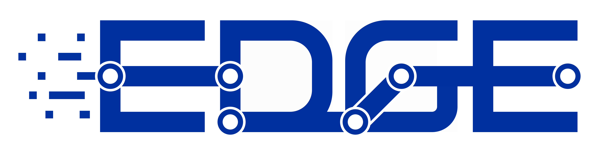
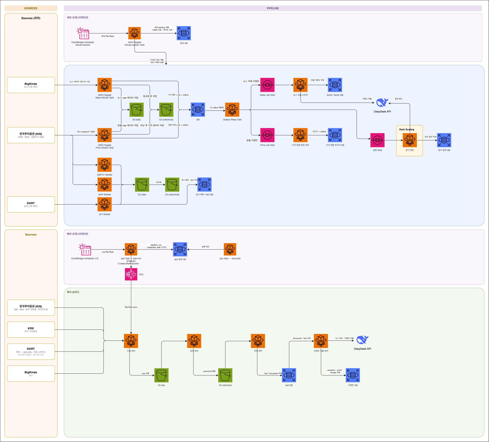

# edge

ETF 가격 변동의 이유를 공개 정보 기반 변동 요인 후보로 설명하는 분석 엔진과, 그 설명을 증권사(B2B)와 개인 투자자(B2C)에게 전달하는 제품 둘을 한 저장소에서 개발합니다.

<!-- 이 README 는 쇼케이스(포트폴리오) 용도다. 저장소 구조·개발 규약은 하단 "개발 문서" 링크 참조. 제품별 소개는 1-2 의 제품 README 참조. -->

## 1. 프로젝트 개요

### 1-1. 프로젝트 소개

MTS에는 내 종목이 오늘 왜 움직였는지 보여주는 화면이 없습니다. EDGE 엔진은 공시·뉴스·수급 같은 공개 정보를 수집·분석해 ETF 가격 변동의 요인 후보를 만듭니다. 장중에는 1분 주기로 변동을 판정해 설명을 생성하고, 장 마감 후에는 하루치 데이터를 정제하며, 개장 전에는 ETF별 전망을 만듭니다.

엔진의 결과는 두 제품이 받아 씁니다. 증권사에는 검수·정책·감사 로그를 갖춘 운영 인프라로 납품하고, 개인 투자자에게는 모바일 앱으로 제공합니다. 두 제품 모두 엔진의 결과 DB에서 설명을 가져가고, 자기 데이터는 각자의 DB에 둡니다.

### 1-2. 제품 구성

| 디렉터리 | 제품 | 대상 | 소개 |
|---|---|---|---|
| `apps/engine` | EDGE 엔진 | 공용 상류 | 수집·분석 파이프라인. 아래 2-3 |
| `apps/edgesignal` | edgesignal | 증권사(B2B) | 증권사가 자기 클라우드 계정에서 검수해 MTS에 게시하는 운영 인프라. [제품 README](apps/edgesignal/README.md) |
| `apps/etforca` | ETF Orca | 개인 투자자(B2C) | 엔진의 ETF 분석을 보고 전망에 투표하는 모바일 앱. [제품 README](apps/etforca/README.md) |

디렉터리를 제품 축으로 나눈 결정은 [ADR-0061](docs/adr/0061-product-axis-directory-layout.md)에 있습니다.

### 1-3. 기술 스택

세 런타임을 한 저장소에서 관리하는 폴리글랏 모노레포입니다.

- **JVM** — Spring Boot 4 · Gradle 멀티모듈(앱 8 + 라이브러리 2) · Flyway · JPA/JdbcTemplate 병행
- **Node** — React 콘솔 UI 2종 + 포트폴리오 화면 + 공유 디자인 시스템(ui-kit) · pnpm workspace. 모바일 앱은 Expo(워크스페이스 밖)
- **Python** — 데이터 파이프라인 · 분석 엔진 · 온톨로지 SSOT · uv workspace. 포트폴리오 워커는 독립 워크스페이스
- **인프라** — AWS(ECS Fargate·Step Functions·RDS PostgreSQL·ElastiCache·Athena/Iceberg·CloudFront) · Terraform(그린필드 IaC) · GitHub Actions

## 2. 개발 결과물

### 2-1. Cloud Architecture

<!-- 그림은 설계 시점 단일 계정·B2B 기준. 엔진·edgesignal·etforca 세 묶음 배치로 재작도 예정 -->

논리 컴포넌트를 실제 AWS 리소스로 배치한 인프라 구성도입니다. 서브넷을 public/앱/데이터로 분리하고 가용영역을 이중화했으며, 전체를 Terraform으로 관리합니다. 증권사 계정 쪽 배치는 [edgesignal README](apps/edgesignal/README.md#2-구조)의 BYOC 토폴로지에 있습니다.

### 2-2. DB 스키마 SSOT

Cloud DB의 도메인 7개와 데이터 흐름, 그리고 증권사 관리 환경에서 도는 온프렘 세트까지 한 장입니다. 그림을 클릭하면 도메인별 상세 ERD가 열립니다. 스키마 변경은 Flyway 마이그레이션으로만 하고, CI가 이 문서 ERD를 마이그레이션에서 생성한 DBML과 대조하기 때문에 그림과 실제 DB가 어긋나면 빌드가 실패합니다.

Flyway 세트는 둘입니다 — Cloud 세트 97테이블, On-Prem 세트 14테이블. 두 세트를 잇는 경계는 증권사 쪽에서 여는 단방향 Pull 하나뿐이고, 온프렘 쪽 상세는 [온프렘 테넌트 DB ERD](docs/data-model/onprem/) 한 장으로 봅니다. 두 세트 모두 같은 CI 대조를 받습니다. ETF Orca의 app-api는 회원 개인정보와 파이프라인 데이터의 권한 경계를 위해 이 세트 밖의 자체 PostgreSQL·Flyway를 씁니다([ADR-0056](docs/adr/0056-etforca-app-api-infra.md)).

### 2-3. 데이터 파이프라인 · 분석 엔진

장중에는 1분 주기 파이프라인이 뉴스·시세·공시를 받아 가격 변동을 판정하고 분석 엔진이 설명을 생성합니다. 장 마감 후에는 배치 파이프라인이 하루치 데이터를 정제해 적재합니다. 스케줄러는 실행 전에 작업 목록을 DB에 기록해 두고, 기록과 실제 실행을 대조해 누락된 실행을 탐지합니다.

### 2-4. 성능 실험

edgesignal의 MTS 조회 표면(publication-api)에 총 75회의 부하 실험을 수행했고, 네 캐시 전략은 API 서버 4대·1,600 req/s의 공통 조건에서 비교했습니다. 이 조건에서 Caffeine만으로 3분간 DB 조회가 288,000회에서 1,062회로 줄어, 현재 규모에서는 Redis를 도입하지 않았습니다.

네 캐시 구성의 p99는 모두 1~2ms였습니다. 응답 지연보다 DB 조회 횟수가 결정 기준이 됐습니다.

로컬 캐시의 임계점과 Redis 재검토 조건은 [후속 29회 실험](https://choyoungseo20.github.io/posts/measuring-the-cache-boundary)에서 따로 측정했습니다.

전체 과정은 [75회 부하 실험](https://choyoungseo20.github.io/posts/the-redis-experiment-that-removed-redis)과 [결정 기록](https://choyoungseo20.github.io/posts/four-instances-caffeine-was-simpler)에서 확인할 수 있습니다.

### 2-5. CI/CD

병렬로 작업하다 보면 나중에 만든 마이그레이션이 더 낮은 버전 번호로 머지되는 사고가 납니다. 위는 그 역행을 CI 게이트가 잡아낸 실제 실패 기록입니다.

- **자체 제작 게이트 3종** — PR 제목 형식(Conventional Commits), 마이그레이션 버전 순서, ERD 재생성 대조를 CI에서 검사합니다. 컨벤션을 문서로만 두지 않고 체크로 강제합니다.
- **러너 운영 이력** — GitHub-hosted에서 self-hosted 4대 자체 운영으로 전환했다가, repo public 전환 시점에 비용을 다시 따져 GitHub-hosted로 돌아왔습니다.
- **CD** — dev 머지 시 스키마 마이그레이션이 자동 적용되고, 데모 서버는 SSH 접속 없이 SSM Run Command로 배포합니다.

### 2-6. 설계 결정 기록(ADR)

설계 결정 61건을 ADR로 남겼습니다. 결정을 뒤집을 때도 기존 문서를 지우지 않고 새 ADR로 대체 근거를 기록합니다.

- [ADR-0010 하이브리드 온프렘 피벗](docs/adr/0010-hybrid-onprem-pivot.md) — 제품 방향을 바꾼 결정
- [ADR-0016 단일 레포, 배포 아티팩트 2종](docs/adr/0016-single-repo-two-artifacts.md) — 한 저장소에서 벤더·증권사 아티팩트를 나누는 결정
- [ADR-0056 ETF Orca 앱 API 인프라](docs/adr/0056-etforca-app-api-infra.md) — B2C 제품을 엔진과 다른 DB·캐시에 올린 결정
- [ADR-0061 제품 축 디렉터리 배치](docs/adr/0061-product-axis-directory-layout.md) — 배포 위치 대신 제품으로 묶은 결정
- 전체: [docs/adr/](docs/adr/)

## 3. 수행 방법 · 프로젝트 관리

### 3-1. 개발 프로세스

모든 기능·버그 작업은 Jira 티켓을 먼저 만들고 그 키로 브랜치를 팝니다. 컴포넌트 단위 에픽과 2주 스프린트로 운영하고, 브랜치 push와 PR 머지에 따라 보드 상태가 자동으로 넘어갑니다.

### 3-2. 형상 관리

모든 작업은 `feature/fix → dev → main` 순서로만 흐릅니다. feature→dev는 Squash 머지로 PR 하나를 커밋 하나로 남기고, dev→main은 릴리스 단위의 Merge commit입니다.

### 3-3. AI 에이전트 하네스

봇의 지적, 라운드 9까지 간 수용·수정 답글, 재리뷰 통과까지 리뷰 왕복이 PR에 그대로 남습니다.

에이전트(Claude Code)가 티켓 생성부터 머지까지 위 개발 프로세스를 그대로 따르도록 스킬 3종을 만들어 운영합니다.

- **pr-cycle** — 티켓 확인, 브랜치 생성, PR, 머지, 브랜치 삭제까지 작업 순서를 강제합니다.
- **edge-review** — PR 올리기 전에 코드 리뷰를 돌리고, 수용할 지적이 없어질 때까지 반복합니다.
- **docs-sync** — 코드 변경으로 낡아진 문서·주석을 찾아 갱신합니다.

원격에서는 Codex 봇이 PR을 한 번 더 리뷰하고, 지적 반영과 재리뷰 왕복이 PR에 기록으로 남습니다.

---

## 개발 문서

- [저장소 구조](docs/repo-structure.md) — 모노레포 구조·워크스페이스·모듈 역할·데이터 흐름
- [Git 컨벤션](docs/git-conventions.md) — 브랜치 전략·커밋/PR 제목·머지 정책 (SSOT)
- [docs/](docs/) — 설계 문서(context·ADR·계약·아키텍처 뷰)
