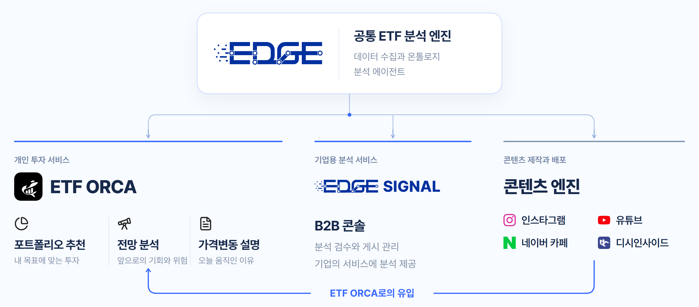
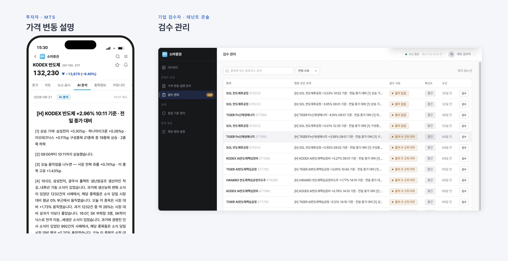
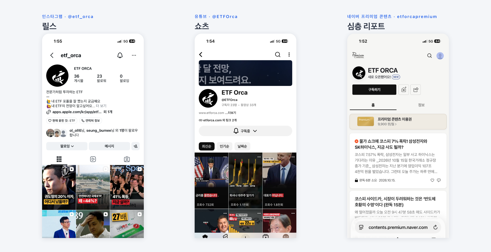
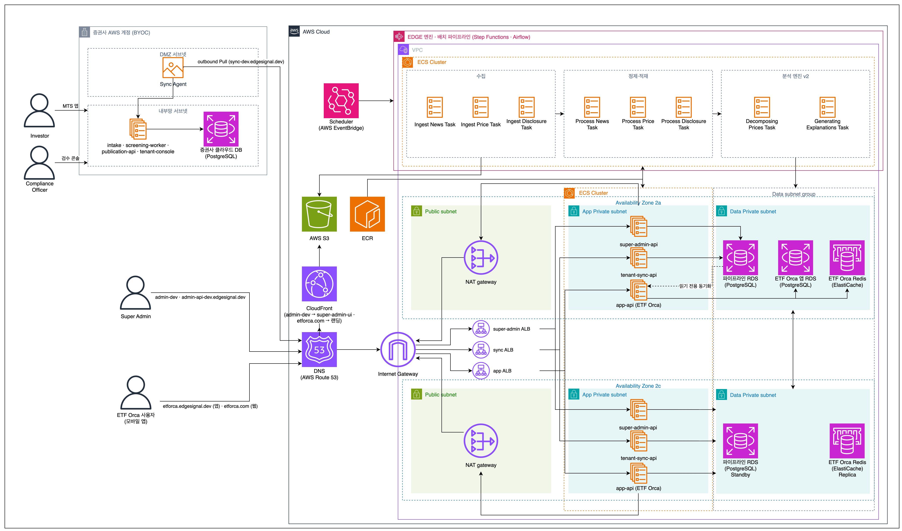
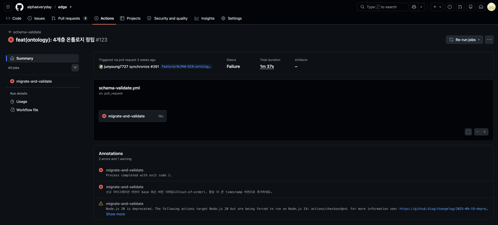
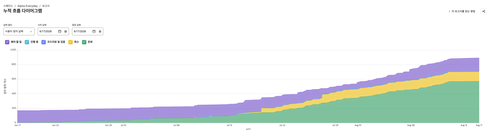
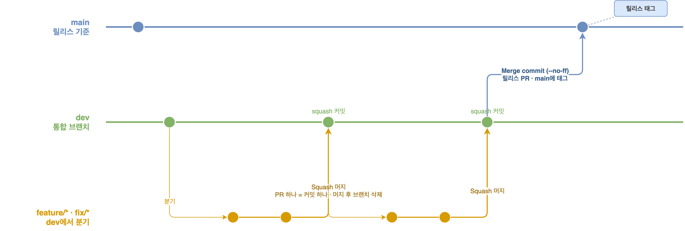
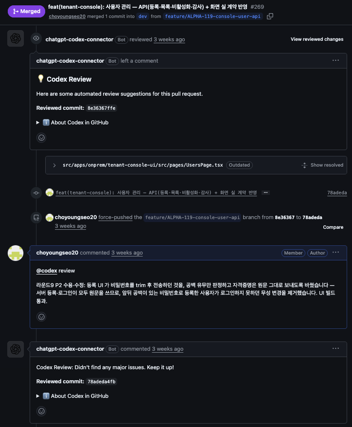

<p align="center"></p>

# EDGE

### 하나의 금융 인텔리전스를 개인·기업·콘텐츠로

투자자는 가격이 움직일 때 그 이유와 다음 판단의 근거를 찾습니다. 금융회사는 분석을 제공하면서도 무엇을 고객에게 보여줄지 직접 통제해야 합니다.

EDGE는 금융 데이터를 수집하고 ETF 전망과 가격변동을 분석합니다. 개인 투자자는 **ETF ORCA**에서 포트폴리오 추천과 ETF 분석을 이용하고, 기업은 **EDGE SIGNAL**에서 분석을 검수해 자사 서비스에 제공합니다. 분석 결과는 투자 콘텐츠 제작에도 활용하며, 콘텐츠는 ORCA를 만나는 접점이 됩니다.



## 제품과 분석 엔진

| 구성 | 누구를 위해, 무엇을 만드는가 | 상세 문서 |
|---|---|---|
| **EDGE SIGNAL** | 기업이 ETF 분석을 검수하고 자사 서비스에 제공하는 B2B 운영 인프라 | [제품·BYOC·아키텍처·성능 검증](apps/edgesignal/README.md) |
| **ETF ORCA** | 개인의 투자 목표에 맞는 ETF를 추천하고 전망과 가격변동의 이유를 설명하는 서비스 | [실제 화면·사용 경험·서비스 구조](apps/etforca/README.md) |
| **EDGE 분석 엔진** | 금융 데이터, 기업과 사건의 관계, 저장된 근거를 바탕으로 ETF 분석을 만드는 공통 기술 | [파이프라인·온톨로지·에이전트·근거 추적](apps/engine/README.md) |
| **콘텐츠 엔진** | 분석 결과로 투자 콘텐츠를 만들어 [인스타그램](https://www.instagram.com/etf_orca/)·[유튜브](https://www.youtube.com/@ETFOrca)·[네이버 프리미엄 콘텐츠](https://contents.premium.naver.com/etforca/etforcapremium)·커뮤니티에 배포하고, ETF ORCA로 유입을 만드는 접점 | [채널·제작 흐름](docs/content-engine.md) |

위 그림은 제품의 활용 관계입니다. 포트폴리오 추천은 ORCA의 독립 API·워커가 담당하며, 공통 엔진의 저장된 ETF 전망을 제한된 단건 조회로 활용합니다. [제품별 런타임과 데이터 경계](docs/repo-structure.md)는 분리돼 있습니다.

## 실제 서비스

### ETF ORCA — 내 투자에 맞는 제안과 그 이유

투자 목표와 보유 내역을 입력하면 현재 구성을 점검하고, 조건에 맞는 ETF 구성과 이유를 확인합니다. 관심 ETF에서는 전망, 핵심 이슈, 가격이 움직인 이유를 읽습니다.


[서비스](https://etforca.com/) · [포트폴리오 분석](https://etforca.com/portfolio/) · [ETF ORCA 상세](apps/etforca/README.md)

### EDGE SIGNAL — 분석의 게시 기준은 기업이 결정

기업 검수자는 금칙어·근거 수·확신도 기준을 설정하고, 검수 대기 건을 승인하거나 반려합니다. 투자자 화면에는 게시된 설명을 제공하고, 플랫폼 운영자는 전달과 회수 상태를 확인합니다.



[MTS 데모](https://demo-mts.edgesignal.dev) · [EDGE SIGNAL 상세](apps/edgesignal/README.md)

### 콘텐츠 엔진 — 분석이 투자자를 만나는 첫 접점

엔진의 ETF 전망과 가격변동 설명을 짧은 영상과 글로 만들어 채널에 올립니다. 콘텐츠를 본 사람이 ETF ORCA에서 전망과 포트폴리오 분석을 이어서 보는 흐름입니다.



[인스타그램](https://www.instagram.com/etf_orca/) · [유튜브](https://www.youtube.com/@ETFOrca) · [네이버 프리미엄 콘텐츠](https://contents.premium.naver.com/etforca/etforcapremium) · [콘텐츠 엔진 상세](docs/content-engine.md)

## 분석을 뒷받침하는 기술

| 기술 | 해결하는 문제 | 자세히 보기 |
|---|---|---|
| 데이터 파이프라인 | 서로 다른 원천의 수집·정제·적재와 예정 작업의 누락을 추적 | [수집과 실행 관리](apps/engine/README.md#데이터-파이프라인) |
| 온톨로지 모델링 | ETF 편입종목에서 발행회사·사건·원문까지 일관된 의미로 연결 | [객체와 관계](apps/engine/README.md#온톨로지-데이터-모델링) |
| PostgreSQL·PuppyGraph | 관계형 원천을 객체 뷰와 그래프 탐색으로 활용 | [저장과 탐색의 역할 분담](apps/engine/README.md#postgresql과-puppygraph) |
| 분석과 근거 추적 | 설명에 사용한 도구 입력·결과와 출처를 다시 확인 | [분석 에이전트와 근거 추적](apps/engine/README.md#분석-에이전트와-근거-추적) |
| 기업별 검수·배포 | 기업 환경에서 게시 정책과 노출을 통제 | [EDGE SIGNAL의 BYOC](apps/edgesignal/README.md#byoc와-데이터-경계) |

온톨로지 정의, 그래프 연결 검증, 고객 서비스의 기본 실행 경로는 서로 다른 적용 단계입니다. 범위와 검증 기록은 [엔진 README](apps/engine/README.md#검증-범위)에 함께 기록합니다.

## 기술 스택과 저장소

| 영역 | 주요 기술 |
|---|---|
| 분석·데이터 | Python, uv, PostgreSQL, PuppyGraph, Airflow |
| 서비스 API | Java, Spring Boot, Gradle, JPA/JdbcTemplate, Flyway |
| 웹·모바일 | React, pnpm, Expo / React Native |
| 인프라·운영 | AWS ECS, Step Functions, S3, RDS, ElastiCache, Terraform, GitHub Actions |

```text
apps/
  engine/       # 공통 데이터 수집·ETF 분석
  edgesignal/   # 기업용 전달·검수·게시
  etforca/      # 개인 투자 서비스와 포트폴리오 추천
  content/      # 콘텐츠 제작·배포 (디렉터리 추가 예정)
libs/           # 스키마·온톨로지·공유 코드
docs/           # 설계·계약·데이터 모델·ADR
```

제품 축으로 디렉터리를 묶되 배포 환경과 데이터 책임은 각 제품에서 구분합니다. 모바일 앱은 자체 npm 구성을, 포트폴리오 워커는 독립 Python 워크스페이스를 사용합니다. [저장소 구조](docs/repo-structure.md) · [ADR-0061](docs/adr/0061-product-axis-directory-layout.md)




벤더 AWS 계정 하나에 엔진과 제품 둘이 함께 있습니다. 엔진은 파이프라인 RDS를 두 제품과 나눠 쓰고, ETF Orca는 회원·투표 원본을 위해 RDS·Redis를 따로 둡니다. 증권사 계정에서 벤더로 들어오는 연결은 sync ALB로 향하는 outbound Pull 하나이고, 증권사 계정 안의 배치는 [EDGE SIGNAL의 BYOC 토폴로지](apps/edgesignal/README.md#byoc와-데이터-경계)에 있습니다.

## 공통 품질 관리



병렬로 작업하다 보면 나중에 만든 마이그레이션이 더 낮은 버전 번호로 머지되는 사고가 납니다. 위는 그 역행을 CI 게이트가 잡아낸 실제 실패 기록입니다.

- **자체 제작 게이트 3종** — PR 제목 형식(Conventional Commits), 마이그레이션 버전 순서, ERD 재생성 대조를 CI에서 검사합니다. 컨벤션을 문서로만 두지 않고 체크로 강제합니다.
- **러너 운영 이력** — GitHub-hosted에서 self-hosted 4대 자체 운영으로 전환했다가, repo public 전환 시점에 비용을 다시 따져 GitHub-hosted로 돌아왔습니다.
- **CD** — dev 머지 시 스키마 마이그레이션이 자동 적용되고, 데모 서버는 SSH 접속 없이 SSM Run Command로 배포합니다.

## 설계 결정 기록

설계 결정 61건을 ADR로 남겼습니다. 결정을 뒤집을 때도 기존 문서를 지우지 않고 새 ADR로 대체 근거를 기록합니다.

- [ADR-0010 하이브리드 온프렘 피벗](docs/adr/0010-hybrid-onprem-pivot.md) — 제품 방향을 바꾼 결정
- [ADR-0016 단일 레포, 배포 아티팩트 2종](docs/adr/0016-single-repo-two-artifacts.md) — 한 저장소에서 벤더·증권사 아티팩트를 나누는 결정
- [ADR-0056 ETF Orca 앱 API 인프라](docs/adr/0056-etforca-app-api-infra.md) — B2C 제품을 엔진과 다른 DB·캐시에 올린 결정
- [ADR-0061 제품 축 디렉터리 배치](docs/adr/0061-product-axis-directory-layout.md) — 배포 위치 대신 제품으로 묶은 결정
- 전체: [docs/adr/](docs/adr)

## 수행 방법과 프로젝트 관리

### 개발 프로세스



모든 기능·버그 작업은 Jira 티켓을 먼저 만들고 그 키로 브랜치를 팝니다. 컴포넌트 단위 에픽과 2주 스프린트로 운영하고, 브랜치 push와 PR 머지에 따라 보드 상태가 자동으로 넘어갑니다.

### 형상 관리



모든 작업은 `feature/fix → dev → main` 순서로만 흐릅니다. feature→dev는 Squash 머지로 PR 하나를 커밋 하나로 남기고, dev→main은 릴리스 단위의 Merge commit입니다.

### AI 에이전트 하네스



봇의 지적, 라운드 9까지 간 수용·수정 답글, 재리뷰 통과까지 리뷰 왕복이 PR에 그대로 남습니다.

에이전트(Claude Code)가 티켓 생성부터 머지까지 위 개발 프로세스를 그대로 따르도록 스킬 3종을 만들어 운영합니다.

- **pr-cycle** — 티켓 확인, 브랜치 생성, PR, 머지, 브랜치 삭제까지 작업 순서를 강제합니다.
- **edge-review** — PR 올리기 전에 코드 리뷰를 돌리고, 수용할 지적이 없어질 때까지 반복합니다.
- **docs-sync** — 코드 변경으로 낡아진 문서·주석을 찾아 갱신합니다.

원격에서는 Codex 봇이 PR을 한 번 더 리뷰하고, 지적 반영과 재리뷰 왕복이 PR에 기록으로 남습니다.

---

## 개발 문서

- [EDGE SIGNAL](apps/edgesignal/README.md) · [ETF ORCA](apps/etforca/README.md) · [EDGE 분석 엔진](apps/engine/README.md) · [콘텐츠 엔진](docs/content-engine.md)
- [저장소 구조](docs/repo-structure.md) · [Git 컨벤션](docs/git-conventions.md)
- [설계 문서](docs/README.md) · [데이터 모델](docs/data-model/README.md) · [설계 결정 기록](docs/adr)

기존 `context`·`scope`의 증권사 데이터 경계와 MVP 제외 범위는 B2B 설계의 맥락에서 읽습니다. ORCA의 개인 입력·포트폴리오 기능은 [별도 서비스 설계](docs/design/portfolio-worker.md)를 따릅니다.
