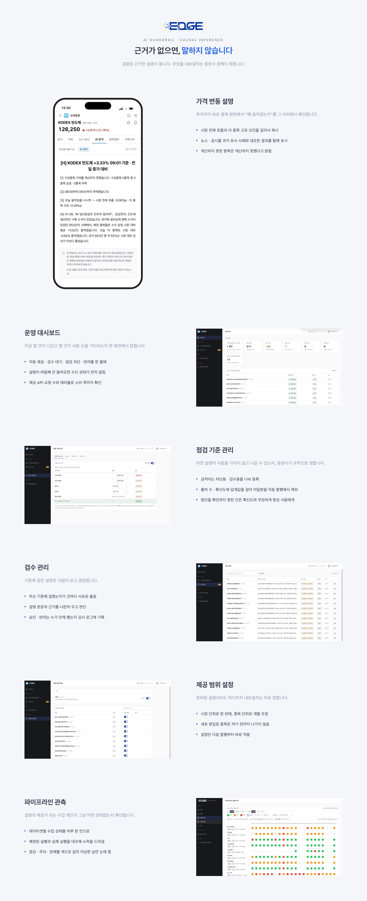
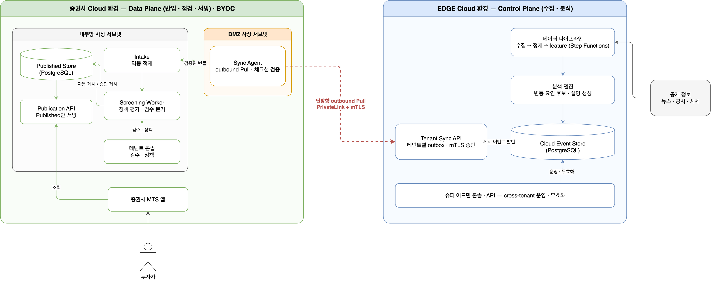
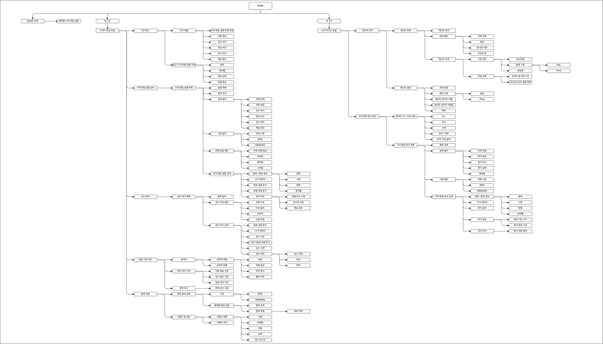
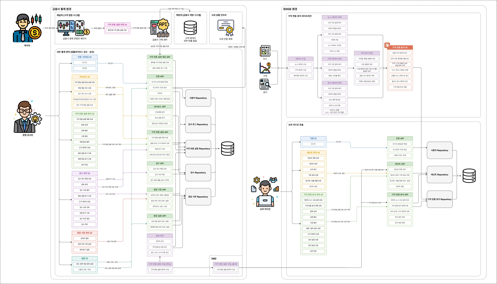
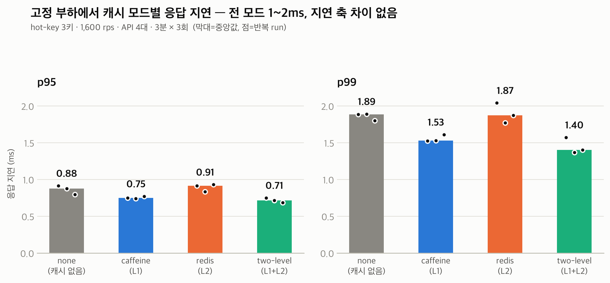
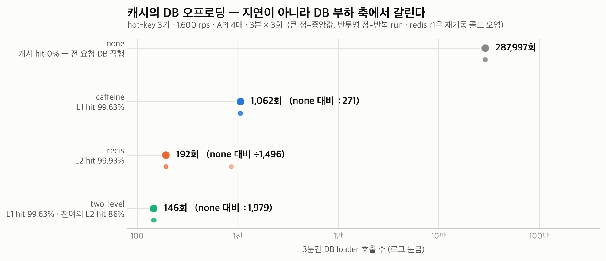
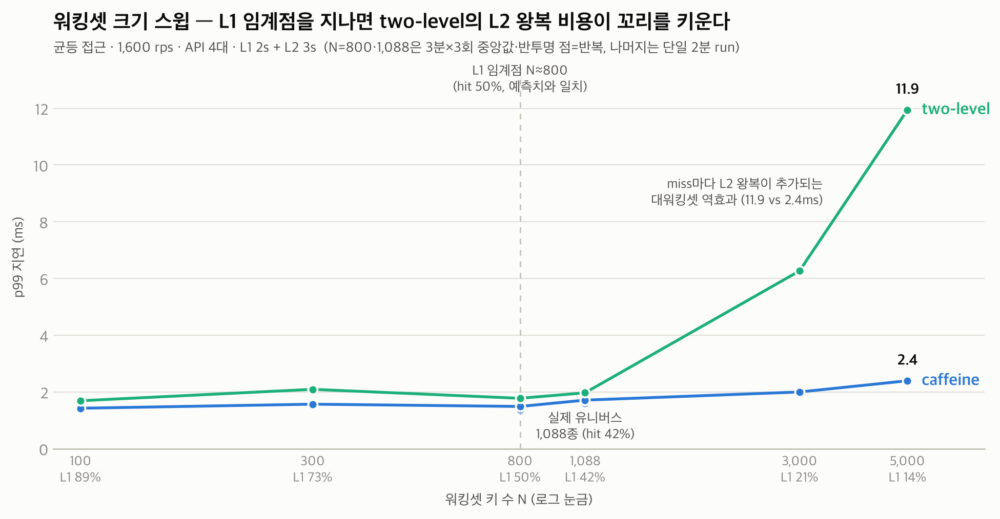

[프로젝트 전체](../../README.md) · [ETF ORCA](../etforca/README.md) · [EDGE 분석 엔진](../engine/README.md)

# EDGE SIGNAL

**기업이 ETF 분석을 검수하고 자사 서비스에 제공할 수 있는 B2B 운영 인프라입니다.**

EDGE 분석 엔진은 공시·뉴스·수급 같은 공개 정보를 분석해 ETF 가격변동의 요인 후보와 근거를 만듭니다. EDGE SIGNAL은 기업이 이 분석의 게시 기준을 정하고, 검수·승인·반려·회수를 관리하도록 합니다. 승인·반려·회수는 전부 감사 로그에 남아 누가 언제 무엇을 노출했는지 사후에 추적할 수 있습니다. 컴플라이언스 통제권이 증권사 안에 있다는 것이 이 제품의 핵심 가치입니다.

공통 분석의 생성은 [EDGE 엔진](../engine/README.md)이, 기업별 전달·검수·게시와 고객 접점은 EDGE SIGNAL이 담당합니다.

## 제품 경험

[MTS 데모](https://demo-mts.edgesignal.dev) · [확대 가능한 아키텍처 포털](https://alphaeveryday.github.io/edge-pages)

| 사용자 | 하는 일 |
|---|---|
| 투자자 | MTS 종목 상세에서 게시된 가격변동 설명과 원문 근거 확인 |
| 기업 검수자 | 자동 제공·검수 대기·차단 현황 확인, 게시 기준 설정, 대기 건 승인·반려 |
| 플랫폼 운영자 | 테넌트별 게시 현황과 무효화·회수, 데이터 수집 상태 확인 |

## 분석이 게시되는 과정

1. `sync-agent`가 기업 환경에서 벤더의 `tenant-sync-api`를 Pull하고, 받은 바이트를 내부망으로 전달합니다.
2. `intake`가 Raw Event Store에 멱등 적재합니다.
3. `screening-worker`가 금칙어·최소 근거 수·최소 확신도 정책을 평가합니다.
4. 정책 결과에 따라 자동 게시·검수 대기·차단으로 나뉘며, 검수자는 대기 건을 승인하거나 반려합니다.
5. `publication-api`가 게시된 설명을 MTS에 제공합니다. 사후 조치는 무효화와 회수 경로로 처리합니다.

앱 수준 체크섬 검증과 mTLS 클라이언트 인증서의 테넌트 바인딩은 목표 계약으로 남아 있습니다. 현재 구현과 목표 계약은 [ADR-0040](../../docs/adr/0040-sync-integrity-mvp-to-signing.md) 및 [Sync 인증 계약](../../docs/contracts/sync-auth.md)을 함께 확인합니다.

## BYOC와 데이터 경계

납품 형태는 **BYOC(Bring Your Own Cloud)**입니다. 벤더가 수집·분석 환경을 운영하고, 검수·서빙 환경은 증권사 명의 클라우드 계정에 배치합니다. 벤더는 컨테이너 이미지·IaC·마이그레이션을 제공하고, 실행 주체는 증권사입니다.

두 환경의 연결은 증권사 쪽에서 시작하는 Pull 경로입니다. 고객 데이터는 증권사 관리 환경에 두는 설계입니다. 이 B2B 데이터 경계는 개인 입력을 받는 ORCA의 데이터 구조와 구분합니다. [ADR-0051](../../docs/adr/0051-byoc-deployment-topology.md)

그림은 [ADR-0051](../../docs/adr/0051-byoc-deployment-topology.md)의 목표 구성입니다. 체크섬 검증과 mTLS 인증서 바인딩은 아직 구현 전입니다.

## 상세 아키텍처

### 콘솔 정보구조

왼쪽이 기업 검수자의 테넌트 콘솔, 오른쪽이 플랫폼 운영자의 슈퍼 어드민 콘솔입니다. 화면과 권한의 상세 계약은 [콘솔 정보구조](../../docs/console-ia)에 있습니다.

### UI·API·저장소 연결

화면 기능이 어느 API를 호출하고 어느 저장소를 읽고 쓰는지 나타냅니다. 제품별 디렉터리 이동 이후의 모듈 위치는 [저장소 구조](../../docs/repo-structure.md)를 기준으로 읽습니다.

### 테넌트 데이터

Raw Event Store, 정책 평가와 게시 상태의 물리 구조는 [온프렘 테넌트 DB ERD](../../docs/data-model/onprem/README.md)에 있습니다. 분석 원천과 생성 결과의 데이터 모델은 [공통 데이터 모델](../../docs/data-model/README.md)에서 확인합니다.

## 모듈과 배포 위치

배포 위치는 디렉터리가 아니라 이 표가 담당합니다([ADR-0061](../../docs/adr/0061-product-axis-directory-layout.md)).

| 모듈 | 런타임 | 플레인 | 역할 |
|---|---|---|---|
| tenant-sync-api | JVM | cloud | Sync Agent Pull 표면 |
| super-admin-api | JVM | cloud | 플랫폼 운영자 API |
| super-admin-ui | Node | cloud | 플랫폼 운영자 콘솔 |
| sync-agent | JVM | onprem | DMZ의 Cloud Pull과 내부망 무변형 릴레이 |
| intake | JVM | onprem | 내부망 Raw Event Store 적재 |
| screening-worker | JVM | onprem | 정책 평가와 상태 분기 |
| publication-api | JVM | onprem | MTS 조회 표면 |
| tenant-console-api | JVM | onprem | 테넌트 검수·정책 API |
| tenant-console-ui | Node | onprem | 테넌트 검수·정책 콘솔 |

* cloud: 벤더 운영 환경
* onprem: 증권사 통제 환경. 증권사 명의 클라우드 계정 포함([ADR-0010](../../docs/adr/0010-hybrid-onprem-pivot.md))

모듈 역할의 상세는 [저장소 구조](../../docs/repo-structure.md#apps--배포-단위)가 정본입니다.

---

## Publication API 성능 검증

edgesignal의 MTS 조회 표면(publication-api)에 총 75회의 부하 실험을 수행했고, 네 캐시 전략은 API 서버 4대·1,600 req/s의 공통 조건에서 비교했습니다. 이 조건에서 Caffeine만으로 3분간 DB 조회가 288,000회에서 1,062회로 줄어, 현재 규모에서는 Redis를 도입하지 않았습니다.

네 캐시 구성의 p99는 모두 1~2ms였습니다. 응답 지연보다 DB 조회 횟수가 결정 기준이 됐습니다.

로컬 캐시의 임계점과 Redis 재검토 조건은 [후속 29회 실험](https://choyoungseo20.github.io/posts/measuring-the-cache-boundary)에서 따로 측정했습니다.

전체 과정은 [75회 부하 실험](https://choyoungseo20.github.io/posts/the-redis-experiment-that-removed-redis)과 [결정 기록](https://choyoungseo20.github.io/posts/four-instances-caffeine-was-simpler)에서 확인할 수 있습니다.

위 수치는 기존 부하 실험의 조건과 결과입니다. 이번 문서 작성에서 부하 실험을 다시 수행한 값이 아닙니다.

## 설계 결정

- [ADR-0010](../../docs/adr/0010-hybrid-onprem-pivot.md): 고객 접점·검수·노출을 증권사 환경으로 옮긴 결정. 이전의 Cloud-only·embed widget 구조는 폐기된 방향이다
- [ADR-0036](../../docs/adr/0036-sync-agent-intake-topology.md): DMZ의 sync-agent와 내부망의 intake 분리
- [ADR-0044](../../docs/adr/0044-correction-abolition.md): 정정 전달을 폐지하고 무효화 경로를 유지한 결정
- [ADR-0046](../../docs/adr/0046-confidence-gate-risk-grade-abolition.md): 확신도 게이트를 단순 AND 조건으로 정리한 결정
- [ADR-0051](../../docs/adr/0051-byoc-deployment-topology.md): BYOC 납품 형태
- [ADR-0053](../../docs/adr/0053-widget-direct-serving-no-personalization.md): 고객 컨텍스트를 제거한 MTS 위젯 직접 호출

## 기술 스택과 개발 안내

Java·Spring Boot, JPA/JdbcTemplate, Flyway, PostgreSQL, React, 공유 [ui-kit](../../libs/ui-kit/README.md)을 사용합니다. 배포 구성은 AWS ECS·RDS·ALB·CloudFront와 Terraform으로 관리합니다.

- 로컬 전체 스택(cloud·onprem DB 2개, JVM 모듈 7개, 콘솔 UI 2종)은 레포 루트에서 `scripts/up-all.sh`로 띄우고 `scripts/up-all.sh down -v`로 정리합니다(`-v`는 DB 볼륨까지)
- [데모 온프렘 실행 안내](../../demo/onprem/README.md)
- [구현·배포 결정](../../docs/implementation.md)
- [스키마 관리](../../libs/schema/README.md)
- [Publication API 계약](../../docs/contracts/publication-api.md)
- [Sync 프로토콜](../../docs/contracts/sync-protocol.md)
- [아키텍처 상세 뷰](../../docs/architecture)

[프로젝트 전체로 돌아가기](../../README.md)
