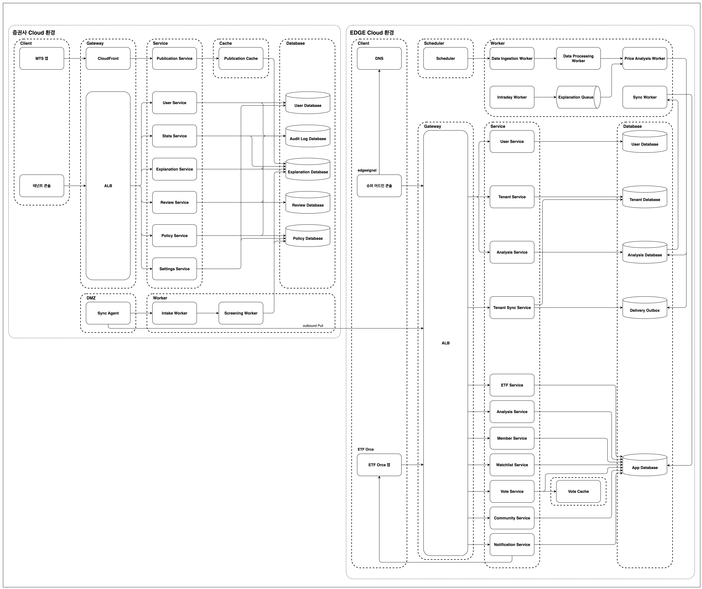

# edgesignal

> EDGE 엔진의 변동 요인 설명을 증권사가 검수해 자기 MTS에 게시하는, 증권사가 통제 가능한 운영 인프라(B2B)

---

## 1. 프로젝트 소개

### Background

MTS에는 내 종목이 오늘 왜 움직였는지 보여주는 화면이 없습니다.
EDGE 엔진은 공시·뉴스·수급 같은 공개 정보를 수집·분석해 가격 변동의 요인 후보를 만듭니다.
edgesignal은 이 설명을 증권사가 검수를 거쳐 자기 MTS에 게시하게 하는 B2B 산출물입니다.

생성한 글을 그대로 내보내는 도구가 아닙니다.
금칙어·확신도 기준·검수 큐·감사 로그로 증권사가 노출을 통제합니다.

### Goal

* 고객(투자자) 데이터는 증권사 관리 환경 밖으로 나가지 않음
* 무엇을 어떤 기준으로 게시할지는 증권사 검수자가 결정
* 승인·반려·회수가 전부 감사 로그에 남음
* 벤더 환경과 증권사 환경의 연결은 증권사 쪽에서 여는 단방향 Pull 하나

### 납품 형태

BYOC(Bring Your Own Cloud)입니다.
벤더가 수집·분석 플레인(control plane)을 운영하고, 서빙·검수 플레인(data plane)은 증권사 명의 클라우드 계정 안에서 돕니다.
벤더는 컨테이너 이미지·IaC·마이그레이션을 제공하고 실행 주체는 증권사입니다.
물리 DMZ·내부망 분리는 VPC 서브넷과 보안 그룹으로 대응합니다.
결정은 [ADR-0051](../../docs/adr/0051-byoc-deployment-topology.md)에 있습니다.

---

## 2. 구조


오른쪽 EDGE 환경이 공개 정보를 수집·분석해 설명을 만들면, 왼쪽 증권사 환경이 이를 받아 점검을 거쳐 MTS에 서빙합니다.
두 환경을 잇는 연결은 증권사 쪽에서 여는 단방향 Pull 하나이고, 고객 데이터는 증권사 환경 밖으로 나가지 않습니다.



전체를 Service·Worker·Cache·DB 논리 컴포넌트 단위로 나타낸 구성도입니다.
왼쪽 증권사 통제 환경(위젯·콘솔·서빙·검수 워커)과 오른쪽 EDGE 환경(수집·분석 워커·동기화)은 동기화 경로 하나로만 이어집니다.

증권사 환경 안의 경로는 다음 순서입니다.

1. sync-agent(DMZ)가 벤더의 tenant-sync-api를 mTLS로 Pull해 받은 바이트를 무변형으로 내부망에 넘김. 전송 무결성은 mTLS가 맡고, 앱 수준 체크섬 검증은 서명 계약으로 이관([ADR-0040](../../docs/adr/0040-bundle-integrity-deferred-to-signing.md))
2. intake(내부망)가 Raw Event Store에 멱등 적재
3. screening-worker가 금칙어·최소 근거 수·최소 확신도 정책을 평가해 자동 게시·검수 대기·차단으로 분기
4. 검수자가 tenant-console에서 대기 건을 승인·반려
5. publication-api가 게시된 설명만 MTS에 서빙

아키텍처 다이어그램 전체(인터랙티브)는 [아키텍처 포털](https://alphaeveryday.github.io/edge-pages)에서 확대해 볼 수 있습니다.

---

## 3. 모듈

배포 위치는 디렉터리가 아니라 이 표가 담당합니다([ADR-0061](../../docs/adr/0061-product-axis-directory-layout.md)).

| 모듈 | 런타임 | 플레인 | 역할 |
|---|---|---|---|
| tenant-sync-api | JVM | cloud | Sync Agent Pull 표면 |
| super-admin-api | JVM | cloud | 플랫폼 운영자 API |
| super-admin-ui | Node | cloud | 플랫폼 운영자 콘솔 |
| sync-agent | JVM | onprem | DMZ의 Cloud Pull과 내부망 무변형 릴레이 |
| intake | JVM | onprem | 내부망 Raw Event Store 적재 |
| screening-worker | JVM | onprem | 정책 평가와 상태 분기 |
| publication-api | JVM | onprem | MTS 조회 표면 |
| tenant-console-api | JVM | onprem | 테넌트 검수·정책 API |
| tenant-console-ui | Node | onprem | 테넌트 검수·정책 콘솔 |

* cloud: 벤더 운영 환경
* onprem: 증권사 통제 환경. 증권사 명의 클라우드 계정 포함([ADR-0010](../../docs/adr/0010-hybrid-onprem-pivot.md))

모듈 역할의 상세는 [저장소 구조](../../docs/repo-structure.md#apps--배포-단위)가 정본입니다.

---

## 4. 기능 목록

데모는 [demo-mts.edgesignal.dev](https://demo-mts.edgesignal.dev)에서 로그인 없이 열립니다.


### 투자자 (MTS 위젯)

* 가상 MTS 종목 상세의 AI 분석 탭
* 종목 36종의 실시간 시세(증권사 공식 Open API 프록시)
* 게시된 변동 요인 설명과 근거 원문 링크

### 증권사 검수자 (테넌트 콘솔)

* 자동 제공·검수 대기·점검 차단 현황 대시보드
* 금칙어·최소 근거 수·최소 확신도로 점검 기준 설정
* 기준에 걸린 건의 승인·반려
* 제공 범위를 시장·종목 단위로 켜고 끄기

### 플랫폼 운영자 (슈퍼 어드민 콘솔)

* cross-tenant 게시 현황과 무효화(회수)
* 데이터셋별 수집 상태 확인

---

## 5. 설계 결정

### 콘솔 정보구조


콘솔의 화면과 기능을 트리 하나로 정리한 화면 맵입니다.
왼쪽이 증권사 검수자가 쓰는 테넌트 콘솔(대시보드·설명 관리·검수·점검 기준·설정), 오른쪽이 운영자가 쓰는 슈퍼 어드민 콘솔(테넌트 관리·분석 관측)입니다.


위 화면들을 UI·API·Repository 단위까지 내려 매핑한 상세도입니다.
화면의 기능 하나가 어느 API를 호출하고 어느 테이블을 읽고 쓰는지 확인할 수 있습니다.

### 방향을 정한 결정

* [ADR-0010 하이브리드 온프렘 피벗](../../docs/adr/0010-hybrid-onprem-pivot.md): 고객 접점·검수·노출을 증권사 환경으로 옮긴 결정. Cloud-only·embed widget 구조는 폐기
* [ADR-0036 Sync 2모듈 토폴로지](../../docs/adr/0036-sync-agent-intake-topology.md): DMZ의 sync-agent와 내부망의 intake 분리
* [ADR-0044 정정(CORRECTION) 전달 폐지](../../docs/adr/0044-correction-abolition.md): 자기 기능을 폐지한 결정
* [ADR-0046 확신도 게이트](../../docs/adr/0046-confidence-gate-risk-grade-abolition.md): 융합 산정 설계를 폐기하고 단순 AND 게이트로 회귀
* [ADR-0051 BYOC 배포 토폴로지](../../docs/adr/0051-byoc-deployment-topology.md): 납품 형태 확정
* [ADR-0053 MTS 위젯 직접 호출](../../docs/adr/0053-widget-direct-serving-no-personalization.md): 고객 컨텍스트 제거

---

## 6. 기술 스택

* Java 21, Spring Boot 4.1, JPA·JdbcTemplate 병행, Flyway
* PostgreSQL. 스키마는 [libs/schema](../../libs/schema/README.md)의 cloud·onprem 두 세트
* React 19, 공유 디자인 시스템 [ui-kit](../../libs/ui-kit/README.md), pnpm workspace
* AWS ECS Fargate, RDS, ALB, CloudFront, Terraform, GitHub Actions

---

## 7. 실행 방법

로컬 전체 스택은 레포 루트의 compose(cloud·onprem DB 2개와 JVM 모듈 7개, mock-broker)와 콘솔 UI 2종을 한 번에 띄웁니다.

```bash
scripts/up-all.sh             # 전체 기동. Ctrl-C 로 UI 종료
scripts/up-all.sh down -v     # 백엔드 정리. -v 는 DB 볼륨까지
```

JVM 테스트는 레포 루트에서 실행합니다.

```bash
./gradlew :apps:edgesignal:tenant-console-api:test
```

데모 박스의 온프렘 서브셋 compose는 [demo/onprem](../../demo/onprem/README.md)에 있습니다.

---

## 8. 문서

* [프로젝트 컨텍스트](../../docs/context.md): 서비스·책임 경계의 SSOT
* [구현 결정사항](../../docs/implementation.md): 현행이 무엇인가
* [아키텍처 설계 뷰](../../docs/architecture/): IA·AA·SA·CA
* [콘솔 화면·권한](../../docs/console-ia/): 테넌트 콘솔·슈퍼 어드민 콘솔·권한 매트릭스
* [온프렘 테넌트 DB ERD](../../docs/data-model/onprem/)
