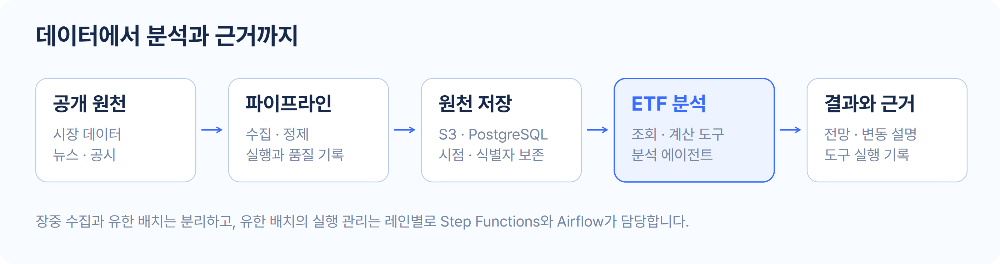
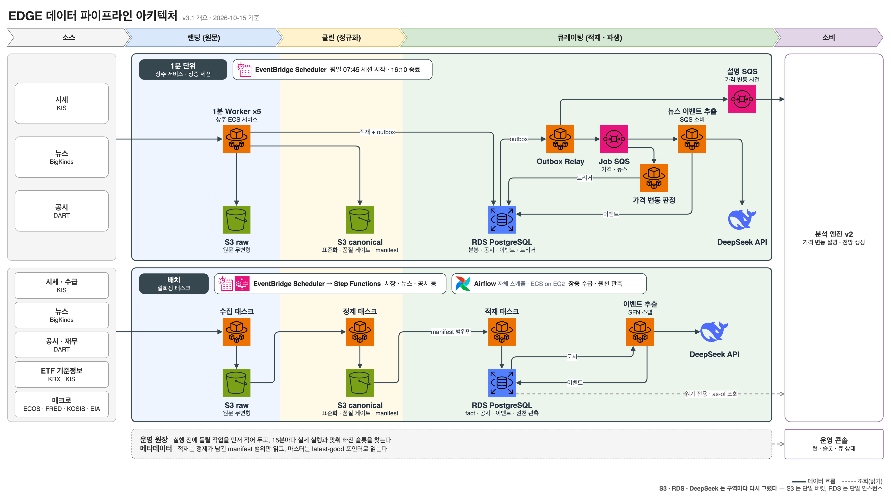
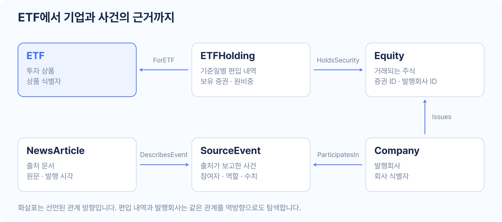
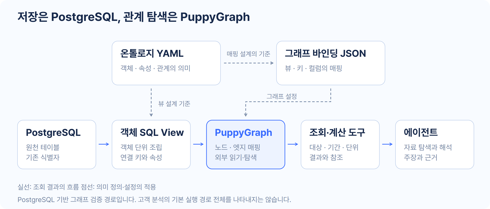
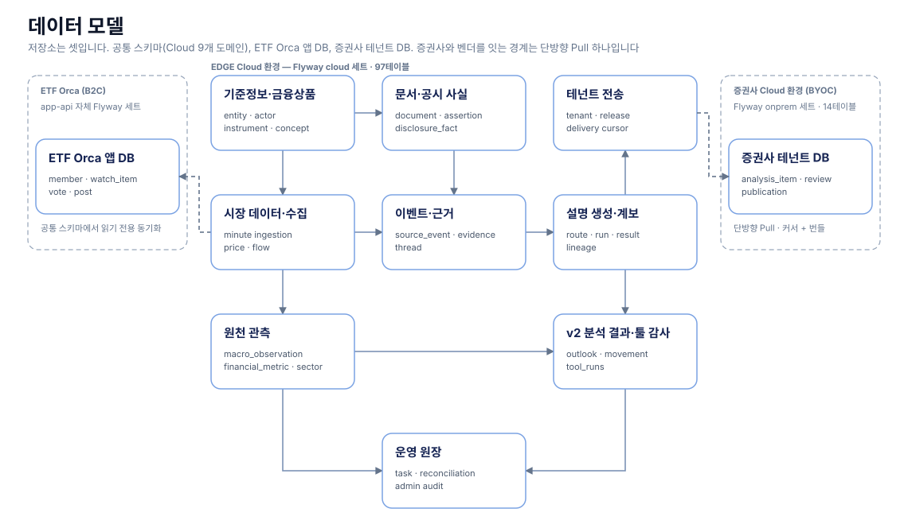

[프로젝트 전체](../../README.md) · [EDGE SIGNAL](../edgesignal/README.md) · [ETF ORCA](../etforca/README.md)

# EDGE 분석 엔진

**금융 데이터와 기업·사건의 관계를 바탕으로 ETF 전망과 가격변동을 분석하고, 판단에 사용한 근거를 추적합니다.**

ETF 분석에는 상품의 가격뿐 아니라 편입종목, 발행회사, 뉴스와 공시, 수급과 재무 자료가 필요합니다. EDGE는 이 자료를 수집·정제하고, 분석 도구와 에이전트가 사용할 수 있는 형태로 관리합니다.

분석 결과는 기업용 [EDGE SIGNAL](../edgesignal/README.md)과 개인용 [ETF ORCA](../etforca/README.md)에서 활용합니다. 개인별 포트폴리오 추천은 ORCA의 독립 서비스가 담당합니다.

## 전체 흐름

| 입력 | 처리 | 결과 |
|---|---|---|
| 가격·구성종목·수급, 뉴스·공시, 재무·거시 관측 | 수집·정규화·적재, 자료 조회와 계산, 전망·변동 요인 분석 | ETF 분석 본문, 방향과 이유, 도구 실행·출처 기록 |

## 데이터 파이프라인

기존 파이프라인은 장중 수집과 유한 배치를 구분합니다. 상주 수집기·SQS 소비자와 배치 오케스트레이터의 책임이 다릅니다. 유한 배치는 레인별로 Step Functions 또는 Airflow가 실행을 관리하고, 실제 업무는 `data-pipeline`의 ECS 태스크와 명령이 수행합니다.

장중 1분 레인은 상주 ECS 서비스가 시세·뉴스·공시를 받아 가격 변동을 판정하고 설명 요청을 큐로 넘깁니다. 배치 레인은 EventBridge → Step Functions 또는 Airflow(ECS on EC2)가 레인별로 수집·정제·적재 태스크를 실행합니다. 레인별 Airflow 이관 상태는 [Airflow README](airflow/README.md)가 설명합니다.

### 실행 성공과 데이터 충족을 구분

Planner는 실행 전에 예정 작업을 PostgreSQL 원장에 기록합니다. Reconciler는 예정 작업과 실제 실행·산출물 증거를 대조해 누락과 미귀결을 드러냅니다. 프로세스의 종료 코드만으로 모든 데이터가 확보됐다고 판단하지 않습니다.

| 경계 | 검사·관리 방식 |
|---|---|
| 외부 원천 → raw | 수집 결과와 실패·중단 상태를 기록해 자료 없음과 수집 실패 구분 |
| raw → canonical | 가격·뉴스·보유 등의 데이터셋별 필수값·날짜·식별·정합성 게이트와 품질 로그 |
| canonical → DB | 대상 키·식별자를 기준으로 적재하고 원천과 객체의 연결 보존 |
| 계획 → 실제 실행 | 예정 작업, 시도, 실행 결과와 충족 증거를 원장에서 대조 |

데이터셋별 보장 범위는 다릅니다. 한 경로의 원자성·시점 검사를 전체 데이터에 일반화하지 않습니다. [파이프라인 개요](data-pipeline/docs/overview.md) · [운영 원장](data-pipeline/docs/ops-ledger.md) · [레이크 계약](data-pipeline/docs/lake-contract.md)

## 온톨로지 데이터 모델링

뉴스에 나온 기업이 ETF에 얼마나 포함돼 있는지, 어떤 사건이 언급됐는지, 그 근거 문서가 무엇인지 찾아야 합니다. 이를 위해 ETF·편입 내역·증권·회사·사건·문서를 서로 다른 객체로 정의하고 관계를 연결합니다.

그림의 화살표는 선언된 관계 방향입니다. ETF에서 편입 내역을 찾거나 주식에서 발행회사를 찾을 때는 같은 관계를 역방향으로 탐색합니다. 관계를 반대로 읽기 위해 사실을 두 번 저장하지 않습니다.

### 무엇을 구분하는가

| 객체·계약 | 구분하는 이유 |
|---|---|
| ETF와 ETFHolding | 상품 자체와 특정 기준일의 구성·비중을 분리 |
| Equity와 Company | 거래되는 증권과 그 증권을 발행한 회사의 정체성 구분 |
| NewsArticle·Disclosure와 SourceEvent | 문서 한 건과 그 문서가 보고하는 사건을 구분 |
| EventMeasurement | 사건에 기록된 금액·기간·규모 등의 수치 보존 |
| EventThread | 출처별 사건 기록의 정체성과 진행을 묶는 계약 |
| Actor·Security·SourceDocument | 서로 다른 객체가 공유하는 역할을 인터페이스로 정의 |

모델은 테마가 같다는 이유로 인과관계를 만들거나, 기사 수를 곧바로 신뢰도 점수로 바꾸지 않습니다. 객체의 식별자, 관측 시점, 단위와 출처를 보존한 뒤 분석에서 해석합니다.

현재 라이브러리는 **객체 유형 26개, 방향 링크 유형 40개**를 정의합니다. 이는 모델 정의의 개수이며 모든 관계의 운영 적용이나 실제 데이터 커버리지를 뜻하지 않습니다. OMS는 정의·로더·검증을 담은 패키지이며 별도의 운영 메타데이터 서버가 아닙니다.

[온톨로지 라이브러리](../../libs/ontology/README.md) · [객체 정의](../../libs/ontology/src/edge_ontology/metadata/object_types) · [관계 정의](../../libs/ontology/src/edge_ontology/metadata/link_types) · [선언 규칙](../../docs/analysis-engine/ontology/ontology-system-spec.md)

## PostgreSQL과 PuppyGraph

**PostgreSQL**은 원천을 저장하고 SQL View에서 객체 한 건의 식별자·속성·연결 키를 제공합니다. **PuppyGraph**는 이 뷰의 키와 컬럼을 노드·엣지로 매핑해 관계 탐색을 제공합니다. 온톨로지 YAML은 의미 계약, 그래프 바인딩은 실제 뷰와 노드·엣지를 연결하는 설정입니다.

- 객체 뷰는 기존 식별자를 유지합니다. 회사와 주식은 `company.id`, `equity.id`, `equity.issuer_id`로 연결합니다.
- 주식 뷰를 주식 노드와 회사→주식 엣지의 원천으로 함께 사용합니다. 관계마다 별도 복제 테이블을 만들 필요는 없습니다.
- SQL View에 표시한 PK/FK 역할은 검증할 계약입니다. 일반 VIEW에 물리 PK/FK 제약이 자동 생성되는 것은 아닙니다.
- 정의 파일을 작성했다고 뷰와 그래프가 자동 배포되는 것은 아닙니다. 뷰 적용과 그래프 바인딩·검증을 구분합니다.
- 기존 원천을 외부 조회하는 경로입니다. 별도 그래프 저장소로 전체 레코드를 복제하는 방식과 구분하되, 조회 중 데이터 전송과 캐시까지 없다고 주장하지 않습니다.

이 그림은 **PostgreSQL 기반 그래프 검증 경로**입니다. 고객 분석의 모든 실행이 이 경로를 사용한다는 뜻은 아닙니다. S3/Iceberg 통합 설계도 이 경로의 검증 완료 범위에 포함하지 않습니다. [객체 뷰와 연결 검증 기록](../../libs/ontology/src/edge_ontology/sql/README.md)

## 분석 에이전트와 근거 추적

에이전트는 자료 조회와 계산 도구를 사용하고, 저장된 결과를 바탕으로 전망과 가격변동 요인을 설명합니다. 최종 본문과 사용한 도구 실행을 연결해 어떤 입력과 결과를 근거로 썼는지 다시 확인합니다.

| 단계 | 남기는 정보 |
|---|---|
| 자료 조회·계산 | 도구 실행 ID, 입력, 결과와 실행 상태 |
| 설명 작성 | 최종 설명과 선택한 `tool_run_ids` |
| 출처 구성 | 연결된 뉴스의 원천 URL 또는 검증된 웹 문서 URL |
| 결과 검토 | DB 조립 응답, 계약 검사와 실행 관측 기록 |

출처 링크는 모델이 임의로 작성하지 않고 저장된 도구 근거에서 서버가 구성합니다. 과거 실행에 URL이 없거나 뉴스 외 근거인 경우 빈 출처 목록이 나올 수 있습니다. 원래 없던 링크를 소급 생성하지 않습니다.

도구 실행이 존재한다는 검사와 최종 문장이 그 근거를 올바르게 해석했다는 평가는 다릅니다. 참조 구조의 유효성을 답변 정확도로 바꾸어 말하지 않습니다. [분석 결과·출처 계약](analysis-engine-v2/README.md) · [최종 선택 근거 계약](../../docs/contracts/analysis-v2-selected-evidence.md)

## 검증 범위

| 항목 | 확인된 범위 | 해석의 한계 |
|---|---|---|
| 온톨로지 정의 | 객체·관계·인터페이스·어휘와 로더의 패키지 구조 | 정의 개수가 운영 커버리지나 분석 정확도는 아님 |
| 회사–주식 연결 | 2026-10-05 검증 기록에서 회사 2,766개·주식 2,766개·발행 관계 2,766쌍을 원천과 대조 | 해당 경로와 데이터셋의 결과 |
| PuppyGraph 양방향 조회 | 같은 발행 관계 쌍을 정방향·역방향 조회로 확인 | 전체 온톨로지 완료나 SQL 대비 성능 우위를 입증하지 않음 |
| 결과 근거 연결 | 저장된 도구 실행과 출처를 최종 결과에 연결하는 계약 | 문장과 근거의 의미 일치는 별도 평가 필요 |

회사–주식 파일럿은 PuppyGraph 1.13.0에서 PostgreSQL 외부 읽기를 사용한 기록입니다. 모델 정의, 연결 검증, 고객 서비스 기본 경로 전환, 분석 효과 측정을 구분합니다. 최신 실행과 배포 상태는 각 모듈의 기록을 확인합니다.

## 물리 데이터 모델

물리 ERD는 테이블·키·저장 책임을, 온톨로지는 업무 객체·관계의 의미를 설명합니다. 공통 Cloud/On-Prem 스키마는 [libs/schema](../../libs/schema/README.md), ORCA 앱과 포트폴리오의 전용 DB는 각 서비스에서 관리합니다. 객체 SQL View의 적용 절차도 Flyway 테이블 마이그레이션과 구분합니다.

## 모듈과 개발 안내

| 모듈 | 책임 | 상세 문서 |
|---|---|---|
| data-pipeline | 수집·정제·피처·적재와 실행 원장 | [실행과 설정](data-pipeline/README.md) |
| airflow | 유한 배치의 레인별 실행 관리와 검증 | [DAG·전환·운영](airflow/README.md) |
| analysis-engine-v2 | 분석 실행, 결과와 근거 저장, 관측 대시보드 | [실행·출력 계약·검증](analysis-engine-v2/README.md) |
| db-query | 운영 DB의 일회성 조회 태스크 | [조회 범위와 제한](db-query/README.md) |
| libs/ontology | 의미 정의·어휘·로더·객체 뷰 | [패키지 구조](../../libs/ontology/README.md) |

운영 DB 조회 도구 `db-query`와 에이전트의 그래프 도구를 같은 인터페이스로 취급하지 않습니다. 모듈별 테스트에는 전용 로컬 DB, 컨테이너 또는 실제 외부 호출 등 서로 다른 전제가 있으므로 각 실행 안내를 따릅니다.

[프로젝트 전체로 돌아가기](../../README.md)
