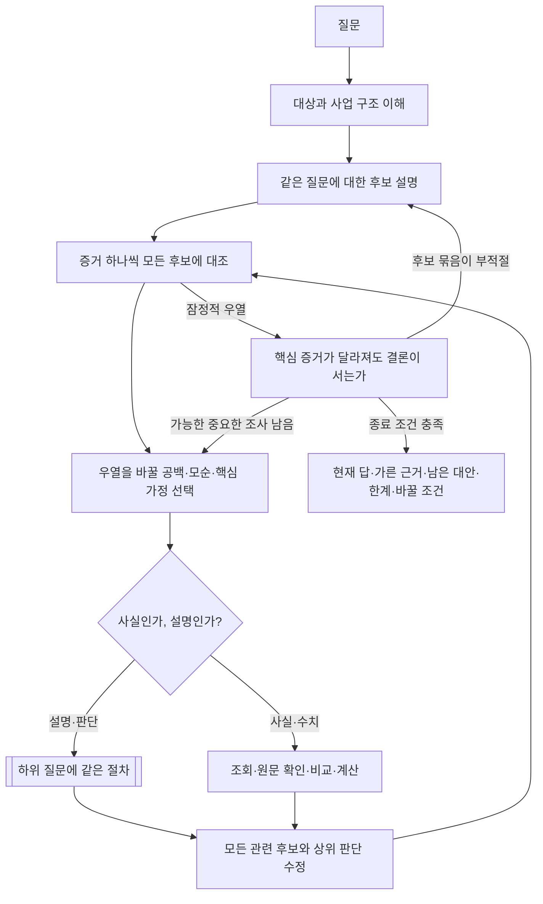

# 후보를 가르는 방법

이번 작업에 제공된 최초 조사 또는 수정 조사 스킬의 범위와 종료 조건을 따른다. 이 스킬은 조사가 필요한 질문에서 후보를 가르는 방법을 보충한다. 수정에서 이미 답한 질문을 다시 열거나 조사 범위를 늘리지 않는다. 스킬을 다시 부르거나 하위 에이전트를 만들라는 뜻이 아니다. ACH를 재귀 구조로 넓힌 설계이며 CIA 원문의 알고리즘이라고 주장하지 않는다.

## 1. 가르는 관측을 고른다

- 후보마다 "맞다면 보일 것"을 나란히 놓는다. 서로 다르게 예측하는 곳이 가르는 관측이다. 모든 후보가 같게 예측하는 관측은 조회해도 우열이 바뀌지 않는다.
- 불일치를 찾으면 먼저 출처 오류·시점·단위 차이인지 확인한다. 그 뒤에 설명에 반영한다.
- 기대한 흔적이 없다는 것은, 그 출처와 기간에서 그 흔적이 보일 수 있었을 때만 반증이다. 입증하지 못한 것과 반증된 것을 구분한다.
- 핵심 자료의 접근성·전문성·이해관계·독립성·완전성을 본다.
- 모든 후보와 맞지 않는 증거가 나오면 후보 묶음을 다시 짠다.

## 2. 하위 질문을 열고 되돌린다

- 하위 질문은 상위 후보의 우열이나 결론의 방향·크기·시점·범위를 바꿀 수 있어야 한다. 기업이나 기사 목록을 차례로 모으는 과제로 바꾸지 않는다. 고객·공급자·경쟁사·정책에서 중요한 외부 관측도 찾는다.
- 하위 판단은 새 관측이 아니다. 원래의 근거와 가정을 잇는다. 같은 자료를 여러 가지에서 독립 근거로 다시 세지 않는다.
- 계산이 맞는 것과 인과가 타당한 것은 다르다. 고정 EPS에서 가격과 PER이 함께 움직이는 것, 고정 배수로 역산한 EPS는 독립적인 원인·기대 증거가 아니다.
- 결과가 기존 설명을 지지하면 유지하는 이유를 적는다. 억지로 반전을 만들지 않는다.
- 같은 전제와 근거의 질문은 다시 쓰고, 새 근거가 있을 때만 다시 연다. 서로를 전제로 삼는 순환은 독립 관측으로 푼다. 깊이나 질문 수는 목표가 아니다.

## 3. 과거 사례로 현재 해석을 검토한다

과거 사례는 현재 해석이 타당한지 검토하는 데 쓴다. 정한 결론을 꾸미는 데 쓰지 않는다.

- 사례를 고르기 전에 비교할 질문을 정한다. 예: "최대 실적 뒤의 하락이 일시 조정과 이익 둔화의 시작으로 갈린 조건은 무엇이었나."
- 네 가지를 확인한다. 출발 조건(그때도 같은 문제가 있었는가), 작동 원리(주문·재고·가격·투자 중 무엇이 결과를 만들었는가), 중요한 차이(지금 없거나 새로 생긴 조건), 현재 판단에 주는 영향(어느 후보가 강해지거나 약해지는가).
- 사례 하나는 "이런 일이 어떻게 가능한가"를 설명한다. "이번에도 그 결과가 더 유력하다"고 하려면 사례의 선정과 현재 적용이 타당함을 더 보여야 한다.
- 과거 실적의 변화를 보여 준 자료만으로 단기 주가 경로를 입증했다고 하지 않는다.

## 적용 예 (가상)

수주잔고 증가를 신규 수요·납품 지연·복합 원인으로 비교한다. 잔고 증가 자체는 셋 모두와 양립한다. 신규 주문과 인도 일정에서 고객의 반입 지연을 찾았다면, 그 이유를 공장 준비·투자 축소·검수 문제로 다시 비교한다. 하위의 답은 지연 기간·매출 인식 시점·취소 위험이라는 형태로 상위의 세 후보 모두에 되돌린다.

관계도는 인과의 입증이 아니다. 서로 다른 시장·통화·기간의 수익률 차이를 원인별 기여로 해석하지 않는다. ETF 환매만으로 구성종목의 매도 압력이나 투자 의도를 입증하지 않는다.
