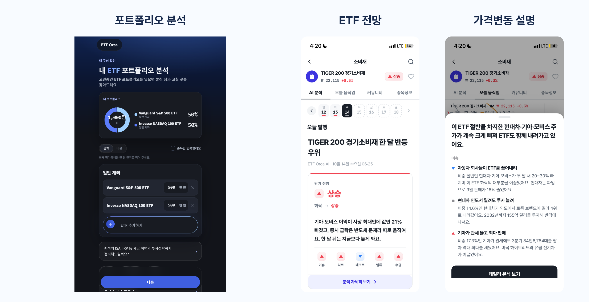
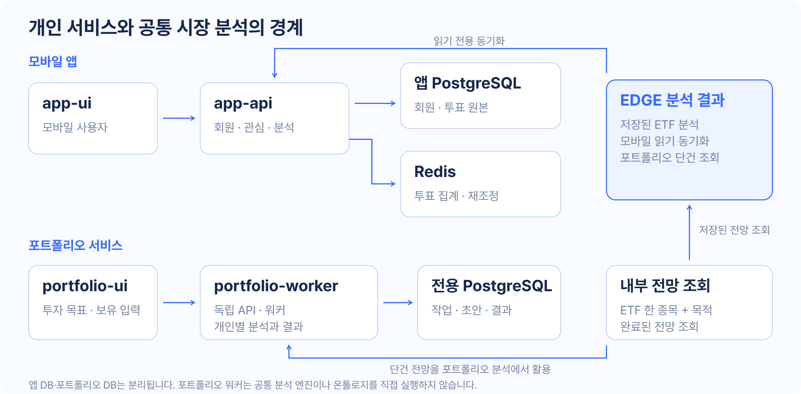

[프로젝트 전체](../../README.md) · [EDGE SIGNAL](../edgesignal/README.md) · [EDGE 분석 엔진](../engine/README.md)

# ETF ORCA

**내 투자 목표에 맞는 ETF를 추천하고, 전망과 가격이 움직인 이유를 설명합니다.**

투자 상품을 고른 뒤에도 질문은 남습니다. 내 구성은 목표에 맞는지, 새로 나온 뉴스가 내 투자에 어떤 영향을 주는지, 가격이 움직였을 때 무엇을 확인해야 하는지입니다.

ETF ORCA는 이 질문을 포트폴리오 추천, ETF 전망, 가격변동 설명으로 다룹니다. 개인의 입력을 해석하는 포트폴리오 서비스와 공통 시장 분석을 읽는 모바일 앱을 함께 개발합니다.

[서비스](https://etforca.com/) · [포트폴리오 분석](https://etforca.com/portfolio/) · [투자정보 기만 검증](https://etforca.com/truth/)

## 사용자가 만나는 기능

| 기능 | 사용자의 질문 | 제공하는 경험 |
|---|---|---|
| 포트폴리오 추천 | 내 목표와 현재 구성이 맞나요? | 현재 구성 평가, 조건에 맞는 후보 비교, 추천 구성과 이유 |
| 관심종목 브리핑 | 오늘 내 ETF에서 중요한 내용은 무엇인가요? | 관심 ETF의 핵심 이슈와 분석 확인 |
| 전망 분석 | 앞으로 무엇을 기대하고 무엇을 조심해야 하나요? | 긍정·부정 요인과 조건을 함께 읽기 |
| 가격변동 설명 | 오늘 왜 움직였나요? | 구성종목과 관련 이슈를 바탕으로 변동 요인 확인 |
| 전망 근거 읽기 | 이 설명의 근거는 무엇인가요? | 이유별 설명과 확보된 출처 확인 |

추천은 조건을 통과한 후보가 있을 때 제공합니다. 전부 탈락하면 추천을 발행하지 않고, 자료 부족과 실제 기준 미달을 구분합니다. 금액·계좌 조건이 부족하면 해당 계산의 한계를 따로 표시합니다. [추천·계산 계약](../../docs/design/portfolio-worker.md)

## 투자 목표에서 추천 이유까지

1. **내 투자 입력** — 보유 ETF와 평가금액, 투자 기간, 질문과 조건을 입력합니다.
2. **현재 구성 점검** — 보유 상품의 특성과 집중·분산, 고객 조건을 확인합니다.
3. **후보 비교와 제안** — 상품 조사와 계산 결과를 비교하고, 조건에 맞는 구성을 선택합니다.
4. **이유와 금액 확인** — 추천의 근거와 현재 정보로 계산 가능한 투자 금액을 제공합니다.
5. **후속 확인** — 관심종목의 전망과 가격변동 설명을 읽고 새 정보를 판단에 활용합니다.

포트폴리오의 금액 배분과 제약 검사는 코드가 수행합니다. 에이전트는 상품·시장 근거를 조사하고 후보 선택의 이유를 설명합니다. 과거 성과와 미래 전망은 구분하며, 수수료·세금·주 단위 주문 반올림을 포함한 실제 주문 실행 서비스로 표현하지 않습니다.

## 서비스와 데이터 경계

**모바일 앱**은 `app-api`를 통해 회원·관심종목·분석·커뮤니티·투표를 제공합니다. ETF와 분석 데이터는 엔진 DB에서 읽기 전용으로 동기화하고, 회원과 투표 원본은 앱 전용 PostgreSQL에 둡니다. Redis는 투표 집계용 파생 저장소입니다.

**포트폴리오 서비스**는 독립 API·워커와 전용 PostgreSQL을 사용합니다. API와 워커는 별도 프로세스이며 작업·초안·결과를 공유합니다. 저장된 ETF 전망은 내부 조회 서비스를 통해 **ETF 한 종목과 명시적인 목적**으로 조회합니다. 포트폴리오 워커가 공통 엔진을 실행하거나 온톨로지에 직접 접근하는 구조는 아닙니다.

조회한 전망은 기존 분석자의 의견으로 구분하고 외부 공식 자료와 대조합니다. 없거나 오래된 자료, 연결 장애를 같은 상태로 처리하지 않습니다. [실행 경계](../../docs/design/portfolio-worker.md) · [배포 경계](../../docs/design/portfolio-deployment.md) · [앱 API 인프라 결정](../../docs/adr/0056-etforca-app-api-infra.md)

**투자정보 기만 검증**은 투자자를 오인하게 한 주장과 후속 해명을 원문과 시간순 기록으로 대조해 공개합니다. 판정(밝혀짐·해소)은 공식 판단이나 법정공시가 있을 때만 바꾸고, 수사기관·당사자 주장은 주체를 밝혀 적습니다. [설계](../../docs/design/truth-service.md) · [조사 방법론](../../docs/design/truth-investigation-methodology.md)

## 사용자 접점과 검증

포트폴리오 분석을 무료로 공개하고 커뮤니티 반응을 관찰했습니다. 인스타그램 릴스, 유튜브 쇼츠, 네이버 프리미엄 콘텐츠, 커뮤니티 홍보를 사용자 접점으로 활용했습니다.

서비스 반응은 **방문, 분석 요청, 분석 완료, 추가 질문, 리포트 신청**을 나눠 봅니다. 자동 테스트와 팀 내부 테스트를 식별해 제외해야 하며, 쿠키 기준 방문이나 분석 요청 수를 실제 사람 수로 바꾸지 않습니다. 사용자 인터뷰·만족도·다운로드 수는 확인된 결과가 있을 때 별도로 제시합니다.

리포트 신청 접수와 이메일 발송은 다른 기능입니다. 현재 포트폴리오 서비스는 신청을 저장하며 자동 이메일 발송은 구현하지 않았습니다. [관리자 집계와 접속 경계](../../docs/design/portfolio-admin.md)

## 앱 기능

| 영역 | 범위 |
|---|---|
| 회원 | 이메일·소셜 로그인, 토큰 회전, 프로필과 탈퇴 |
| ETF와 분석 | 검색·요약·일봉·구성종목, 분석과 요인별 상세 |
| 관심 ETF | 관심 그룹 생성과 ETF 담기·빼기 |
| 전망 투표 | 매수·관망·매도 투표, 재투표·철회, 집계 조회 |
| 커뮤니티·알림 | 글·댓글·좋아요, 신고·차단, 알림·푸시 토큰 |

분석이 아직 없는 ETF는 준비 중으로 응답합니다. Redis 장애 때도 투표 원본은 DB에 저장하고, 집계 조회는 DB 폴백 경로를 사용합니다. 상세 API는 [OpenAPI 계약](app-api/openapi.yaml)을 따릅니다.

## 원본을 보존하고 장애 영향을 제한하는 설계

### 투표 원본과 집계의 분리

* 사용자당 1행은 `UNIQUE(etf_code, member_id)` 제약으로 강제
* 투표와 재투표는 `INSERT ... ON CONFLICT DO UPDATE` 한 문장
* Redis 집계는 Lua 스크립트로 이전 선택 차감과 새 선택 가산을 원자 처리
* 같은 투표의 재실행은 no-op이라 중복 집계 없음

Redis는 파생 데이터입니다. 유실되어도 DB 원본에서 다시 만듭니다.

### 커밋 이후의 Redis 갱신

처음에는 트랜잭션 커밋 직후 리스너에서 Redis를 갱신했습니다.
이 리스너는 DB 커넥션을 쥔 채 Redis 응답을 기다렸습니다.
Redis가 응답하지 않으면 커넥션 풀이 고갈되어 투표와 무관한 요청까지 멈췄습니다.

* 트랜잭션 밖의 Facade가 커밋과 커넥션 반납 이후 Redis 갱신
* Redis 실패는 로그만 남기고 응답은 성공
* 어긋난 집계는 재조정이 복구

### 즉시 실패하는 Redis 클라이언트

* Lettuce `REJECT_COMMANDS`로 연결이 끊긴 동안의 명령을 큐에 쌓지 않고 즉시 실패
* 명령·연결 타임아웃 500ms
* 재연결을 기다리는 요청이 톰캣 스레드를 붙잡지 않음

### 샤드 단위 서킷 브레이커

즉시 실패만으로는 연결은 살아 있고 응답이 없는 장애를 막지 못합니다.
`docker pause`나 네트워크 분리에서는 요청마다 500ms를 기다립니다.

* Resilience4j 서킷으로 반복 대기 차단
* 서킷 단위는 Redis 전체가 아닌 슬롯을 소유한 마스터 샤드
* 장애 샤드의 서킷만 열리고 정상 샤드는 Redis 그대로 사용
* 슬롯 표는 Lettuce `Partitions`를 그대로 사용해 페일오버와 리샤딩 추종

전역 서킷은 장애 샤드의 실패율 때문에 정상 샤드 조회까지 DB로 보냈습니다.
그래서 판단 단위를 샤드로 좁혔습니다.

### 재조정

* DB 스냅샷으로 집계 해시를 Lua 한 번에 교체
* 트리거: 기동 직후, 5분 주기, Lettuce 재연결, 관리자 호출

### 앱 전용 PostgreSQL

엔진 파이프라인과 같은 DB 인스턴스를 쓰지 않습니다. 결정은 [ADR-0056](../../docs/adr/0056-etforca-app-api-infra.md)에 있습니다.

* 파이프라인 스키마 변경의 재부팅이 앱 사용자를 끊지 않도록 인스턴스 분리
* 회원 개인정보와 파이프라인 데이터의 권한 경계
* 투표 upsert의 원자성과 분석 본문의 JSONB 저장을 이유로 PostgreSQL 선택

---

## Redis 장애 실험

Docker Compose 환경에서 k6로 부하를 주고 Redis에 장애를 주입했습니다.
SLO는 응답 1초 이내입니다.

### Sentinel 마스터 장애

투표와 무관 요청을 각 50rps로 넣고 60초 뒤 마스터를 종료했습니다. 주입 후 20초 구간의 값입니다.

| 항목 | 기본 설정 | 즉시 실패 설정 |
|---|---|---|
| SLO 초과 | 39.7% | 0% |
| 투표 p99 | 6,803ms | 7.4ms |
| 무관 요청 p99 | 346.0ms | 2.2ms |
| 톰캣 busy 스레드 최대 | 195 | 3 |
| 장애 후 DB와 Redis 일치 | 일치 | 일치 |

### Cluster 일부 샤드 장애

마스터 3·레플리카 3에서 샤드 하나에 장애를 주입했습니다. 조합마다 3회 측정한 범위입니다.

| 구성 | 장애 | 정상 샤드 투표 SLO 초과 | 정상 샤드 조회의 DB 폴백 |
|---|---|---|---|
| 커밋 직후 리스너 갱신 | pause | 70.1~85.7% | 0~28.3% |
| 커밋 이후 Facade 갱신 | pause·partition | 0% | 0% |
| 전역 서킷 | 종료 | 0% | 94.4~96.5% |
| 샤드 서킷 | 종료 | 0% | 0% |

* 커밋 이후 갱신으로 응답 없는 장애의 커넥션 풀 고갈 제거
* 샤드 서킷으로 정상 샤드 조회의 불필요한 DB 폴백 제거
* 샤드 서킷 적용 시 장애 샤드 요청의 중앙값 504ms에서 3ms로 감소

측정 조건과 회차별 값은 [app-api README](app-api/README.md#실측)와 [Sentinel 실측 기록](app-api/experiments/FAILOVER_RESULTS.md)에 있습니다.
측정 코드는 [app-api/experiments](app-api/experiments)에 있습니다.

---

이 결과는 해당 장애 주입 환경의 시스템 동작을 검증한 기록입니다. 투자 추천 정확도나 운영 전체의 가용성 지표와는 구분합니다.

## 기술 스택과 개발 안내

| 구성 | 기술과 문서 |
|---|---|
| 모바일 앱 | Expo / React Native, Expo Router, TanStack Query, Zustand — [app-ui](app-ui/README.md) |
| 앱 API | Java·Spring Boot, PostgreSQL, Flyway, Redis, Lettuce, Resilience4j — [app-api](app-api/README.md) |
| 랜딩 | 정적 HTML — [app-landing](app-landing/README.md) |
| 포트폴리오 | React 화면, 독립 Python·FastAPI API/워커 — [실행·검증](portfolio-worker/README.md) |
| 투자정보 기만 검증 | 정적 HTML 화면 — [truth-web](truth-web/README.md), Python 사건 계약 검사·공개 데이터 생성·매시 갱신 에이전트 — [truth-agent](truth-agent/README.md), [설계](../../docs/design/truth-service.md) |

모듈별 실행 명령과 환경 설정은 위 문서를 따릅니다. 실제 모델을 호출하는 포트폴리오 검증은 외부 호출 비용이 발생하며, DB 통합 테스트에는 전용 테스트 환경이 필요합니다.

### 다음 검증

추천을 이해하고 자신의 판단에 활용했는지에 대한 사용자 인터뷰와 만족도 검증, 실제 이용·재방문 분석을 이어갑니다. 구독 모델은 후속 사업화 방향이며 현재 유료 결제 운영 성과로 제시하지 않습니다.

[앱 화면 구성](app-ui/screens.md) · [앱 DB 설계](app-api/docs/erd.md) · [프로젝트 전체로 돌아가기](../../README.md)
