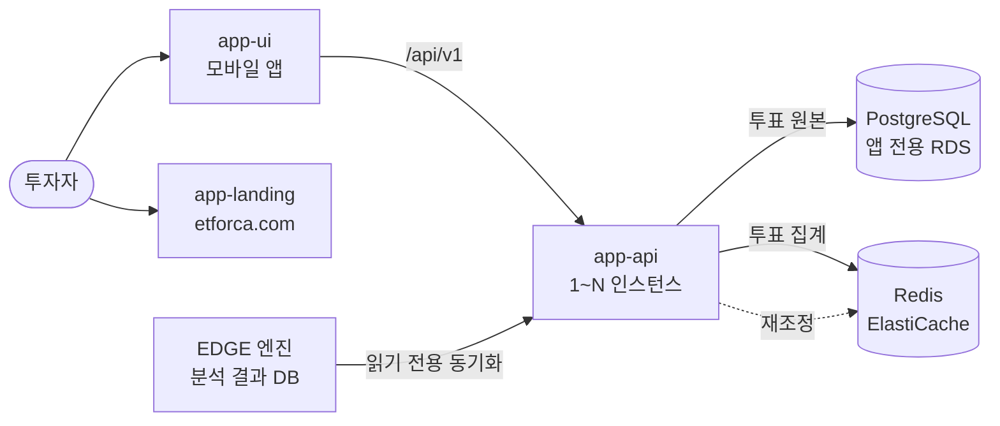

# ETF Orca

> EDGE 엔진의 ETF 분석을 개인 투자자에게 전달하고, ETF 전망 투표를 받는 B2C 서비스

---

## 1. 프로젝트 소개

### Background

EDGE 엔진은 매일 ETF의 가격 변동 원인을 분석합니다.
ETF Orca는 이 분석을 개인 투자자용 앱으로 제공합니다.
투자자는 분석을 읽고 ETF마다 매수·관망·매도 전망에 투표합니다.

투표 집계는 화면에 실시간으로 보여야 하므로 Redis에 둡니다.
여러 인스턴스가 같은 Redis를 쓰는 구조에서는 Redis 장애가 투표와 무관한 API까지 멈출 수 있습니다.
Redis 일부만 장애가 나도 앱 전체가 영향을 받지 않는 구조를 직접 구현하며 검토하고자 했습니다.

### Goal

* Redis 장애 시 투표와 무관한 API의 정상 응답
* Redis 장애 중에도 투표 원본의 유실 없는 저장
* Redis 복구 후 집계와 원본의 자동 일치
* Redis Cluster 일부 샤드 장애 시 정상 샤드의 정상 동작

---

## 2. 구조



* 투표 원본은 PostgreSQL, 집계는 Redis
* Redis 갱신은 DB 커밋과 커넥션 반납 이후
* Redis 집계는 주기 재조정이 원본 기준으로 복구
* 분석·ETF 데이터는 엔진 DB에서 읽기 전용 동기화

---

## 3. 모듈

[app-api](app-api/README.md) · [app-ui](app-ui/README.md) · [app-landing](app-landing/README.md) · portfolio-ui · [portfolio-worker](portfolio-worker/README.md)

모듈별 역할과 배포처는 [저장소 구조](../../docs/repo-structure.md#apps--배포-단위)에 있습니다.

---

## 4. 기능 목록

### 회원

* 이메일 가입과 인증 코드 확인
* Apple·Google·Kakao 소셜 로그인
* 액세스 토큰과 리프레시 토큰 회전
* 비밀번호 재설정, 프로필 수정, 회원 탈퇴
* 예외: 비회원은 기기 식별자로 조회 기능 이용
* 예외: 탈퇴 시 해당 회원의 투표를 집계에서 제거

### ETF와 분석

* ETF 검색과 요약, 일봉 차트, 구성 종목
* 장중 가격 변동의 원인 설명
* 일간 분석의 요인별 상세와 지표
* AI가 고른 오늘의 ETF 순위
* 예외: 분석이 아직 없는 ETF는 준비 중 응답

### 관심 ETF

* 관심 그룹 생성과 삭제
* ETF 하나를 여러 그룹에 담기와 빼기

### 전망 투표

* ETF별 매수·관망·매도 투표와 재투표
* 투표 철회와 내 투표 조회
* 선택지별 집계 조회
* 예외: 같은 선택의 재투표는 집계 변화 없음
* 예외: Redis 장애 시 투표는 DB에 저장하고 집계는 DB 집계로 응답

### 커뮤니티와 알림

* 글과 댓글 작성, 좋아요
* 글·댓글 신고와 회원 차단
* 알림 목록과 읽음 처리, 푸시 토큰 등록

---

## 5. 설계 결정

### 투표 원본과 집계의 분리

* 사용자당 1행은 `UNIQUE(etf_code, member_id)` 제약으로 강제
* 투표와 재투표는 `INSERT ... ON CONFLICT DO UPDATE` 한 문장
* Redis 집계는 Lua 스크립트로 이전 선택 차감과 새 선택 가산을 원자 처리
* 같은 투표의 재실행은 no-op이라 중복 집계 없음

Redis는 파생 데이터입니다. 유실되어도 DB 원본에서 다시 만듭니다.

### 커밋 이후의 Redis 갱신

처음에는 트랜잭션 커밋 직후 리스너에서 Redis를 갱신했습니다.
이 리스너는 DB 커넥션을 쥔 채 Redis 응답을 기다렸습니다.
Redis가 응답하지 않으면 커넥션 풀이 고갈되어 투표와 무관한 요청까지 멈췄습니다.

* 트랜잭션 밖의 Facade가 커밋과 커넥션 반납 이후 Redis 갱신
* Redis 실패는 로그만 남기고 응답은 성공
* 어긋난 집계는 재조정이 복구

### 즉시 실패하는 Redis 클라이언트

* Lettuce `REJECT_COMMANDS`로 연결이 끊긴 동안의 명령을 큐에 쌓지 않고 즉시 실패
* 명령·연결 타임아웃 500ms
* 재연결을 기다리는 요청이 톰캣 스레드를 붙잡지 않음

### 샤드 단위 서킷 브레이커

즉시 실패만으로는 연결은 살아 있고 응답이 없는 장애를 막지 못합니다.
`docker pause`나 네트워크 분리에서는 요청마다 500ms를 기다립니다.

* Resilience4j 서킷으로 반복 대기 차단
* 서킷 단위는 Redis 전체가 아닌 슬롯을 소유한 마스터 샤드
* 장애 샤드의 서킷만 열리고 정상 샤드는 Redis 그대로 사용
* 슬롯 표는 Lettuce `Partitions`를 그대로 사용해 페일오버와 리샤딩 추종

전역 서킷은 장애 샤드의 실패율 때문에 정상 샤드 조회까지 DB로 보냈습니다.
그래서 판단 단위를 샤드로 좁혔습니다.

### 재조정

* DB 스냅샷으로 집계 해시를 Lua 한 번에 교체
* 트리거: 기동 직후, 5분 주기, Lettuce 재연결, 관리자 호출

### 앱 전용 PostgreSQL

엔진 파이프라인과 같은 DB 인스턴스를 쓰지 않습니다. 결정은 [ADR-0056](../../docs/adr/0056-etforca-app-api-infra.md)에 있습니다.

* 파이프라인 스키마 변경의 재부팅이 앱 사용자를 끊지 않도록 인스턴스 분리
* 회원 개인정보와 파이프라인 데이터의 권한 경계
* 투표 upsert의 원자성과 분석 본문의 JSONB 저장을 이유로 PostgreSQL 선택

---

## 6. Redis 장애 실험

Docker Compose 환경에서 k6로 부하를 주고 Redis에 장애를 주입했습니다.
SLO는 응답 1초 이내입니다.

### Sentinel 마스터 장애

투표와 무관 요청을 각 50rps로 넣고 60초 뒤 마스터를 종료했습니다. 주입 후 20초 구간의 값입니다.

| 항목 | 기본 설정 | 즉시 실패 설정 |
|---|---|---|
| SLO 초과 | 39.7% | 0% |
| 투표 p99 | 6,803ms | 7.4ms |
| 무관 요청 p99 | 346.0ms | 2.2ms |
| 톰캣 busy 스레드 최대 | 195 | 3 |
| 장애 후 DB와 Redis 일치 | 일치 | 일치 |

### Cluster 일부 샤드 장애

마스터 3·레플리카 3에서 샤드 하나에 장애를 주입했습니다. 조합마다 3회 측정한 범위입니다.

| 구성 | 장애 | 정상 샤드 투표 SLO 초과 | 정상 샤드 조회의 DB 폴백 |
|---|---|---|---|
| 커밋 직후 리스너 갱신 | pause | 70.1~85.7% | 0~28.3% |
| 커밋 이후 Facade 갱신 | pause·partition | 0% | 0% |
| 전역 서킷 | 종료 | 0% | 94.4~96.5% |
| 샤드 서킷 | 종료 | 0% | 0% |

* 커밋 이후 갱신으로 응답 없는 장애의 커넥션 풀 고갈 제거
* 샤드 서킷으로 정상 샤드 조회의 불필요한 DB 폴백 제거
* 샤드 서킷 적용 시 장애 샤드 요청의 중앙값 504ms에서 3ms로 감소

측정 조건과 회차별 값은 [app-api README](app-api/README.md#실측)와 [Sentinel 실측 기록](app-api/experiments/FAILOVER_RESULTS.md)에 있습니다.
측정 코드는 태그 [vote-cluster-isolation-2026-10-04](https://github.com/alphaeveryday/edge/tree/vote-cluster-isolation-2026-10-04/apps/etforca/app-api)에 있습니다.

---

## 7. 기술 스택

* Java 21, Spring Boot 4.1, Spring Data JPA, Flyway
* PostgreSQL 16, Redis 7 (Sentinel·Cluster, AWS ElastiCache)
* Lettuce, Resilience4j, ShedLock
* Expo (React Native), Expo Router, TanStack Query, Zustand
* Python, FastAPI, React (포트폴리오)
* AWS ECS Fargate, RDS, ElastiCache, ALB, Terraform, GitHub Actions
* k6 (부하 실험)

---

## 8. 실행 방법

### app-api

PostgreSQL과 Redis Sentinel을 함께 띄웁니다.

```bash
cd apps/etforca/app-api
VOTE_ADMIN_TOKEN=local-experiment docker compose up --build -d
```

테스트는 레포 루트에서 실행합니다. Docker가 필요합니다.

```bash
./gradlew :apps:etforca:app-api:test
```

### 장애 실험

```bash
cd apps/etforca/app-api/experiments
python3 run-failover.py S2                  # Sentinel 마스터 장애
HOT=failed FAULT=kill python3 run-cluster.py C4   # Cluster 샤드 장애
```

### app-ui

```bash
cd apps/etforca/app-ui
npm install
npm start
```

---

## 9. 문서

* [app-api 설계와 실측](app-api/README.md)
* [API 계약](app-api/openapi.yaml)
* [DB 설계](app-api/docs/erd.md)
* [앱 화면 구성](app-ui/screens.md)
* [ADR-0056 앱 API 인프라](../../docs/adr/0056-etforca-app-api-infra.md)
