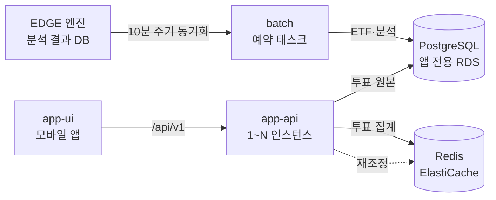

# app-api: ETF Orca 앱 API

ETF Orca 모바일 앱(app-ui)이 사용하는 API 서버다.
회원·관심 ETF·커뮤니티·알림·분석 조회와 ETF 전망 투표(BUY·WAIT·SELL)를 제공한다.
이 모듈에서 가장 공들인 부분은 Redis 장애가 투표와 상관없는 API까지 번지지 않게 막는 것이다.

## 목표

- Redis 장애 시 투표와 무관한 API의 정상 응답
- Redis 장애 중에도 투표 원본의 유실 없는 저장
- Redis 복구 후 집계와 원본의 자동 일치
- Redis Cluster 일부 샤드 장애 시 정상 샤드의 정상 동작

## 구조



- 투표 원본은 PostgreSQL, 집계는 Redis에 둔다.
- ETF·분석 데이터는 `batch` 예약 태스크가 엔진 DB에서 읽어 앱 DB로 동기화한다.

## 투표 흐름

DB에 먼저 저장하고, 커밋이 끝난 뒤 Redis 집계를 갱신한다.
둘이 어긋나면 재조정이 DB 기준으로 맞춘다.

| API | 동작 |
|---|---|
| `PUT /api/v1/etfs/{code}/vote` | 투표·재투표 (마지막 선택 우선, 같은 선택은 no-op) |
| `DELETE /api/v1/etfs/{code}/vote` | 철회 |
| `GET /api/v1/etfs/{code}/vote` | 내 투표 (DB) |
| `GET /api/v1/etfs/{code}/vote/count` | 집계 (공개) |
| `POST /api/v1/admin/votes/reconcile` | 수동 재조정 (`X-Admin-Token`) |

```
PUT ─▶ VoteFacade ─▶ VoteService.vote()          @Transactional upsert
                │       (커밋·커넥션 반납)
                └──▶ VoteCountRepository.vote()   vote.lua, 실패는 로그만 남기고 응답은 성공

GET count ─▶ VoteService.counts()   Redis 집계, 실패하면 DB 집계 (source=db)

재조정 ─▶ VoteReconciler   DB 스냅샷으로 집계 해시를 reconcile.lua 한 번에 교체
```

- **원본.** 사용자당 1행은 `UNIQUE(etf_code, member_id)` 제약이 강제한다. 신규·변경 판정은 `INSERT ... ON CONFLICT DO UPDATE` 한 문장으로 한다.
- **멱등 Lua.** `vote.lua`는 이전 선택과 같으면 아무것도 하지 않는다. 다르면 이전 카운터를 빼고 새 카운터를 더한다.
- **응답에 집계 없음.** 쓰기 응답은 집계를 담지 않는다. 앱은 투표가 성공하면 집계를 따로 조회한다. 쓰기 요청 하나가 Redis를 한 번만 호출하게 하려는 것이다.
- **재조정 시점.** 기동 1초 후, 5분마다, Lettuce가 재연결될 때, 관리자가 호출할 때 돈다. 동시에 들어온 요청은 한 번으로 합친다.
- **탈퇴.** `VoteCacheListener`가 영향받은 ETF의 집계를 남은 표 기준으로 교체한다.
- **빈 집계.** Redis에 키가 없으면 0을 돌려주고 다음 재조정이 채운다.

## 장애 대응 장치

장치 세 개가 각각 다른 종류의 장애를 막는다.

| 장치 | 막는 장애 | 설정 |
|---|---|---|
| 즉시 실패 (Lettuce) | 연결이 끊긴 동안 재연결을 기다리는 요청의 스레드 점유 | `REJECT_COMMANDS`, 명령·연결 타임아웃 500ms, `MASTER` 읽기 |
| 서킷 브레이커 (Resilience4j) | 연결은 살아 있고 응답이 없는 장애에서 500ms 대기의 반복 | 샤드 단위, 열림 유지 3초 |
| 재조정 | Redis 유실과 집계 불일치 | 위 재조정 시점 |

Lettuce 옵션은 [공식 문서](https://github.com/redis/lettuce/blob/main/docs/advanced-usage/client-options.md)의 설명을 기준으로 정했다.

**서킷 위치**
- 쓰기 `VoteCountRepository.vote()`·`withdraw()`: 서킷이 열려도 DB 저장은 막지 않는다. 실패하면 메트릭과 로그만 남긴다.
- 읽기 `VoteCountRepository.counts()`: 열린 서킷의 예외를 `VoteService.counts()`가 받아 DB 집계로 응답한다.
- 재조정 `replace()`: 복구 경로라 서킷을 걸지 않는다.

**서킷 단위** (`VOTE_CIRCUIT_SCOPE`)
- `shard` (기본): 슬롯을 소유한 마스터마다 서킷을 따로 둔다(`redis-shard-0`·`redis-shard-5461`·…). 장애 샤드만 차단한다.
- 슬롯 표는 Lettuce `Partitions`를 그대로 쓴다. 페일오버에는 서킷 상태가 이어지고, 리샤딩에는 옮긴 슬롯이 새 샤드의 서킷을 따른다.
- `global`: Redis 전체를 서킷 하나로 판단한다. Cluster가 아닌 환경에서는 `shard`로 설정해도 이렇게 동작한다.

## 트러블슈팅

세 문제 모두 장애를 직접 주입해 보면서 발견하고 고쳤다. 측정 조건은 [실측](#실측)에 정리했다.

### Lettuce 기본 설정의 톰캣 스레드 점유

- **증상.** Sentinel 마스터를 종료하자 요청의 39.7%가 1초를 넘겼다. Redis를 쓰지 않는 요청도 p99가 346ms까지 늘었다.
- **원인.** Lettuce 기본 설정은 연결이 끊긴 동안 명령을 큐에 쌓아 두고 재연결을 기다린다. 기다리는 요청들이 톰캣 스레드를 붙잡으면서 busy가 195까지 올라갔다.
- **해결.** `REJECT_COMMANDS`로 연결이 끊긴 동안의 명령은 바로 실패시키고, 타임아웃을 5초에서 500ms로 줄였다. Redis 전체를 한 단위로 보는 서킷 브레이커도 함께 적용했다.
- **결과.** SLO 초과 39.7% → 0%, 무관 요청 p99 346.0ms → 2.2ms, busy 195 → 3.

### 커밋 직후 리스너의 DB 커넥션 풀 고갈

- **증상.** Redis 샤드 하나가 응답하지 않자 정상 샤드의 투표도 70~86%가 1초를 넘겼다.
- **원인.** Redis 갱신을 `AFTER_COMMIT` 리스너에서 하고 있었다. 이 콜백은 커넥션을 반납하기 전에 실행되기 때문에, Redis 응답을 기다리는 동안 DB 커넥션을 계속 쥐고 있었다. 결국 커넥션 풀(10개)이 바닥났다.
- **해결.** 트랜잭션 밖에 `VoteFacade`를 두고, 커밋과 커넥션 반납이 끝난 뒤에 Redis를 갱신하도록 바꿨다.
- **결과.** 정상 샤드 투표 SLO 초과 70.1~85.9% → 0%, HikariCP 대기 181~187 → 0.

### 전역 서킷의 정상 샤드 조회 차단

- **증상.** Cluster 샤드 하나를 종료하자 정상 샤드 조회의 94.4~96.5%가 DB로 폴백됐다.
- **원인.** 서킷 하나가 Redis 전체의 실패율을 보고 판단했다. 장애 샤드에서 난 실패 때문에 정상 샤드 조회까지 막혔다.
- **해결.** 슬롯을 소유한 마스터 단위로 서킷을 나눴다.
- **결과.** 정상 샤드 조회 DB 폴백 94.4~96.5% → 0%. 응답 없는 장애에서 장애 샤드 조회 중 타임아웃(500ms)까지 대기한 비율 99% → 7%.

## 실측

모든 값은 Docker Desktop 단일 호스트에서 k6로 부하를 주고 Redis에 장애를 주입해 측정했다.
SLO는 응답 1초 이내로 잡았다.

| 용어 | 뜻 |
|---|---|
| 무관 요청 | Redis를 쓰지 않는 정적 경로(`/terms.html`) 요청 |
| busy | 톰캣 작업 스레드의 최대 사용 수 |
| HikariCP 대기 | DB 커넥션을 기다린 요청 수 (풀 10개) |
| pause·partition | `docker pause`와 네트워크 분리. 연결은 살아 있고 응답이 없는 장애 |
| hot | 트래픽 50%를 받는 인기 종목의 위치. `failed`는 장애 샤드, `healthy`는 정상 샤드 |
| S1·S2 | Sentinel 시나리오. S1 기본 설정, S2 즉시 실패 |
| C1~C4 | Cluster 시나리오. C1 기본값, C2 즉시 실패, C3 전역 서킷, C4 샤드 서킷 |

### Redis Sentinel 마스터 장애 (2026-09-13)

- 마스터 1·복제본 2·Sentinel 3
- 투표·무관 요청 각 50rps를 3분, 60초 후 마스터 SIGKILL
- 주입 후 20초 구간의 값
- 당시 Redis 갱신은 `AFTER_COMMIT` 리스너, 두 시나리오 모두 서킷 켬

| 주입 후 20초 | S1 기본 설정 (타임아웃 5초) | S2 즉시 실패 (500ms) |
|---|---|---|
| SLO 초과 | **39.7%** | **0%** |
| 투표 p99 | 6,803ms | 7.4ms |
| 무관 요청 p99 | 346.0ms | 2.2ms |
| 톰캣 busy 최대 | 195 | 3 |

<details>
<summary>전체 지표와 해석</summary>

| 주입 후 20초 | S1 | S2 |
|---|---|---|
| SLO 1초 초과 | 352건 (39.7%) | 0건 (0%) |
| 투표 p99 / 최대 | 6,803ms / 9,817ms | 7.4ms / 11.0ms |
| 무관 요청 p99 | 346.0ms | 2.2ms |
| 톰캣 busy 최대 | 195 | 3 |
| 부하 유실 | 118건 | 0건 |
| Redis 실패 로그 ≈ 재조정 delta | 697건 | 639건 ≈ 640 |
| 최종 DB = Redis | 통과 | 통과 |

- 서킷이 없던 빌드에서 S1은 SLO 초과 68.1%, 무관 요청 p99 972ms였다.
- `/actuator/health`는 Redis 인디케이터를 포함하고 있어 무관 요청에서 뺐다.

</details>

상세 기록과 이전 빌드의 측정은 [FAILOVER_RESULTS.md](experiments/FAILOVER_RESULTS.md)에 있다.

### Redis Cluster 부분 장애 (2026-10-04)

- 마스터 3·replica 3, `cluster-require-full-coverage=no`
- 투표·조회·무관 요청 각 50rps를 3분, 60초 후 샤드 0의 마스터·replica에 장애 주입
- 주입 후 20초 구간의 값, 조합마다 3런의 범위, 별도 표기가 없으면 hot=failed
- "수정 전"은 커밋 직후 리스너, "수정 후"는 `VoteFacade` 갱신

| 구성 | 장애 | 정상 샤드 투표 SLO 초과 | 정상 샤드 조회 DB 폴백 |
|---|---|---|---|
| C1 기본값, 수정 전 | SIGKILL | **91.1~95.0%** | 0% |
| C2 즉시 실패, 수정 전 | pause·partition | **70.1~85.9%** | 0~28.3% |
| C2 즉시 실패, 수정 후 | pause·partition | 0% | 0% |
| C3 전역 서킷 | SIGKILL | 0% | **94.4~96.5%** |
| C4 샤드 서킷 | SIGKILL·pause·partition | 0% | **0%** |

<details>
<summary>전체 지표와 해석</summary>

인기 종목을 장애 샤드에 두면 전역 실패율이 67%, 정상 샤드에 두면 17%가 된다.
원본은 `experiments/runs/`(gitignore)의 result.json이고, 수정 전 코드는 커밋 ecd74dc8이다.

| 구성 | 코드 | 장애 | 정상 샤드 투표 SLO 초과 | 정상 샤드 조회 DB 폴백 | busy | HikariCP 대기 | 조회 폴백 qps |
|---|---|---|---|---|---|---|---|
| C1 기본값(60s·버퍼링·서킷 off¹) | 수정 전 | SIGKILL | 91.1~95.0% (hot=healthy 76.5~80.3%) | 0% | 164~169 | 91~94 | 0 |
| C2 500ms·REJECT·서킷 off | 수정 전 | SIGKILL | 0% | 0% | 4 | 0 | 32.6~32.9 |
| C2 | 수정 전 | pause | 70.1~85.7% | 0~28.3%² | 200 | 181~186 | 19.2~32 |
| C2 | 수정 전 | partition | 82.4~85.9% | 0% | 200 | 183~187 | 18.7~19.5 |
| C2 | 수정 후 | pause·partition | 0% | 0% | 39~40 | 0 | 31.7~32 |
| C3 전역 서킷 | 수정 후 | SIGKILL | 0% | 94.4~96.5% | 4 | 0 | 48.9~49.3 |
| C3 hot=healthy | 수정 후 | SIGKILL | 0% | 0% | 4 | 0 | 8.8 |
| C4 샤드 서킷 | 수정 후 | SIGKILL | 0% | 0% | 4 | 0 | 32.7~32.9 |
| C4 | 수정 후 | pause·partition | 0% | 0% | 13~17 | 0 | 32.8 |

¹ 서킷 off는 실패율 임계치를 100%로 올려 사실상 끈 상태다. 집계 구간(20건)이 전부 실패하면 열린다.
² 두 런은 주입 후 17~19초에 서킷이 열려 정상 샤드 조회 일부가 폴백됐고, 그만큼 SLO 초과가 낮게 나왔다.

- **수정 전.** C1은 60초씩 기다리느라 풀이 고갈돼 무관 요청까지 27~40%가 SLO를 넘겼다. C2 SIGKILL은 연결 종료를 감지해 바로 거부됐다. 반면 pause·partition은 TCP가 살아 있어 요청마다 500ms를 기다렸고, 같은 이유로 풀이 바닥났다.
- **수정 후.** 서킷 없이도 pause·partition에서 정상 샤드가 받던 영향이 사라졌다. 남은 busy 39~40은 장애 샤드 요청이 500ms를 기다린 몫이다.
- **C3.** 전역 실패율로 판단하기 때문에 정상 샤드 조회까지 폴백됐다. hot=healthy에서는 3런 모두 서킷이 열리지 않았고, 폴백 8.8qps는 모두 장애 샤드 요청이다.
- **C4.** 장애 샤드의 서킷(`redis-shard-0`)만 열린다. pause·partition에서는 주입 후 0.8초 만에 열렸다. 장애 샤드 조회 중 타임아웃(500ms)까지 대기한 비율은 99.2~99.8%(C2 수정 후)에서 7.0%로, 중앙값은 504ms에서 3ms로 줄었다. 남은 7%는 half-open 상태의 시험 호출이라 p99는 505ms로 남는다.
- **재조정 검산.** C1은 부하가 끝난 뒤에도 버퍼가 남아 제한 시간 안에 끝나지 않았다. 수정 전 C2 partition 한 런은 9건 불일치로 끝났는데, 같은 런의 주기 재조정 delta는 0이었고 원인은 아직 확인하지 못했다. 나머지 런은 30/30 모두 일치했다.

**replica 승격** (`KILL_REPLICA=false`, C4, 10런)
- 승격에 7.0~9.0초가 걸렸고, 정상 샤드 조회 폴백은 모든 런에서 0%였다.
- 승격 뒤 장애 샤드 조회가 Redis로 돌아오기까지 0.5~2.7초 또는 6.9~7.4초로 두 갈래가 나뉘었다. topology refresh 설정과는 관계가 없었고, 원인은 아직 확인하지 못했다.

**이전 측정** (2026-09-20, 리스너 수정 전 커밋 [5b4cd967](https://github.com/alphaeveryday/edge/tree/5b4cd967a4486e55771c4710527a2860faa96884/src/apps/cloud/app-api/src))

| 구성 | 장애 | 정상 샤드 투표 SLO 초과 | 정상 샤드 조회 DB 폴백 | busy | HikariCP 대기 | 조회 폴백 qps |
|---|---|---|---|---|---|---|
| C1 기본값(60s·버퍼링·서킷 off¹) | SIGKILL | 94.2% (hot=healthy 80.6%) | 0% (폴백 없이 대기) | 168~176 | 102~122 | 0 |
| C2 500ms·REJECT·서킷 off | SIGKILL | 0% | 0% | 2~4 | 0 | 33 |
| C2 | pause·partition | 82~86% | 0% | 200 | 185~187 | 18~19 |
| C3 전역 서킷 | SIGKILL | 0% | 94.5% (재현 95.3%) | 4 | 0 | 49 |
| C3 | pause·partition | 0% | 89.2% | 42 | 15 | 48 |
| C4 샤드 서킷 | SIGKILL | 0% | 0% | 4 | 0 | 33 |
| C4 | pause·partition | 0% | 0% | 13 | 0 | 33 |

¹ C1 두 런은 주입 60초 뒤(측정 구간 밖)에, C2 kill 한 런(021853)은 0.2초 만에 서킷이 열렸다. 표에 쓴 C2 런(022148)에서는 서킷이 한 번도 열리지 않았다.

</details>

Redis Cluster 개념은 [블로그](https://choyoungseo20.github.io/posts/redis-cluster/)에 정리했다.

## 한계

- 같은 사용자의 서로 다른 선택이 동시에 들어오면 커밋 순서와 Redis 반영 순서가 다를 수 있다. 다음 재조정까지 DB와 Redis가 어긋난다. 같은 선택을 동시에 다시 투표하는 경우는 no-op이라 문제가 없다.
- 재조정 스냅샷 이후 커밋된 표는 그 재조정의 교체에 덮일 수 있다. 다음 주기까지 집계에서 빠진다. 복구 경로에서만 생기는 틈이라 버전 검사는 두지 않았다.
- 재조정은 ETF 하나의 전체 사용자 목록을 메모리와 Lua로 처리한다. 실험 규모를 넘는 성능은 검증하지 않았다.
- 미측정: Sentinel 네트워크 분리(S4)와 복제본 읽기(S5), PostgreSQL 기준 replica 승격.

## 실행

### 로컬 기동

PostgreSQL과 Redis Sentinel(마스터 1·복제본 2·Sentinel 3)을 함께 띄운다.

```sh
# 이 디렉터리에서
VOTE_ADMIN_TOKEN=local-experiment docker compose up --build -d
curl -i -X PUT localhost:8080/api/v1/etfs/069500/vote -H "Authorization: Bearer $TOKEN" -H 'Content-Type: application/json' -d '{"choice":"buy"}'
curl localhost:8080/api/v1/etfs/069500/vote/count
curl -i -X POST localhost:8080/api/v1/admin/votes/reconcile -H 'X-Admin-Token: local-experiment'
```

- 관리자 토큰을 설정하지 않으면 수동 재조정은 403이다.
- 경로의 ETF 코드는 6자리 문자열이다.

### 테스트

실제 PostgreSQL·Redis 컨테이너를 띄우므로 Docker가 필요하다.

```sh
# 이 디렉터리에서
./gradlew test
```

### 장애 실험

기존 compose를 내려 포트 8080, 55440, 6390을 비운 뒤 `experiments`에서 실행한다.

```sh
python3 run-failover.py S2                         # Sentinel: S1·S2·S4·S5
HOT=failed FAULT=kill python3 run-cluster.py C4    # Cluster: C1~C4 (docker-compose.cluster.yaml)
```

<details>
<summary>실험 옵션과 판정 방법</summary>

**Cluster 실험**
- `FAULT`로 한 샤드의 마스터·replica에 SIGKILL·`docker pause`·네트워크 분리를 고른다.
- `KILL_REPLICA=false`면 마스터만 죽여 replica 승격을 본다.
- k6가 Redis와 같은 CRC16으로 종목을 샤드별 10개 배치하고, 요청마다 샤드를 태깅한다.
- `HOT`으로 인기 종목(트래픽 50%)을 장애 샤드나 정상 샤드에 둔다.
- 결과는 장애 전·중·후 × 샤드 등급별 SLO 초과·DB 폴백·서킷 개방으로 집계한다.

**Sentinel 실험**
- k6 투표 50rps, 별도 compose project를 쓴다.
- 매 실행 새 사용자·전망 ID를 쓴다.
- S4는 해당 프로젝트의 원래 master만 네트워크에서 분리한다. S3(retry)는 제거해서 실행하면 거부된다.
- 재투표 부하는 `USER_POOL=3000 python3 run-failover.py S2`로 준다. 500 미만이면 같은 사용자의 요청이 겹쳐 ack 순서와 커밋 순서가 달라지므로 거부한다.

**공통**
- 종료 후 데이터 확인을 위해 컨테이너를 남긴다. 출력된 down 명령으로 정리한다.
- 결과는 `experiments/runs`에 기록한다.
- `token.js`가 compose와 같은 `APP_JWT_SECRET`으로 회원별 액세스 JWT를 서명해 투표한다.

**판정**
- 수집: k6 samples의 응답 코드·투표 지연, threads.json의 최대 busy, fault.json과 sentinel.log의 +switch-master 차이, DB와 Redis의 선택지별 차이, app.log의 재조정 delta·duration.
- 장애 직후 재연결 트리거가 먼저 보정할 수 있어 app.log delta를 함께 본다.
- 합계만 같아도 선택지별 오류가 있을 수 있다. 최종 판정은 각 선택지와 choices 해시까지 확인한다.
- 재투표 판정은 사용자별 최종 choice를 k6 ack·DB·Redis 세 방향으로 대조한다. 결과는 `per-user.json`과 `checks.json`에 남긴다.
- NFR-4는 failover 완료부터 복구 완료까지로 판정한다.

</details>

## 코드 구조

헥사고날 아키텍처를 따른다.
controller는 provided 포트만 호출한다.
서비스는 저장소와 외부 연동을 required 포트를 통해 호출한다.
같은 application 안의 호출은 허용한다(`VoteFacade` → `VoteService`, `MemberModifyService` → `MemberFinder`).

```
app-api/
├── openapi.yaml                    계약 정본
├── docs/erd.md                     DB 설계
├── docker-compose.yaml             PostgreSQL + Redis Sentinel
├── docker-compose.cluster.yaml     Redis Cluster 부분 장애 실험
├── experiments/                    장애 주입 실험 (k6·러너·결과 기록)
├── batch/                          Spring Batch 하위 프로젝트 (sync 잡)
└── src/main/
    ├── resources/
    │   ├── vote.lua · reconcile.lua · withdraw.lua   집계 Lua
    │   ├── db/etf-migration/       Flyway (현행 스키마)
    │   ├── db/migration/           이전 스키마 기록
    │   └── static/                 약관·처리방침·지원 페이지
    └── java/com/edge/app/
        ├── domain/<기능>/          엔티티와 도메인 이벤트
        ├── application/<기능>/     서비스
        │   ├── provided/           controller가 부르는 포트, 요청 DTO, 조회 모델
        │   └── required/           서비스가 부르는 포트 (저장소, 외부 연동)
        ├── adapter/
        │   ├── webapi/<기능>/      controller와 응답 DTO
        │   ├── persistence/        Redis 집계
        │   ├── integration/        메일, 푸시, 소셜 로그인
        │   └── security/           인증 필터와 principal 해석
        └── support/                설정, 커서, 에러 코드, JSON
```

### 포트

- 조회는 `XxxFinder`, 변경은 `XxxModifier` 포트로 나눈다.
- 조회와 변경이 헬퍼를 공유하면 서비스 하나가 두 포트를 구현한다(`WatchService`·`PostService`).
- 리스너만 부르는 메서드는 포트에 넣지 않는다(`NotificationModifyService.notifyComment`).
- JPA 저장소는 required 포트가 곧 Spring Data 인터페이스라서 구현 클래스를 따로 두지 않는다.
- Redis·외부 API는 adapter가 required 포트를 구현한다(`VoteCountRepository`·`ExpoPushClient`·`Mailer`).

### 반환 타입

- 엔티티를 그대로 옮기는 응답은 포트가 도메인을 반환한다. 응답 DTO는 adapter가 만든다(`MemberFinder` → `MeResponse`).
- 여러 출처를 조립하는 응답은 조회 모델을 provided에 두고 포트가 반환한다(`EtfSummaryResponse`·`DailyAnalysisResponse`).
- JSON 하위호환 같은 웹 전용 처리는 adapter의 응답 DTO에서만 한다(`PostView` → `PostResponse`의 레거시 `reply` 필드).

### 트랜잭션과 이벤트

- 트랜잭션 밖에서 실행 순서를 맞춰야 할 때는 Facade를 둔다(`VoteFacade`). 이유는 [트러블슈팅](#커밋-직후-리스너의-db-커넥션-풀-고갈)에 정리했다.
- 다른 기능의 데이터는 그 기능의 required 저장소를 직접 읽는다. 쓰기는 자기 기능만 한다.
- 부수 효과는 이벤트로 넘긴다(`MemberWithdrawn`·`CommentCreated`).

### 계약과 공통 규칙

- **계약.** API 계약의 기준은 [openapi.yaml](openapi.yaml)이다(ADR-0056). springdoc의 `/v3/api-docs`는 yaml과 대조하는 검증용으로만 쓴다.
- **인증.** 회원은 `Authorization: Bearer` 액세스 JWT와 DB 저장 리프레시, 게스트는 `X-Device-Id`다. 둘 다 있으면 토큰이 우선한다. `adapter/security`의 `AuthFilter`가 해석하고 리졸버가 인자 타입으로 넘긴다. 필터는 DB를 보지 않는다.
- **principal.** `MemberPrincipal`은 회원만, `AppPrincipal`은 회원 또는 게스트를 받는다. 익명이면 COMMON401이다.
- **에러 코드.** `AppErrorStatus`가 도메인 코드를 소유하고 openapi.yaml의 `x-error-codes`와 1:1이다. 형식은 `{도메인}{HTTP}{일련}`(예 `ETF4001`, `ANALYSIS4001`)이다. 앱은 이 code 값을 그대로 보고 분기한다.
- **구현 순서.** 계약의 operation 전부를 controller·DTO로 먼저 만들고 서비스는 고정 예시를 반환한다. 도메인을 구현하면 그 서비스 본문을 교체한다. 앱 쪽 mock 클라이언트가 이미 모든 도메인을 다루고 있어서 서버에는 mock 모드를 두지 않는다.

### 데이터

- 이 모듈이 직접 쓰는 데이터: 사용자·관심·게시물·투표·알림.
- 동기화 테이블(ETF·분석·순위)의 쓰기는 `batch` 의 sync 잡 하나만 한다([ADR-0063](../../../docs/adr/0063-app-sync-batch-scheduled-task.md)). app-api 는 읽기만 한다.
- sync 잡의 저장소는 JdbcTemplate이다. 파이프라인 테이블에 엔티티가 없고 쓰기가 일괄 upsert이기 때문이다.
- 파이프라인 접속 env(`APP_PIPELINE_URL`·`APP_PIPELINE_USERNAME`·`APP_PIPELINE_PASSWORD`)는 `batch` 만 받는다.
- 원천 없는 값(선별 목록·테마·운용사)은 `etf_curation`·`theme` 마이그레이션이 넣는다.
- 스키마는 `db/etf-migration` Flyway(별도 history table)가 소유하고, Hibernate는 `validate` 모드로 스키마를 검증만 한다.
- `batch`의 `BATCH_*` 메타 테이블도 이 Flyway가 만든다.

### 운영

- `@Scheduled` 작업은 ShedLock 리스(`shedlock` 테이블)로 다중 인스턴스에서 한 대만 실행한다.
- ElastiCache에는 `SPRING_DATA_REDIS_SSL_ENABLED=true` 설정으로 TLS 연결한다.

## 이력

- **write-behind 모드 (제거).** 투표를 Redis에 먼저 기록하고 DB에 뒤늦게 반영하던 실험용 모드다. db-first와 비교 실측한 뒤 제거했다. 코드는 태그 `vote-write-behind-2026-09-19`에, 실측과 해석은 [FAILOVER_RESULTS.md](experiments/FAILOVER_RESULTS.md)에 있다.
- **이전 구현 기록.** `experiments/RESULTS.md`와 `load.py`는 이전 Redis 선저장 구현의 기록이다. 지금 구현과는 관계가 없다.
