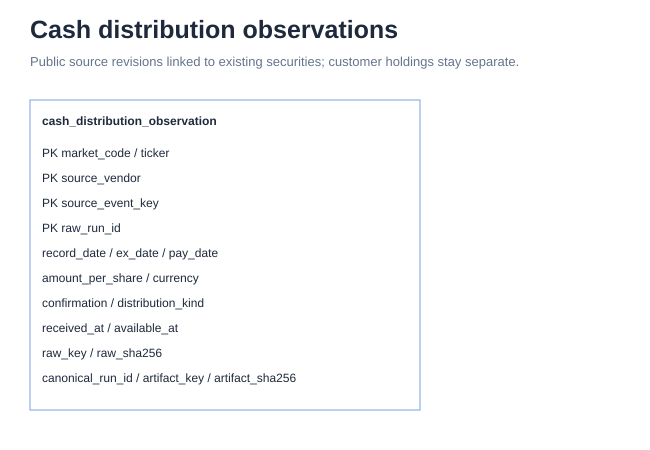

# Cash distributions

One source-event revision per market, ticker and raw collection run. Like other public source observations, ingestion does not require a pre-existing master. The ontology view resolves existing instrument IDs using the database-unique `(market_code, ticker)` pair; unmatched references remain null. No ID is fabricated. This is a view join, not a physical foreign key. Latest revision selection precedes publication filtering. Amounts are original-currency gross cash per share. Customer holdings and account receipts are not stored here.

`cash_distribution_coverage` records the requested interval and validation outcome per security, source and raw run, including valid empty responses. Its raw provenance identifies the immutable collection manifest. It is loaded in the same transaction as the observations through the existing companion-artifact contract. There is no physical FK: a successfully queried interval can contain no distribution event. `complete` means every requested response window validated, not that the vendor independently guarantees its entire history.

`observations_sha256` binds the event artifact to coverage even when it contains zero events. Replaying the same raw run with a different normalized event set is rejected through the companion digest check.
