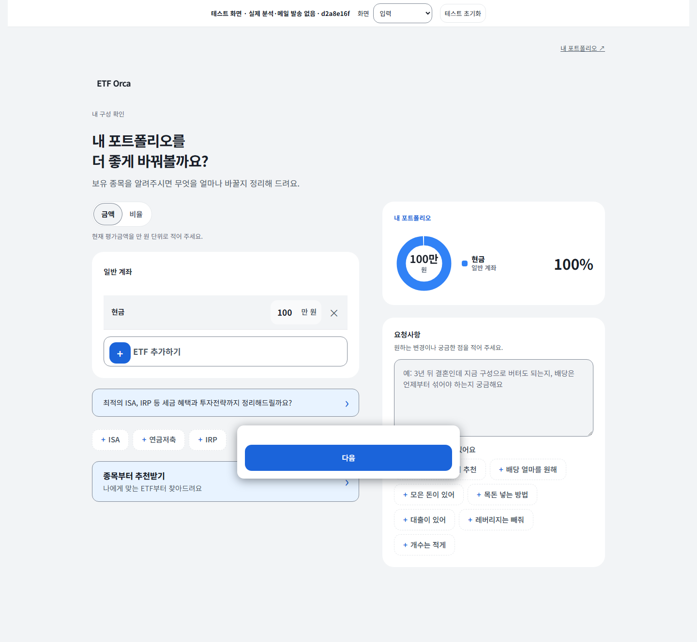
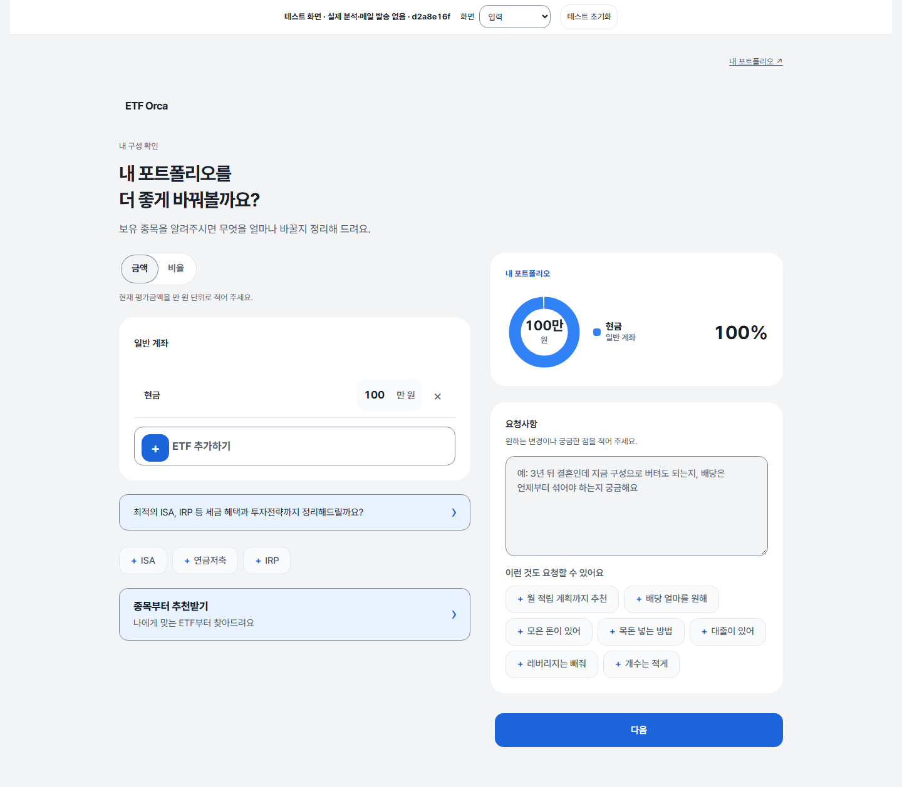
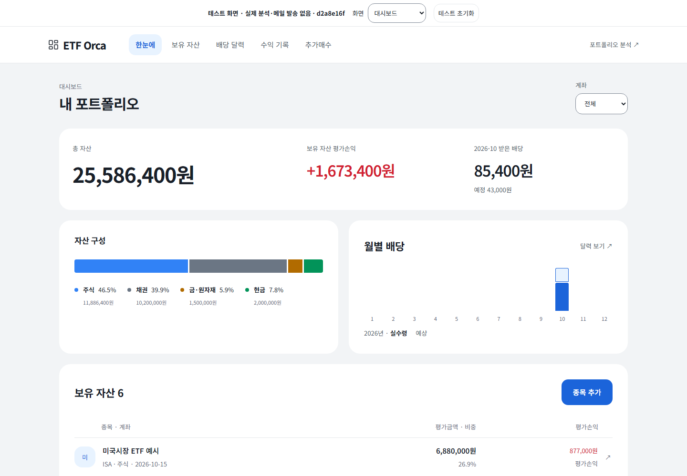
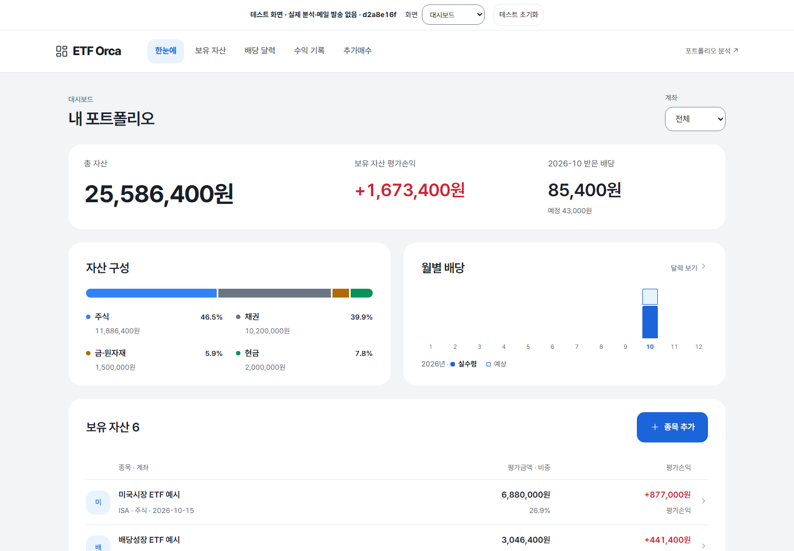

# 화면 전체를 조율해 포트폴리오의 완성도를 높인다

Orca 화면이 평범한 AI 결과물처럼 느껴지는 주된 이유는 파란색이나 둥근 카드가 아니라, **각 부분의 강조·간격·상태가 전체 목적에 맞게 조율되지 않았기 때문**이라는 것이 이번 연구의 판단이다. 기존 화면에는 이미 토스 계열 색상과 크기, 공유 컴포넌트, 접근성 기반이 있다. 필요한 작업은 새로운 디자인 시스템 도입보다 그 기반을 실제 한국어·금액·차트·입력 상태에 맞게 끝까지 적용하는 일이다. 입력 화면에서는 본문과 겹치는 CTA와 서로 다른 선택·추가 표현이, 대시보드에서는 카드 안의 빈 공간과 작은 금융 정보, 열 정렬과 차트 설명이 주요 개선 지점이다. 토스 방향은 유지하되 화면의 비례와 밀도까지 함께 다듬는 편이 적절하다. 아래 내용은 인간 디자이너의 실무 기록, 공식 컴포넌트 문서, 접근성 표준, 코드 조사와 제공된 두 화면을 종합했다. 인터넷의 모든 디자인 지식을 망라한 결과나 사용자 선호가 입증된 최종 디자인은 아니며, 현재 구현과 후속 검증을 위한 판단 근거다.

## AI 같은 인상은 특정 장식보다 판단의 부재에서 생긴다

디자이너이자 교육자인 Jarrett Fuller는 AI 디자인의 유사성을 비판하면서, 인간의 디자인도 같은 도구·맥락·패턴을 따르며 이미 표준화되어 왔다고 지적한다. 이 관점은 AI를 썼는지를 화면만 보고 판정하기보다, **이 제품의 내용 때문에 내린 구체적인 결정이 보이는가**를 묻게 한다. 그의 주장은 디자인 비평이며 모델의 생성 원리를 입증한 실험 결과는 아니다. ‘보라색이면 AI’, ‘카드가 많으면 AI’ 같은 판별 규칙으로 바꾸면 원래 논지를 잃는다. ([Jarrett Fuller, An essay about AI that isn’t really about AI](https://www.jarrettfuller.blog/2025/09/design-ai/))

이 제품에는 이미 자산 합계를 크게 보여 주는 결정이 있다. 그러나 합계와 함께 읽어야 할 구성 금액은 작은 범례로 밀리고, 보조 행동에도 큰 테두리와 채움이 반복된다. 각각은 작동하지만 전체 화면의 주연과 조연이 분명하지 않다. NN/g의 Kelley Gordon이 설명하는 시각적 위계는 크기뿐 아니라 색·간격·위치·대비를 함께 사용해 중요도에 맞는 읽기 순서를 만드는 것이다. 따라서 모든 여백을 늘리거나 모든 텍스트를 크게 만드는 방식으로는 이 문제를 해결하기 어렵다. ([5 Principles of Visual Design in UX](https://www.nngroup.com/articles/principles-visual-design/))

Linear 팀의 2026년 리프레시는 실제 제작 사례를 보여 준다. 기능 하나씩은 합리적이어도 누적된 컨트롤과 예외가 제품을 산만하게 만들 수 있다고 설명하며, 본문에 비해 과했던 탐색 영역·아이콘 배경·구분선의 강조를 줄였다. 중요한 점은 빈 화면을 만드는 것이 아니라 정보가 많은 상태에서 시선 경쟁을 줄였다는 것이다. Orca도 카드를 더 장식하기보다 합계, 현재 선택, 다음 행동에 강조를 배분하는 편이 낫다. ([Charlie Aufmann·Maxime Heckel, A calmer interface for a product in motion](https://linear.app/now/behind-the-latest-design-refresh))

아름다움은 기능 이후의 사치로 취급할 필요가 없다. Kate Moran은 매력적인 외형이 사용하기 쉽다는 인식과 작은 불편에 대한 관용에 영향을 준다고 정리한다. 동시에 심각한 사용성 문제는 미관으로 해결되지 않으며, 예쁘다는 평가가 실제 작업 실패를 가릴 수 있다고 설명한다. 따라서 이번 목표는 ‘테스트가 통과하는 화면’과 ‘계속 쓰고 싶은 화면’을 함께 만드는 것이고, 두 결과는 각각 확인해야 한다. ([The Aesthetic-Usability Effect](https://www.nngroup.com/articles/aesthetic-usability-effect/))

## 사람들의 지식은 다섯 역할로 나누어 적용한다

이번 조사에서는 디자인 비평, 시각 원칙, 실제 제품 제작 과정, 컴포넌트 계약, 웹 표준을 구분했다. 비평은 문제를 보는 관점을 제공하고, 원칙은 선택의 이유를 설명하며, 실제 사례는 작업 과정을 보여 준다. 컴포넌트 문서는 상태와 상호작용을 구체화하고, 표준은 주관적 취향으로 생략할 수 없는 조건을 정한다. 이 구분을 하면 유명 제품의 색과 크기를 무조건 복사하거나, 접근성 준수만으로 미적 완성도가 확보되었다고 생각하는 오류를 줄일 수 있다.

| 지식의 역할 | 직접 참고할 사람·자료 | Orca에서 가져올 것 |
|---|---|---|
| 디자인 비평 | [Jarrett Fuller](https://www.jarrettfuller.blog/2025/09/design-ai/), [Karri Saarinen의 Output isn’t design](https://linear.app/now/output-isn-t-design) | 빠르게 만들어진 그럴듯한 결과와 실제 맥락에 맞춘 디자인을 구분하는 질문 |
| 시각 원칙과 수정 기법 | [NN/g Kelley Gordon](https://www.nngroup.com/articles/principles-visual-design/), [Adam Wathan·Steve Schoger의 Refactoring UI](https://refactoringui.com/) | 강조 순서, 근접성, 테두리 대신 배경·간격으로 구분하는 선택 |
| 제품 제작 과정 | [Linear 2024 리디자인](https://linear.app/now/how-we-redesigned-the-linear-ui), [토스 박수현의 TDS 개선](https://toss.tech/article/toss-design-system) | 여러 실제 화면과 긴 내용·다양한 상태를 함께 검토하고 공통 부품으로 해결하는 과정 |
| 컴포넌트 계약 | [TDS ListRow](https://tossmini-docs.toss.im/tds-mobile/components/ListRow/list-row-overview/), [BottomCTA.Single](https://tossmini-docs.toss.im/tds-mobile/components/BottomCTA/Single/), [Radix Dialog](https://www.radix-ui.com/primitives/docs/components/dialog) | 정보 영역, 고정 버튼 공간, 제목·초점·닫기·복귀의 구체적인 동작 |
| 표현과 접근성의 조건 | [CSS Fonts](https://www.w3.org/TR/css-fonts-3/#font-matching-algorithm), [W3C Status Messages](https://www.w3.org/WAI/WCAG22/Understanding/status-messages.html), [Text Spacing](https://www.w3.org/WAI/WCAG22/Understanding/text-spacing.html) | 실제 폰트 매칭, 보조기술에 전달되는 상태, 글자 간격 변경에도 유지되는 내용 |

토스의 박수현은 컴포넌트 개선을 실제 사례의 패턴화, 심미성, 접근성으로 연결했다. 긴 라벨과 메뉴 길이부터 팝업의 가벼운 인상, 등장·퇴장, 큰 글자와 화면 읽기까지 함께 다뤘다. 여기서 배울 것은 특정 그림자 값보다 **좋은 기본 상태를 만든 뒤 예외를 방치하지 않는 방식**이다. Linear의 2024 작업도 여러 화면과 흐름을 만들어 환경·외형·위계를 검토했으며, 탐색 구조 변경은 범위를 크게 늘려 별도로 분리했다. 두 사례 모두 모든 것을 바꾸는 것이 완성도의 조건이라고 주장하지 않는다. ([토스 TDS 개선](https://toss.tech/article/toss-design-system), [Linear UI redesign](https://linear.app/now/how-we-redesigned-the-linear-ui))

기존 [Orca UI 1.0](../docs/design/portfolio-design-system.md)은 이 방향과 충돌하지 않는다. 이미 토큰과 공유 조작부, 입력의 읽기 순서, PC 두 열과 모바일 하단 행동, 긴 내용·실패 상태, 확대·초점·모션 검증을 규정한다. 이번 연구는 그 기준을 폐기하는 제안이 아니다. 기준서의 의도가 실제 화면에서 얼마나 구현되었는지 확인하고, 부족한 시각 판단과 검수 항목을 보강하는 작업이다.

## 현재 화면은 공간 관계와 금융 정보의 연결부터 고친다

다음 표의 ‘관찰’은 제공된 이미지 또는 조사 시점의 코드에서 확인한 사실이다. ‘해석·방향’은 연구자의 판단이다. 예를 들어 요소가 겹친다는 것은 관찰할 수 있지만, 카드 반경이 어느 정도여야 더 아름다운지는 취향과 맥락을 포함한다. 이미지 출처는 [입력 화면](C:/Users/user/Documents/detail-before-input.png)과 [대시보드](C:/Users/user/Documents/detail-before-dashboard.png)다. 상단 테스트 도구는 제품 본체와 구분해 평가한다.

| 순서 | 관찰 | 원인 해석과 해결 방향 |
|---|---|---|
| 1 | 입력 화면의 큰 그림자 CTA가 요청사항·칩 일부와 겹친다. | 화면 하단 고정 패턴을 PC 작업 공간에 그대로 적용한 결과로 보인다. PC는 본문을 가리지 않는 흐름에 배치하고 모바일은 실제 CTA 높이와 안전 영역을 확보한다. 캡처만으로 모든 스크롤 상태의 문제를 확정하지 않는다. |
| 2 | 금액/비율, ETF 추가, 계좌 추가, 추천 안내가 각각 다른 테두리·채움·아이콘 문법을 쓴다. | 같은 역할의 컴포넌트를 조율하기보다 개별 기능을 추가한 흔적이다. 선택·보조 추가·이동·주요 실행의 표현을 나누고 같은 역할끼리 통일한다. |
| 3 | 구성·배당 카드가 큰 면적을 차지하지만 구성 금액은 작고, 배당은 한 달 막대만 보인다. | 카드 대칭이 정보량보다 앞선 구성이다. 범례를 비교 가능한 행으로 만들고 선택 월 금액과 실제/예정 표식을 차트에 연결한다. 없는 데이터를 장식용으로 채우지 않는다. |
| 4 | 보유자산 열 제목과 실제 행이 다른 grid·여백 산술을 쓴다. 금액에도 긴 문자열용 줄바꿈이 적용된다. | 이미 있는 우측 정렬만으로는 제목과 값의 축이 일치하지 않는다. 동일 축을 맞추고 종목명과 금액의 줄바꿈 정책을 분리한다. |
| 5 | CSS의 첫 폰트는 Pretendard지만 조사 시점 HTML은 다른 웹폰트를 요청하고 있었다. | 선언과 전달의 차이는 기기별 폭·굵기 차이의 후보 원인이다. 실제 렌더링과 파일 응답을 확인하고 전달 경로를 일치시킨다. 내부 이름에 Thin이 보였다는 사실만으로 굵기 결함을 단정하지 않는다. |
| 6 | 종목 추가도 수정과 같은 제목을 쓰고, 선택 10개 이후 칩 반응이 없으며, 일부 대기·저장 상태가 불분명하다. | 시각 마감은 문구와 행동 결과까지 포함한다. 새 상태 관리 체계보다 기존 Button·Notice와 가까운 안내를 재사용한다. |

코드 조사상 `tabular-nums`, 수치 우측 정렬, 주요 44px 이상 버튼, focus-visible, reduced-motion 대응은 이미 존재한다. 이를 새로 도입해야 할 해결책으로 제시하면 원인을 잘못 짚는다. 반대로 CSS에 규칙이 있다는 사실만으로 모든 상태에서 작동한다고 보장할 수도 없다. 조사 근거와 세부 위치는 [타이포그래피 노트](../research_notes/포트폴리오%20UI%20디테일%20개선/typography.md)와 [상호작용 노트](../research_notes/포트폴리오%20UI%20디테일%20개선/interaction.md)에 남겼다.

금액/비율 전환 때 입력값을 초기화하는 동작은 별도로 취급해야 한다. 이것은 버튼 모양의 문제가 아니라 데이터 보존과 사용자 기대의 문제다. 값이 있을 때 결과를 알려 주는 기존 확인 패턴 또는 입력 보존 정책을 검토하되, 디자인 개선을 이유로 임의의 금액↔비율 자동 변환을 추가해서는 안 된다. 발견한 이슈를 시각 작업 속에 숨기거나 해결했다고 표시하지 않는 것이 필요하다.

## 좋은 컴포넌트는 외형과 상태를 함께 가져온다

추천하는 전체 방향은 **밝은 바탕, 차분한 정보, 선명한 주요 행동, 읽기 좋은 금융 숫자**다. 토스의 한국어 친화성과 현재 파란 행동색을 유지하고, Linear에서는 보조 UI의 절제와 반복되는 정렬축을 참고한다. Carbon은 행 밀도를 비교하는 자료로 사용하되 업무용 표의 크기를 그대로 복제하지 않는다. 금융 상승·하락 색은 기존 Orca 규칙을 보존하고 부호·문구를 함께 사용한다. 아래는 레퍼런스의 구체적인 읽을 부분과 제품 적용안을 연결한 것이다.

| 대상 | 레퍼런스와 가져올 디테일 | Orca 적용 및 확인 조건 |
|---|---|---|
| 제목·본문·숫자 | [TDS Typography](https://tossmini-docs.toss.im/tds-mobile/foundation/typography/): 크기와 행간의 역할별 조합 | 기존 36/30/22/17/15/13 계층을 기반으로 같은 역할의 굵기·행간을 맞춘다. 긴 한글 제목과 큰 음수 금액에서 확인한다. |
| 자산 행 | [TDS ListRow](https://tossmini-docs.toss.im/tds-mobile/components/ListRow/list-row-overview/), [Carbon Data table](https://www.carbondesignsystem.com/building-blocks/core/components/data-table/guidelines): 정보 영역과 콘텐츠에 맞는 행 밀도 | 심볼→이름·계좌→금액·비중의 축을 통일한다. 긴 이름에도 숫자 열을 보존하고, 행 전체가 눌릴 때는 배경 반응을 우선 검토한다. |
| 금액/비율 선택 | [TDS SegmentedControl](https://tossmini-docs.toss.im/tds-react-native/components/segmented-control/): 상호 배타적 선택 | 하나의 선택 위치를 분명히 표현한다. 요청사항의 다중 선택 칩과 의미를 구분한다. React Native 예제의 웹 복사를 뜻하지 않는다. |
| 다음 행동 | [TDS BottomCTA.Single](https://tossmini-docs.toss.im/tds-mobile/components/BottomCTA/Single/): 공간 점유·safe area·키보드 조건 | PC에서는 겹침 없이 배치하고, 모바일에서는 최종 입력과 오류가 버튼 뒤에 숨지 않는지 확인한다. |
| 저장·수정 팝업 | [Radix Dialog](https://www.radix-ui.com/primitives/docs/components/dialog): 제목·설명·초점·Escape·복귀 | 기존 native dialog를 유지한다. 제목, 첫 필드, 저장의 정렬을 맞추고 삭제의 강조를 낮춘다. 저장 실패 시 내용과 초점을 보존한다. |
| 자세한 근거 | [Radix Accordion](https://www.radix-ui.com/primitives/docs/components/accordion), [NN/g Progressive Disclosure](https://www.nngroup.com/articles/progressive-disclosure/) | 기존 details를 다듬고 ‘계산 기준·가정 보기’처럼 내용을 예고한다. 핵심 추천·금액·중요 한계는 접지 않는다. |
| 문구·상태 | [토스 라이팅 원칙](https://toss.tech/article/8-writing-principles-of-toss), [오류 문구](https://toss.tech/article/how-to-write-error-message) | ‘다음’은 행동명으로 유지하고 부족 조건을 가까이 설명한다. 추가와 수정 제목을 구별하고, 무응답처럼 보이는 선택 제한과 저장 중 상태를 명시한다. |

폰트는 ‘토스 느낌이 나는 이름’보다 같은 파일과 굵기가 사용자에게 전달되는지가 중요하다. 현재 구현 담당자는 Pretendard 1.3.9 variable을 라이선스와 함께 자체 제공하는 방향을 적용 중이라고 보고했다. 공식 프로젝트는 가변 폰트와 SIL OFL 라이선스를 제공한다. 전체 파일 방식은 전달 경로가 단순한 대신 초기 용량 비용이 있으므로 첫 로드에서 평가해야 한다. 이는 이전 글꼴이 잘못 렌더링되었다는 확정 증거가 아니라 일관된 전달을 위한 선택이다. ([Pretendard 공식 README](https://github.com/orioncactus/pretendard), [v1.3.9 라이선스](https://raw.githubusercontent.com/orioncactus/pretendard/v1.3.9/LICENSE))

작성 시점의 구현 공유에는 그림자에 overlay 색을 재사용하던 부분 조정, 금융 열 정렬, 두 열 구성 범례와 16px 막대, 22px 섹션 제목, 선택 월 배당과 실제/예정 표식, 폭에 대응하는 차트와 최대 높이 300px, 입력 안내·선택 제한·추가 제목·로딩 상태 개선이 포함된다. PC CTA, 선택·추가 조작부, 팝업 마감은 계속 작업 중이다. 이 수치는 Orca에 대한 구현 선택이며 외부 표준이 아니다. **이 보고서는 변경의 테스트 통과·배포 완료·사용자 선호 향상을 주장하지 않는다.**

## 기능 검사 뒤에 같은 화면을 비교하는 검수가 필요하다

‘오류가 없다’와 ‘가로로 넘치지 않는다’는 유용한 검사지만 충분한 미적 평가가 아니다. CTA는 화면 안에 있으면서 본문을 가릴 수 있고, 숫자는 표시되면서 열 제목과 어긋날 수 있다. 차트는 정상 렌더링되어도 텍스트가 과하게 커지거나 실제/예정 의미가 연결되지 않을 수 있다. 이전 검사가 이런 조건만 확인했다면 이번 문제가 남은 이유를 설명할 수 있다. 다만 조사자가 이전 전체 실행 기록을 감사한 것은 아니므로, 특정 테스트가 수행되지 않았다고 단정하지 않는다.

개선 과정은 화면의 목적을 먼저 한 문장으로 정하는 데서 시작한다. 입력은 보유 내용을 정확히 작성하고 다음 단계로 이동하는 화면이며, 대시보드는 합계·손익·배당·보유 목록을 순서대로 확인하는 화면이다. 같은 데이터와 같은 뷰포트의 전후 이미지를 나란히 놓고 공간 관계를 먼저 고친 뒤, 타입·열 정렬·경계·상태를 다듬는다. 각 변경은 실제 입력과 결과를 따라 확인하고, 새로운 장식을 추가하기 전에 해당 변경이 읽기 순서 또는 조작 결과를 어떻게 개선하는지 설명할 수 있어야 한다.

| 검수 단계 | 구체적 확인 | 합격 판단의 성격 |
|---|---|---|
| 구조 | 390px와 1440px에서 제목→입력/정보→다음 행동이 이어지고 CTA가 마지막 필드·오류·칩을 가리지 않는가 | 겹침·잘림은 측정, 읽기 순서는 디자인 판단 |
| 타이포·금액 | 실제 로드 폰트와 굵기, 긴 ETF명, 123,456,789원, 음수, 소수 비중, 미확정 기호를 확인하는가 | 로드·보존·축 일치는 측정, 리듬은 비교 판단 |
| 차트 | 선택 날짜/월과 금액이 대응하고 실제/예정 표식이 일치하는가. 크기 변경 뒤 포인터 선택도 맞는가 | 데이터·좌표 검증과 시각 검수 병행 |
| 상태 | 빈 결과·로딩·실패·10개 선택·저장 완료에서 다음 행동을 알 수 있는가 | 상태 존재와 입력 보존은 검증, 문구 이해는 사용자 확인 |
| 접근성 | 키보드 검색·선택·닫기·초점 복귀, 200% 확대, 글자 간격 변경, 모션 감소에서 내용과 기능이 유지되는가 | 실제 동작으로 확인하며 CSS 선언만으로 통과 판정하지 않음 |
| 선호 | 짧게 본 뒤 주요 금액과 다음 행동을 찾는가. 작업 후 다시 쓰고 싶은 이유를 설명하는가 | 수행 결과와 미적 선호를 분리해 기록 |

터치 영역은 Orca가 정한 44px 목표를 유지한다. 이를 WCAG AA의 일률적인 의무로 잘못 설명하지 않는다. WCAG 2.5.8의 최소 기준은 원칙적으로 24×24 CSS px이며 간격 등에 예외가 있다. 글자 간격 기준 역시 기본 화면에 특정 행간을 강제하는 것이 아니라 사용자가 간격을 바꿔도 기능과 내용이 사라지지 않도록 요구한다. 이런 구분이 있어야 취향과 표준을 혼동하지 않고 검수할 수 있다. ([W3C Target Size Minimum](https://www.w3.org/WAI/WCAG22/Understanding/target-size-minimum.html), [W3C Text Spacing](https://www.w3.org/WAI/WCAG22/Understanding/text-spacing.html))

## 완성도는 반복할 수 있는 판단에서 축적된다

Orca의 고유함은 새로운 효과의 개수보다 긴 한국어 종목명과 금융 숫자가 안정적으로 읽히고, 입력과 저장이 예측대로 이어지는 경험에서 만들 수 있다. 이후 기능이 늘어날 때도 기존 버튼을 썼는지만 확인하지 말고, 그 버튼이 실제 화면에서 어느 정도의 시선을 요구하는지 함께 검토해야 한다. 토큰은 값을 통일하고, 화면 비교는 그 값들의 관계를 검증한다.

이번 조사는 선택한 인간 원문과 공식 자료, 코드의 정적 관찰, 두 화면 캡처를 바탕으로 했다. 실제 사용자 실험·로그인 레퍼런스 제품의 직접 조작·모든 기기의 렌더링은 확인하지 않았으며, 조사 과정에서 코드나 테스트를 실행·변경하지 않았다. 진행 중 구현의 최종 상태와 운영 배포는 별도 검증 결과로 확인해야 한다. 특히 입력 모드 변경의 데이터 초기화와 모바일 키보드·CTA 관계는 시각 개선에 묻히지 않도록 남은 판단 항목으로 유지한다.

## 동일 데이터의 전후 화면

2026-10-18 로컬 미리보기, 데스크톱 1440px. 실제 고객 자료가 아닌 같은 테스트 포트폴리오를 사용했다. 입력 화면은 전체 길이를, 대시보드는 같은 1000px 높이를 비교한다. 색상만 바꾸기보다 글꼴·금융 정보의 밀도·정렬·본문을 덮던 버튼을 함께 조정한 결과다.

| 입력 전 | 입력 후 |
|---|---|
|  |  |

| 대시보드 전 | 대시보드 후 |
|---|---|
|  |  |

## 구현과 검증 기록

다음은 연구 후 실제 코드를 수정한 과정이다. 조사자의 관찰과 구현자의 실행 기록을 구분한다.

| 문제 단위 | 확인한 원인 | 적용한 변경 | 확인 방법 |
|---|---|---|---|
| 글꼴과 금액의 일관성 | 토큰의 우선 글꼴과 HTML이 요청하는 글꼴이 다르고 관리자에는 같은 전달 경로가 없었음 | 자체 제공 Pretendard Variable, 불필요한 Google Fonts 요청 제거, 숫자 등폭 유지 | 외부 폰트 요청 0, FontFace 로드, 고객·관리자 빌드 |
| PC에서 떠 있는 버튼 | 모바일 고정 CTA를 넓은 두 열 화면에도 유지 | PC에서는 입력 다음 흐름, 모바일은 실제 높이만큼 하단 여유 | 동일 프레임 위치 비교, 마지막 필드·200% 확대 |
| 데이터 열과 카드 제목 어긋남 | 열 제목의 3열+패딩과 실제 자산 행의 5열이 다른 계산을 사용 | 같은 열 구조, 카드 제목 영역 높이 통일 | 좌우 기준선 1px 이내 비교 |
| 카드가 넓은데 금융 정보는 작음 | 한 줄 구성 범례와 큰 막대, 섹션별 다른 제목 크기 | 16px 구성 막대, 두 열 범례, 금액 13px, 제목 22px, 카드 간격 정리 | 같은 1440px 화면 전후 비교 |
| 실제·예정·선택 월이 흐림 | 범례가 텍스트만 제공하고 월 선택 상태가 없었음 | 채움/윤곽 표식, aria-pressed 선택 월 | 월 변경 후 달력·선택 표시 일치 |
| PC 성과 차트의 과대 확대 | 320×180 viewBox가 넓은 PC에서 전체 배율로 확대 | 실측 폭·최대 300px 높이·동일 좌표 포인터 계산, 날짜 사이 공간에 따른 1~3개 표기 | 리사이즈 전후 첫/마지막 날짜 선택, 축 경계 |
| 과한 그림자·불안정한 목록 반응 | overlay의 50% 어둠을 그림자에 사용, 행 전체에도 버튼 축소 효과 | shadow 토큰으로 수정, 자산 행은 배경 반응 | CSS 계산값·전후 화면·reduced-motion |
| 상태와 문구 불일치 | 공통 미입력 문구, 10개 초과 무반응, 추가에도 수정 제목 | 단계별 안내, 선택 한도 해제 안내, 추가/수정 구별, 저장 상태 | 합계 100%+빈 종목, 10→9개, 추가→저장→수정 |

첫 UI 실행은 216건 중 210건 통과, 6건 실패였다. PC 고정 CTA를 전제로 한 이전 검사를 현재 의도로 고쳤고, 폰트 교체 중 서로 다른 프레임의 높이를 비교하던 검사는 폰트 준비 후 같은 프레임에서 비교하도록 수정했다. 브라우저 시작/종료 및 페이지 시간 초과는 제품 실패와 섞어 숨기지 않고 재실행 결과를 확인한다. 로컬 리뷰에서 발견한 ‘합계가 100%여도 빈 종목이 있으면 합계를 고치라고 안내’하는 오류는 입력 누락을 먼저 구별하도록 수정했다.

2차 전체 UI 검사 216건이 모두 통과했다(건너뛴 검사 없음). 320·768·1440px × 10개 상태의 로컬 미리보기 30개 조합에서 가로 넘침·JavaScript 오류·고객 API/분석/메일/PostHog 호출이 없었고 저장 후 새로고침을 확인했다. 마지막 리뷰의 240px 차트 날짜 겹침도 실제 글자 경계로 재현하여 1~3개 날짜로 조정하고 관련 검사 110건을 다시 실행해 모두 통과했다(건너뛴 검사 없음). 최종 로컬 Codex 독립 리뷰 2회는 지적 0건으로 종료했고 고객·관리자 빌드도 통과했다. 최종 빌드·관련 재검사·배포 결과는 PR의 검증 기록과 운영 버전 확인 결과로 확정한다. 실제 고객의 만족도·재방문 의향 향상은 이 코드 검사만으로 입증하지 않는다.
