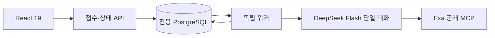

# 독립 포트폴리오 분석 워커

추적: [ALPHA-1266](https://alphaeveryday.atlassian.net/browse/ALPHA-1266)

## 목적과 경계

사용자의 보유 ETF·평가금액·투자 기간·질문에서 한국어 포트폴리오 보고서를 만든다.
React UI와 접수 API, 실행 워커, 전용 PostgreSQL은 별도 배포 단위다.
기존 analysis-engine-v2, ontology, etf-research-agent 모듈을 import하지 않는다.
AWS 전망은 목적을 명시한 ETF 단건 조회 도구로만 연결한다.

## 적용한 공식 사례와 선택 이유

- [Anthropic: Building effective agents](https://www.anthropic.com/engineering/building-effective-agents): 고정된 하위 작업은 prompt chaining과 단계별 코드 검증으로 처리한다. 네 역할은 독립 에이전트가 아니라 같은 대화의 순차 단계다. 서브에이전트·자유 라우팅·토론은 추가하지 않는다.
- [AWS: Asynchronous communication](https://docs.aws.amazon.com/prescriptive-guidance/latest/modernization-integrating-microservices/asynchronous.html): 접수 응답과 실제 실행을 분리하고 작업 ID로 상태를 조회한다. UI는 실패 시 조회 간격을 늘리고 새로고침 뒤 작업 ID를 복원한다.
- [PostgreSQL SELECT / SKIP LOCKED](https://www.postgresql.org/docs/current/sql-select.html): 큐의 원자적 claim을 위해 트랜잭션과 `FOR UPDATE SKIP LOCKED`를 사용한다. 기존 DB 의존 없이 전용 저장소 하나로 작업·결과를 관리한다. 초기 규모에 SQS와 별도 상태 저장소를 동시에 추가하지 않는다.
- [DeepSeek strict 도구 호출](https://api-docs.deepseek.com/guides/tool_calls/): `deepseek-flash`의 beta 엔드포인트를 사용한다. 각 역할의 결과는 `strict: true`인 `submit_report`로 제출한다. 일반 조사·판단은 auto 도구 선택으로 thinking을 유지한다. 종료 또는 출력 복구에서 submit_report를 강제할 때만 공급자 제약에 따라 thinking을 비활성화한다. 필수 후보 계산·최소 출처·요청 계산이 끝나기 전에는 보고 제출 도구를 제공하지 않는다. 공급자가 일반 JSON으로 답해도 유효한 JSON 객체라면 기존 스키마·업무 검증으로 넘기고 진단에 기록한다. 전송 형식·JSON 문법·응답 잘림 오류의 복구는 역할별 최대 두 번이며 업무 검증 수정 횟수와 분리한다. 자료 조사 도구도 모두 strict 스키마를 적용한다. 선택 인자는 null을 허용하는 필수 키로 전송하고 호출 실행 전에 생략값으로 복원해 기존 의미를 유지한다.
- [Exa 공식 MCP](https://github.com/exa-labs/exa-mcp-server#authentication): endpoint `https://mcp.exa.ai/mcp`의 `web_search_exa`, `web_fetch_exa`만 사용한다. `EXA_API_KEY`를 해당 HTTPS 원본의 `x-api-key` 헤더로 전달한다. 운영 키는 Secrets Manager `edge/portfolio/runtime`에서 워커에만 주입하며 URL·모델 입력에 넣지 않는다. 인증 후에도 공급자 요금제의 호출 제한은 적용된다.

## 단일 에이전트의 실행 계약

| 역할 | 판단 | 본문 글자 수 |
|---|---|---|
| question | 사용자가 내릴 결정과 조건 해석 | 90~650 |
| portfolio | 구성·집중·중복·투자 기간 진단 | 90~650 |
| outlook | 공식 자료·반대 근거·조건부 전망 | 90~650 |
| opinion | 투자 의견·추천 구성·평가·자유 분석 최종 확정 | 각 Section 90~650 |

공백·문장부호를 포함한 paragraphs의 Unicode 코드포인트 합계로 계산한다.
각 칸은 기본 3개·최대 5개 불릿이며 한 불릿은 최대 180자다. 한 문장 권장은 작성 지침으로 유지하되 문장 개수만으로 유효한 분석을 거절하지 않는다. 근거와 한계는 본문 분량에 포함하지 않는다. 한계는 항목당 100자 이하, 최대 3개다.
최종 역할은 네 칸과 현재 평가·추천 구성·추천 평가·자유 분석 1~3개 구역을 반환한다. 뒤에서 확인한 사실을 앞 칸에 미확인으로 남기는 모순을 줄인다.
선택 계좌와 정확히 일치하는 계좌 제약의 출처는 코드가 입력값으로 정규화한다. 모델의 인용 형식 때문에 이미 확인된 선택을 거절하지 않으며, 선택과 다른 계좌 제한에는 별도 고객 원문이 필요하다. 질문을 잘못 복사하거나 일부를 빠뜨리면 코드가 현재 질문 전체를 복원하고 이후 역할에 정규화한 결정을 전달한다. 유효한 질문별 분리는 유지한다.

입력 화면의 정해진 관심 선택(균형 잡힌 분산·성장·배당·테마 등)은 목적별 후보 평가에 사용한다. 선택 항목만 인용한 필수 제약은 제거하며, 같은 표현을 질문·메모·배당 목표·납입 조건에 직접 쓴 경우에는 고객 조건을 임의로 삭제하지 않는다. 보완 질문에서도 저장된 잘못된 관심 제약을 다시 적용하지 않는다.
고객 화면은 추천이 있으면 일부 질문·자료가 미완료여도 최종 결론을 먼저 보여 준다. 없는 예상 수익률·배당률 숫자는 숨기고 실제 0은 표시한다. 추천이 없는 이유는 확인된 입력·제약·서비스 기준·가격 자료 실패에 맞게 설명하며, 입력용 내부 코드는 고객이 알아볼 수 있는 항목명으로 바꾸거나 숨긴다. 자연어로 작성한 고객 질문은 코드로 오인해 지우지 않는다.
새 분석 접수에는 보유 금액 또는 합계 100%인 비중, 투자 기간, 투자금 투입 방법을 요구한다. 월 적립을 선택하면 양수 월 납입액을 입력해야 한다. 종목만 입력하는 신규 분석은 받지 않는다. 투자 목적은 선택 입력이며 비어 있어도 접수한다. 코드가 선호를 대신 채우지 않으며 LLM이 보유·기간·질문으로 기본안을 판단한다. 추가 질문·자유 요청·세금 프로필은 선택 입력이며, 보유 종목이 없는 신규 설계는 가상 현금 기준으로 비중을 추천할 수 있다. 초안과 과거 입력 형식은 유지하며 API도 접수 전에 같은 필수 조건을 검사한다.
공통 프롬프트에 `prompts/account-tax/SKILL.md`를 포함하고 버전 해시에 반영한다. ISA·연금저축·IRP와 DC/DB의 운용 주체·가입·공제·상품 제약은 시행 법령과 공식 자료로 확인한다. 빈 세금 프로필은 전체 추천의 보류 사유가 아니며, 합리적인 기본안과 명료한 결론을 먼저 내고 상세 가정·조건별 차이는 `계좌별 절세 전략`에 모은다. 미확인 자격·남은 한도를 확정하거나 지원하지 않는 개인별 환급액을 만들어 계산하지 않는다.
계좌 활용 순서 요청에는 현재 정보로 전략의 우선순위를 정하고 실제 가입·납입 가능 여부 확인과 구분한다. 공식 세금 근거를 확보하지 못하면 해당 수치·자격 판정만 생략하며, 고객 목적에 따른 실행 준비 순서까지 보류하지 않는다. 최종 의견 역할에도 같은 구분을 적용한다.
글자 제한과 스키마 위반은 한 차례 수정 기회를 주며 해결되지 않으면 실패 처리한다. 잘라서 게시하지 않는다.

자료를 검색한 뒤 본문을 읽어 출처 ID와 문장 ID를 등록한다. 모델은 ID를 선택하고 서버가 원문을 복사한다.
상품 페이지의 공식 문서 링크도 직접 읽을 수 있고 후속 질문에서는 저장된 링크를 복원한다. 같은 검색은 캐시하며 기본 인자 생략 여부가 같으면 동일한 조회로 취급한다. 본문이 빈 경로는 반복하지 않고 일시 오류는 한 번만 재시도한 뒤 다른 경로로 이동한다. 실제 원격 호출·실패 이력을 결과에 남긴다. 검색 결과와 연결된 공시·팩트시트 경로를 조사 대상으로 관리하되 일반 탐색 메뉴 전체를 필수 조사로 만들지 않는다. 외부 조회 실패는 가능한 분석을 유지하는 부분 결과로 처리하며 모든 자료가 확보됐다고 표시하지 않는다.
실제 연동 중 모델이 표의 구분자를 바꾸는 문제가 확인되어, 모델에 원문 복사를 맡기는 초기안을 폐기했다.
문장 ID 존재 검증은 의미의 정확성 보증이 아니다. 주장과 근거의 연결은 마지막 역할과 샘플 검수로 평가한다.

## 운영 한계와 실패 처리

- 리밸런싱은 `calculate_rebalance`와 최종 발행에서 같은 코드로 계산한다. LLM이 고객의 일시/월 납입금과 조건을 구조화하고 코드는 원 단위 금액·합계를 검산한다. 목표 총액은 기존 평가금액과 추가 납입금의 합이고 원 단위 배분 합계를 보존한다. 매도 금지는 실제 금액으로 검사해 납입에 따른 비중 희석을 허용한다. 0% 목표로 기존 종목을 없애는 것은 매도 없이 불가능하다.
- 종목·계좌별 매수·매도, 기존 현금 사용과 추가 현금 투입은 “내 포트폴리오에서 바꿀 것” 한 곳에 표시한다. 별도 매수·매도 계획은 중복 출력하지 않으며 행동 목록에 없는 실행 종목도 포함한다. 매수는 빨강, 매도는 파랑이며 현금 투입·확보와 보유 유지는 구분한다. 거래 금액은 실행 행이나 저장된 행동의 계산된 거래 금액을 우선 쓰고, 금액이 없으면 기존 비중→목표 비중을 표시한다. 추가 납입으로 비중은 줄어도 매수할 수 있으므로 비중 증감으로 거래 방향을 추정하지 않는다. 계좌 개설·납입 여력·인출 조건이 미확인이면 실행 금액을 숨기고, 알려진 납입 한도 초과는 실행 불가다. 여러 달에 걸친 조건부 계획은 총 거래 금액임을 표시한다. 월 납입 계산은 가격·환율·분배금 고정 조건이며 미래 시점의 한도는 확인이 필요하다. 수수료·세금·주 단위 주문 반올림은 포함하지 않는다.
- 후보 탐색은 고객 제약을 비중 벡터마다 검사한 후 초과수익률, 오버퍼폼 기간 비율 순으로 조합별 최선을 고른다. 두 지표는 반환값과 같은 소수점 여섯 자리로 비교해 부동소수점 오차가 동점 해소를 뒤집지 않게 한다. 두 지표가 같을 때만 고객의 소득(확인된 12개월 분배율), 유지(현재 구성 보존), 단순성(종목 수) 목적과 기존 40/40/20 점수를 보조 기준으로 쓴다. MDD는 진단 수치이며 순위·동점 해소·LLM 선택 기준에 쓰지 않는다. 미확인 분배율은 0으로 보지 않는다. 계좌 배치 전에는 계좌별 상세 실행을 보장하지 않으며 최종 발행에서 다시 검사한다.
- 서로 다른 조합으로 재탐색할 수 있으며 모든 누적 후보는 같은 공통 기간으로 재계산된다. 최신 revision과 정확히 일치하는 비중만 발행한다. 같은 정상 배치는 캐시하고 자료 실패 배치는 최대 1회 재시도한다. 메모리 보호를 위해 4개 배치·40개 ETF를 넘지 않으며 제한과 실제 검색 범위를 명시한다. 검색 결과 없음은 전체 해 공간의 불가능 증명이 아니다.
- `search_progress`는 가격 수집 실패 여부와 관계없이 고유 조합·고유 ETF 수와 남은 배치를 기록한다. 추천이 없고 대안을 찾을 수 있으면 실패 원인에 맞게 새 노출·계좌·비중을 검토한다. 고유 조합 개수는 탐색 기록이며 추천을 막는 최소 개수 조건은 아니다. 전체 시간·호출·배치 한도는 유지한다.
- 실행 성공과 고객 과제 완료는 다르다. `completion`은 질문별 답변·미확인 입력·추천 상품의 자료 항목과 기준일·실행표를 검사해 complete/partial/needs_input/no_match를 구분한다. 형식 수정과 별도로 최대 2회 질문 답변·자료 보완·대안 탐색으로 돌아가며 해당 실행 전체의 600초 제한과 100회 모델 호출 한도를 공유한다. 실패·제한 종료 시 부분 체크포인트는 유지한다. 과거 로그의 누락된 도구 원문까지 복원하는 기능은 아니다.
- 보완 실행 여부는 전체 입력 대기 상태가 아니라 조사 가능한 미완료 질문·근거·대안 탐색 사유로 판단한다. 고객 답변이 필요한 질문과 보유 비중 입력만 기다리는 비교는 재조사 과제에서 제외하고, 그 밖의 조사는 계속한다. 보완 메시지는 남은 조사 과제만 전달하며 기존에 확인한 답과 추천을 유지하도록 지시한다.
- 같은 후보 탐색 결과에서 검증된 추천을 확보한 뒤 부가 자료·선택 입력 부족으로만 추천을 거둬들이면 한 차례 본문 재작성을 요청한다. 재작성을 거부하거나 호출 여유가 없으면 검증된 추천·본문을 유지하고 최신 질문 답변·자료 확보 상태를 보존하며 본문 재사용을 부분 완료 사유로 남긴다. 이 표시만으로 재조사를 시작하지 않는다. 고객 입력 대기는 부분 완료로 덮어쓰지 않으며 후보 변경·필수 제약 실패는 이전 추천으로 무시하지 않는다. 최종 의견 단계의 마지막 3회 호출은 추가 도구 대신 확보한 자료로 최종 JSON 작성·수정에 사용한다. 미확인 부가 수치는 비워 두고 제약·근거·실행 검사는 그대로 적용한다.
- 앞 역할부터 후속 역할의 작성·수정 호출을 예약한다. 마지막 작성 단계에서도 미실행 후보 비교·최소 출처 확보·요청한 시나리오 계산에 필요한 도구는 남기되 부가 조사는 종료한다. 마지막 단계에서 검증된 결과를 작성하면 추가 보완 조사를 시작하지 않는다. 이전 보완 과정에서 호출·대화 용량 한도에 도달해도 같은 후보 검증 결과의 추천이 있으면 저장한 부분 결과를 반환하고 `MODEL_CALL_BUDGET_WITH_REPORT`·`MODEL_CONTEXT_BUDGET_WITH_REPORT`로 실제 종료 사유를 기록한다. 재작성 초안에서 새로 확인한 질문·자료 상태는 계약 검증을 거쳐 보존하고, 그사이 완료한 계산 결과도 반영한다. 초안 병합·검증 실패는 진단에 남기고 기존 검증 결과를 반환한다.
- 첫 모델 호출 전부터 보유 ETF의 조사 항목을 체크포인트에 등록한다. `research_inventory`는 보유·검색 후보·선택 후보별 구조·보유내역·보수와 소득 목적의 분배 자료 확보 상태를 추천 유무와 관계없이 유지한다. 후보 변경에도 상품 조사 기록은 보존하되 이전 구성에 대한 답은 재사용하지 않는다. 탈락·미선택 후보의 누락 항목은 기록만 남기며 추가 조사를 강제하지 않고, 순수 계산·저장 목표 실행은 상품 조사를 요구하지 않는다.
- 질문·목표 배당금·매도 허용 여부는 일반 점검의 필수 입력이 아니다. 질문이 없으면 현재 구성 점검을 수행하며 해석 단계의 `decision.missing_inputs`만으로 분석을 입력 대기 상태로 만들거나 자료 조사·인용을 생략하지 않는다. 고객 질문별 실제 필요 입력과 계산기가 확인한 보유 비중·원금·추가 자금·계좌 조건을 완료 결과에 남긴다. 비중 추천·점검을 마쳤고 매매 금액 계산에만 평가금액이 부족한 경우에는 보고서 전체를 입력 대기로 바꾸지 않는다. 금액 계산의 미확인은 해당 실행 계획에 유지하며 고객이 실제 매매·납입 계획을 요청했다면 필요한 입력으로 표시한다. 현재 정보로 계산하거나 합리적으로 가정할 수 있는 범위에서 추천과 명료한 결론을 먼저 제시하며, 상세한 계좌·절세 조건별 차이는 해당 전략에서 설명한다. 개인 사실이나 고객 필수 제약의 충족을 추정으로 확정하지 않는다.
- 현재 자료 상태를 매 모델 호출 전에 갱신한다. 아직 조회하지 않음과 실제 조회 실패를 구분하고 과거 가격 가용성을 미래 전망 부재와 혼동하지 않는다. 자료가 없으면 한계를 명시한 부분 분석을 허용하되 출처 없는 추천 평가를 만들지 않는다.
- 자료 실패만으로 출처 없는 부분 분석을 허용하려면 서로 다른 URL 두 개 이상이 실패하고 발견된 미조회 URL도 없어야 한다. 같은 추천 구성을 보완하는 동안 생략된 질문 답변과 자료 항목은 이미 검증한 내용으로 유지하며 새로 명시한 내용은 다시 검증한다. 추천 구성이 바뀌면 이전 답을 자동으로 이월하지 않는다.
- 웹 본문의 메뉴/오류 응답은 근거로 등록하지 않는다. 기본 24,000자, 확장 48,000자를 수집하고 저장된 문단을 24개씩 안정된 ID로 페이지 조회한다. 로컬 페이지 조회·캐시 재사용은 Exa 호출을 추가로 쓰지 않는다. `published_at`은 공급자의 발행 메타데이터이고 `claim_as_of`는 인용 문장에 드러난 사실 기준일이며 수집일로 대체하지 않는다. 추천 ETF의 구조·보유내역·보수 및 소득 목적의 분배 자료를 항목별로 기록한다. 서비스 검토 기준은 보유내역 90일, 보수/구조 365일, 분배 450일이며 날짜 미확인은 완료가 아니다. 이는 사실의 의미적 정확성 검증을 대신하지 않는다.
- 보고서 제출 도구의 스키마를 공급자에서 강제하고 서버의 업무 검증을 함께 사용한다. Pydantic 참조는 펼치고 모든 필드를 명시하도록 하며, 공급자가 지원하지 않는 길이·배열 개수 제한은 기존 서버 검증에 남긴다. 일반 텍스트 응답은 구조화 출력 성공으로 처리하지 않는다. 잘린 응답은 도구 결과를 유지한 채 짧게 재작성하고 JSON 문법·스키마·업무 계약 오류를 구분한다. API 계약은 [DeepSeek strict 도구 호출](https://api-docs.deepseek.com/guides/tool_calls/)과 [Exa 본문 도구](https://github.com/exa-labs/exa-mcp-server/blob/main/src/tools/webFetch.ts)를 확인했다.
- 공급자가 추천 보류 사유를 JSON null 대신 문자열 `"null"`로 반환하면 해당 메타데이터만 null로 정규화하고 진단 이벤트에 기록한다. 다른 잘못된 사유와 추천·고객 제약 검증은 그대로 유지한다.
- 질문 단계에서도 로컬 `search_etfs`로 고객이 지정한 ETF의 등록 ID를 확인한다. 이 단계의 외부 자료 도구는 허용하지 않는다.
- 질문 해석 단계는 의사결정 종류, 고객 목적 우선순위, 필수 제약, 추가 자금 원문, 확인할 입력을 별도 `decision`으로 반환한다. 원본 `input`과 함께 결과에 보존한다. 제약은 입력 원문을 인용하고 등록 종목 ID를 사용해야 한다. 종목 비중·제외/필수 종목·종목 수·계좌·상장시장·매도 금지는 코드로 검사하며 ETF 내부 노출 등 코드로 검사하지 않는 `unverified` 조건은 `model_review`로 보존하고 LLM이 상품명과 확보한 정보로 판단한다. 별도 비레버리지 증빙의 부재로 후보를 탈락시키지 않는다. 코드 검사의 `fail`·`unknown`은 계속 차단하지만 `model_review` 자체는 차단 사유가 아니며 코드 검증 완료로 표시하지 않는다. 추가 투자 분류만으로 매도 금지를 생성하지 않고 고객이 명시한 `no_sell`만 적용한다. 모델의 자연어 요구 추출 자체가 완전하다는 보장은 아니며 추출 내용과 판정 근거를 함께 남긴다.
- 보유 없는 신규 설계만 현금 기준으로 비교하며 차트에 “투자 전 현금”으로 표시한다. 비중을 모르는 기존 보유를 현금으로 대체하지 않는다. 추가 자금 인용만으로 매도 금지 검사를 완화하지 않으며 실제 실행 가능성 계산이 필요하다.
- 여러 종목의 최소·최대 비중은 `scope=each`(각 종목)와 `combined`(종목 묶음 합계)를 구분한다. 같은 종목의 여러 계좌 비중은 합산하며 다중 종목에서 scope가 누락되면 해석을 수정해야 한다. 종목이 지정된 매도 금지는 해당 종목에만 적용하고 중복 보유 금액을 먼저 합산해 검사한다.
- 저장된 목표의 금액 계산이 가능해도 LLM이 새 고객 조건에 맞지 않는다고 판단하면 기존 거래표·납입 추정을 발행하지 않는다. 조건 미충족과 추가 확인이 필요한 상태를 고객 화면에서 구분한다.

- 예상 분석 시간은 약 5분이며 최대 실행 시간과 구분한다. 최초 분석 실행 전체 deadline 600초(10분), 모델 최대 100회, Exa 검색·본문 읽기 합계 최대 70회(원격 도구 호출 기준, 저장된 문단 페이지 조회는 제외하고 아래 HTTP 429 재시도는 별도), 최종 응답 수정 최대 2회·다른 역할 최대 1회.
- 웹 조회 한도에 도달하면 추가 검색·원격 본문 조회를 닫고 확보한 자료로 보고서를 마무리한다. 저장된 URL의 문단 페이지 읽기, 필요한 비중 검산과 요청 계산은 계속할 수 있으며, 조회 한도 자체로 분석 전체를 실패시키지 않는다.
- 검색 미리보기는 2,500자로 제한하되 발견 URL 목록은 원 응답에서 수집한다. 읽은 원문의 excerpt와 인용 문장을 모델에 중복 전달하지 않으며, 인용 문장·ID와 저장하는 원문은 보존한다.
- Exa MCP의 일시적인 429는 HTTP 전송 단계에서 최대 2회 재시도한다. Retry-After를 따르며 안내가 없으면 2초·4초 간격, 안내가 10초를 넘으면 조기 재시도하지 않는다. 도구 35초·분석 600초 제한은 유지한다. 제한이 계속되면 SEARCH_RATE_LIMIT으로 저장해 방문자 체험 횟수 제한과 구분한다.
- Exa 연결 수립 실패·연결 시간 초과도 같은 전송 시도 상한 안에서 2초·4초 간격으로 복구한다. 일시적인 연결 오류가 MCP 세션 전체를 취소하기 전에 같은 요청을 다시 연결하며, 다른 호스트와 이미 응답을 읽다가 생긴 오류는 이 재시도에 포함하지 않는다. 지속적인 장애는 숨기지 않는다.
- 모델 호출은 응답 본문이 조금씩 도착하더라도 한 번에 90초까지만 기다린다. 연결 수립 실패·연결 시간 초과·읽기 오류/시간 초과·공급자의 응답 중단·호출 전체 시간 초과는 분석 전체에서 한 번만 같은 문맥으로 재시도한다. 실제 오류 유형을 기록하며 분석 전체 600초 제한과 외부 취소는 그대로 적용한다.
- 현금만 보유한 현재 평가가 점수 보류인 경우 입력 사실만 설명하는 reason에는 외부 인용을 요구하지 않는다. ETF 평가·추천 별점·전망의 외부 근거 검증은 유지한다.
- 최종 출력 검증 실패 로그는 계약에 정의된 필드명과 검증 오류 종류만 최대 6개 기록한다. 입력값·모델 답변·등록되지 않은 필드명은 기록하지 않으며, JSON 파싱 실패와 필수 근거 누락도 별도 코드로 구분한다.
- 각 실행의 `diagnostics`에 단계·모델·도구 시작/종료, 허용된 토큰 사용량, 도구 상태, 실제 호출 횟수와 상한, 종료 사유를 저장한다. 모델·프롬프트 해시·실행 Python 소스 해시로 적용 버전을 구분한다. 일반 로그에는 작업 ID와 정제된 오류 코드만 남기고 도구 인자·모델 내부 추론·인증 키를 진단 이벤트에 넣지 않는다.
- 도구 응답과 단계 완료 시점의 정상 섹션·근거·계산·최적화 결과를 모아 백그라운드에서 부분 체크포인트로 저장한다. 저장 지연이 분석 이벤트 루프를 막지 않으며 실패·프로세스 중단 뒤에는 마지막으로 저장된 기록을 유지한다. 진행 중 기록은 완료 보고서가 아니다. 중첩 예외의 시간 초과와 Exa 429를 구분하고 잘못된 도구 JSON 인자는 도구 거부 응답으로 돌려 수정할 수 있게 한다. 체크포인트 저장 장애는 코드와 함께 기록하며 분석의 최종 결과 저장을 계속 시도한다.
- `diagnose-portfolio`의 선택 입력 `replay_job_id`로 실패한 분석 한 건을 서버 안에서 재현할 수 있다. 저장된 요청 상태나 체험 횟수를 바꾸지 않고 모델·조회 도구를 다시 실행하며, 성공 여부·소요 시간·후보 수 또는 정제된 오류 코드만 출력한다. 실제 모델 호출 비용이 발생하며 수동 재현 실행은 기존 300초 제한을 유지한다. 전체 진단 워크플로 제한은 10분이다.
- 로컬 ETF 목록 검색은 별도로 최대 20회·회당 8종목이며 offset으로 다음 결과를 읽는다. 등록 ID/티커 정확 일치를 우선하고 상품명 공백·하이픈 차이를 정규화한다. 목록 검색은 상품 투자 근거를 대신하지 않는다.
- 기다리게 하기 위한 인위적인 sleep은 없다. 큐 대기 시간은 실행 시간과 별개다.
- 워커가 중단되면 최초 분석과 후속 질문 모두 시작 후 11분이 지난 조회 또는 다음 claim에서 실패 처리한다. 해당 작업의 늦은 결과는 게시할 수 없다. 자동 재실행으로 중복 모델 비용을 만들지 않는다.
- Idempotency-Key와 방문자 식별자로 중복 제출을 하나의 작업으로 만든다. 키 재사용 시 입력이 다르면 409다.
- 익명 브라우저 쿠키 기준 하루 새 분석 3개, 전역 하루 50개(환경 설정), 동시 대기·실행 20개. 방문자 제한은 로그인 사용자 단위의 강한 사용량 제한이 아니다. 공개 출시 시 인증 또는 별도 남용 방어가 필요하다.
- 분석별 추가 질문 5회와 분석별 누락·오류 보완 2회는 서버에서 별도로 원자적으로 예약한다. 실패한 답변은 해당 횟수를 차감하지 않는다. 보완 요청은 본인 소유의 성공/실패 분석에서 가능하며 기존 전역 동시 실행·대기열 정책은 유지한다. 추가 질문과 보완 요청은 방문자의 일일 3회 한도(새 분석에만 적용)에서 분리하지만 전역 일일 한도는 유지한다.
- 추가 질문은 같은 분석 안에서 대화로 이어진다. 워커는 이번 질문보다 먼저 성공한 같은 분석의 질문과 답 문단을 `conversation`으로 함께 넘겨, "그럼 그건?" 같은 이어 묻기를 앞선 답 기준으로 해석하게 한다. 실패한 답과 보완 요청은 대화 맥락에 넣지 않는다.
- 후속 질문은 원본 입력·결정·필수 제약·이전 보고서와 출처를 공통 분석 엔진에 전달한다. 계산·자료 재조회·대체 후보 검토를 수행하고 기존 필수 제약을 코드로 합쳐 유지한다. 원본 보고서는 덮어쓰지 않으며 별도 작업 ID의 `revision`과 새 기준시각을 저장한다. 후속 질문도 최초 분석과 같은 실행 전체 600초·100회 모델·70회 Exa 상한, 검증 및 진단을 사용한다. 저장된 추천의 리밸런싱 조건도 재검사한다.
- `calculate_scenarios`는 이번 계산에 한정된 `funding` 인자를 받는다. 모델이 최신 질문의 원금·납입 조건을 직접 지정하고 최신 질문 원문 금액으로 검산한다. 생략하면 기존 자금 해석을 사용하며, 계산용 인자는 저장된 매수 계획을 변경하지 않는다. 이전 추가 투자금을 새 계산에 자동 합산하지 않도록 최신 질문을 우선한다. 여러 호출의 기간별 결과는 원금·월 납입·계산 가정이 같을 때만 합친다. 수정 계산이 거절되면 이전 계산값을 최신 결과처럼 표시하지 않는다.
- 기간별 금액 질문은 확인된 원금과 명시적 납입·수익률 가정으로 코드가 복리 계산한다. 원금 미입력을 0원으로 바꾸지 않는다. 추정한 추가금·월 납입금은 금액과 가정을 표시한다. 월말 납입, 세금·수수료·물가 제외를 표시하며 미래 예측과 구분한다. 단순 시나리오 질문에는 새로운 ETF 최적화를 강제하지 않는다.
- 포트폴리오 변경과 계산을 함께 요청하면 주된 의사결정 종류와 별도로 `scenario_requested`를 추출한다. 이 값이 참이면 계산표가 없는 보고서는 완료가 아니며 계산·보완으로 돌아간다. 계산 요청의 자연어 해석은 질문 역할이 담당하고 산술 및 완료 판정은 코드가 수행한다.
- `decision.kind`는 참고 정보이며 도구 접근·추천 가능 여부·필수 입력을 결정하지 않는다. 비중 추천에 총액을 요구하지 않고, 실제 금액 계산 요청은 `execution_requested`로 따로 기록한다. 계산표가 있어도 함께 요청한 추천과 답변을 생략할 수 없다. 계좌 이동 금지를 매도 금지로 확대하지 않으며 명시된 고객 제약만 적용한다.
- 하나의 고객 요청에 대한 답을 모델이 여러 항목으로 나누면 답변 번호 때문에 보고서를 폐기하지 않고 같은 요청 아래 합친다. 각 답변의 내용·누락 항목을 보존하고 미완료 상태를 완료로 올리지 않는다. 서로 다른 요청 간 답변 연결은 기존 검증을 유지한다.
- 계산 전용 질문은 외부 조회 없이 계산 도구만 사용하며, Exa 연결은 실제 외부 조회가 필요할 때 연다. 보완 질문의 자금 변경은 LLM이 구조화하고 코드가 인용·금액을 검증한다. 자금 변경이 없으면 기존 조건을 유지한다. 같은 요청에서 추가 비교 가정을 계산해도 앞선 계산 행을 버리지 않는다.
- 역할별 상품·시장 조사 지침은 고객이 실제로 구성 검토나 전망을 요청한 경우에 적용한다. 미래 금액만 묻고 수익률을 지정하지 않았다면 계산기의 기본 가정으로 먼저 계산하며, 수익률을 찾기 위한 웹 조사나 고객 재질문을 요구하지 않는다. 계산과 추천을 함께 요청하면 둘 다 수행한다.
- 자유문장의 납입·원금·조건은 LLM이 `decision.funding`으로 구조화한다. 코드는 인용이 고객 입력에 존재하는지와 원 단위 금액이 인용에 일치하는지 검산하고, 매매·복리 금액을 계산한다. 여러 계좌의 월 납입은 LLM이 `monthly_components_krw`로 포함 항목을 선택하며 코드는 각 금액의 단위와 `monthly_krw` 합계를 검사한다. ISA 20만·IRP 10만·연금 20만원은 월 50만원이며 적금·여유금·금 매수는 자동 합산하지 않는다. “각각”으로 표현한 동일 금액은 여러 계좌에 적용할 수 있으므로 원문 숫자 등장 횟수는 검사하지 않는다. 구성 항목 없는 과거 구조화 결과와 직접 명시한 총액도 그대로 지원한다. 추가금·월 납입·별도 계산 원금은 구분하고 납입 종료 개월과 조건부 가정을 유지한다. 일반 문장이 정규식 목록에 없다는 이유로 계산을 보류하지 않는다. 구조화 자금이 없는 과거 보고서는 기존 파서를 사용한다. 계산한 시나리오는 부분 체크포인트에도 저장한다.
- 저장된 목표의 실행만 설명하는 경로는 원본 분석이 완료된 경우에만 새 최적화를 생략한다. 실패한 작업의 초안이나 부분 완료 추천은 다시 조사·검증해야 하며 바로 실행표로 게시하지 않는다. 기존 필수 제약과 새 제약을 합칠 때 추출 회당 20개 상한으로 기존 조건을 누락시키지 않는다.
- 이메일 신청은 별도 테이블에 저장한다. 사용자 지시에 따라 UI는 “1일 이내에 리포트를 보내드려요”라고 안내한다. 자동 발송·정기 마케팅·예약 작업은 구현하지 않는다. 접수 후 발송은 운영자가 처리해야 한다.
- API 키는 워커 환경에만 주입한다. API·React 번들에는 넣지 않는다. 로컬 Compose 포트는 loopback에만 공개한다.

최종 출력의 검증 실패 이벤트에는 고객 입력·모델 원문 대신 고정된 `validation_step`을 기록해 후보 선택, 고객 제약, 실행 가능성, 본문, 완료 판정을 구분한다. 필수 도구 실행 전 형식 오류가 발생하면 보고서 제출을 요구하지 않고 남은 도구 호출을 강제한다. 이 복구 호출은 [DeepSeek 도구 선택 계약](https://api-docs.deepseek.com/api/create-chat-completion/)에 따라 thinking을 끄고 `tool_choice=required`를 사용하며, 필요한 작업이 끝난 뒤 보고서를 제출한다.

## AWS 전망의 단건 조회 계약

`read_etf_outlook`은 `etf_code` 하나, 20~240자의 `purpose`, 15~240자의 `decision_question`을 필수로 받는다. 사용자 입력 또는 읽은 근거에 등장한 코드만 허용한다. 코드 배열·전체 목록·범위 검색·일괄 조회 기능은 없다.
한 분석에서 최대 3종목만 순서대로 조회하며 같은 코드를 다시 읽지 않는다. 각 조회의 목적·판단 질문·코드·성공 여부는 결과의 `aws_outlook.queries`에 남는다. 문자열 길이 검증만으로 목적의 타당성을 보증할 수는 없으므로 목적과 종목의 관련성은 에이전트 지시문 및 실행 기록 검수로 보완한다.
내부 전망 조회 서비스가 기존 결과 API의 읽기 전용 계정으로 `outlook_analyses`에서 지정한 ETF의 완료된 최신 1건만 읽는다. 분석 워커에는 전망 DB 비밀번호나 AWS 관리 키를 주지 않는다. 실행 기준시각 이후 발행본은 제외하고, 14일보다 오래된 자료는 본문 없이 stale로 반환한다. SQL 제한시간은 5초다.
반환한 전망은 원천 사실이 아닌 기존 분석자의 의견으로 구분하며 외부 공식 자료와 대조한다. 데이터가 없으면 missing, 연결 장애는 unavailable, 미설정 환경은 not_connected다. 기존 엔진 실행 및 온톨로지 접근은 제공하지 않는다.

## 현재 결과의 범위

평가금액·ETF별 비중·추천 금액·변경 비중·세 축의 평균은 코드로 계산한다. 과거 성과는 yfinance의 최대 가용 일별 수정 종가를 공통 기간으로 맞춰 계산하며, 예상 수익률·배당률은 아래 근거 계약을 따른다. v2 별점은 별도의 근거 기반 AI 정성 평가이며 검증된 성과 점수와 구분한다.
검색 자료를 해석하는 실제 보고서는 제공하지만, 이를 검증된 백테스트나 수익 예측 모델로 표시하지 않는다.
프롬프트 해시·모델·기준시각·호출별 사용량·출처를 결과에 함께 저장한다.

## 검증 기준

자동 검증: 글자 제한, 허위 문장 ID, 네 단계 및 문맥 유지, 수정 횟수, 중복 제출, 작업 중복 claim, 소유권, 중단된 작업, 채팅 한도, 이메일 소유권, React 빌드와 브라우저 흐름.
실제 호출 검증: 명시적으로 실행하는 smoke 명령으로 DeepSeek와 Exa를 사용한다. 테스트 더블과 실제 호출 결과를 구분한다.
샘플 검수: 질문 직접 답변, 근거 관련성, 날짜 일관성, 앞뒤 모순, 쉬운 한국어, 근거 없는 숫자 및 단정 여부.

### 검증 기록

- 전용 PostgreSQL을 연결한 Python 테스트 12개 통과, 건너뛴 테스트 없음. Starlette TestClient의 httpx 사용 중단 예정 경고 1건은 남아 있다.
- React TypeScript·Vite 프로덕션 빌드 성공. 모바일·데스크톱 브라우저 테스트 2개 통과.
- 실제 DeepSeek Flash와 Exa를 연결한 브라우저 검증 성공: 합성 VOO 70%·QQQM 30% 분석 78.08초, 결과 복원, 첫 추가 질문 응답, 두 번째 질문 차단, 이메일 접수. 브라우저 오류 없음.
- 이 기록은 최초 로컬 검증 시점의 결과다. 이후 배포 상태와 추가 검증은 아래 배포 문서를 따른다. 실제 호출 샘플 검증은 일반적인 분석 품질·수익 예측 정확도를 보증하지 않는다.

## 배포 및 원본 화면 복원

[배포 운영 기록](portfolio-deployment.md)을 참조한다. React는 원본 compose HTML의 CSS·460px 레이아웃·단계형 입력·카드 구조를 재사용한다. 임의 점수나 시안의 가상 수익률은 게시하지 않는다. 빈 일반 계좌로 시작하며(기본 현금 행 없음) 금액(원 단위)·비율·종목명 입력을 지원한다. 종목 추천 버튼은 바로 다음 단계로 이동한다. 배당 질문 단계는 제거했고 계좌 세부 정보는 별도 팝업, 관심 키워드는 선택과 직접 입력을 지원한다.

대기 화면은 원본의 Three.js 구체와 분석 관점 카드 3개·매니저 카드 2개를 사용한다. 카드의 진행 상태는 서버의 네 역할에 대응하며, 별도 에이전트 5개가 실행되는 것은 아니다. 원본의 자동 완료 타이머와 예시 결론은 사용하지 않는다. 절세 전략 팝업의 필수 선택은 빈 상태에서 시작하고, 사용자가 직접 ‘확인 필요’를 선택할 수 있다. 팝업을 열었다면 필수 답변과 전략에 포함할 계좌를 적용해야 다음 단계로 이동한다. 개설일·납입 금액은 선택 입력이다. 목돈 투자는 추가 금액을 묻지 않으며, 금액 입력은 월 적립에만 사용한다.

## 최종 결과 v2

`result.schema_version=3`는 기존 JSONB 결과 열에 저장하므로 DDL 마이그레이션이 없다. 기존 `sections`, `metrics`, `current_evaluation`, `insights`를 유지하며 `recommendation`은 조건을 통과한 후보가 없으면 null이다. `optimization`에 후보 순위·계산값·선택 ID·비교 기간·자료 출처를 보관한다. 과거 v1/v2 결과도 계속 읽는다. 화면 순서는 현재 평가 → 추천 구성·추천 별점·개선사항·계좌별 최종 금액·과거 성과 → 최종 투자 의견과 실행할 행동 → 전망 → 자유 분석이다.

에이전트는 최적화 함수를 통과한 추천 후보와 계좌를 선택한다. 서버는 선택 후보와 ETF별 비중 일치, 추천 현금 0%, 카탈로그 존재, 사용자가 지정한 계좌, 미국 상장 ETF의 절세 계좌 직접 배치 금지, 비중 합계 100과 중복을 검증한다. 계좌별 ETF 가능 여부와 세금 규정의 전체 적합성을 기계적으로 보증하는 것은 아니며 공식 근거를 조사하도록 지시한다. 금액은 입력 총액에서 비중으로 계산하고 원 미만 잔여를 배분해 합계를 보존한다. 총액 미입력은 임의 금액으로 바꾸지 않는다. 계좌 간 자금 이동 가능성·납입 한도는 별도 확인 조건이다.

`planning=true`에서도 단일 ETF를 추천할 수 있다. 종목 수의 하한이나 정확히 열 조합을 채우는 조건 대신 LLM이 고객 목적에 맞는 조합 1~10개를 제출한다. `preferred_allocations`로 직접 설계한 소수점 8자리까지의 비중도 같은 가격·고객 제약 검사를 거쳐 선택 후보에 남긴다. 과거 성과 순위가 낮다는 이유로 이 후보를 버리지 않는다. 같은 조합의 다른 비중을 다시 검토할 수 있으며 최대 100배치·전체 40종을 계산 자원 상한으로 둔다.

추천안은 시장 주도성(상위 기업·산업 비중), 수익성(장기 수익률·레버리지·보수), 안정성(나라·통화·자산 종류·하락 폭)을 0.5점 단위로 평가하며 세 항목을 반드시 반환한다. 종합 점수는 코드가 평균으로 계산하며 추천의 절대 점수 하한은 두지 않는다. 통과 후보를 평가 점수만으로 보류하면 서버 검증에서 재작성을 요구한다. 이미 검증한 추천은 점수 또는 부가 자료 누락만으로 지우지 않는다. 고객 제약 통과 후보를 고객 목적 순서대로 비교하고 낮은 점수의 약점도 그대로 설명한다. 현재 평가가 현금뿐이면 점수를 보류할 수 있다. 평가 숫자를 부풀리지 않으며 과거 보고서의 `RATING_BELOW_MINIMUM` 사유는 읽을 수 있도록 유지한다. UI 판단 기준은 원본 HTML의 세 축과 등급 구간을 사용한다.

LLM은 고객의 현재 요청을 최우선으로 해석하고, 보유 상품별 구체적인 투자 대상·전략·계좌별 역할에서 읽히는 투자 의도를 출발점으로 대안을 만든다. 반도체와 로봇을 모두 '기술 성장'으로 합쳐 해석하지 않는다. 명시적인 방향 전환 요청은 기존 구성보다 우선하며, 추론한 의도를 새 필수 제약이나 고정 비중으로 바꾸지 않는다. 같은 역할의 직접 대안을 이름 검색에 그치지 않고 실제 투자 대상·편입 방식·비용으로 비교하며, 더 넓은 시장·기술주 ETF를 단순한 저비용 교체재로 취급하지 않는다. 새 역할은 구체적인 고객 요청이나 기존 투자 논리를 구현하는 데 확인된 부족함을 해결할 때 추가한다. 같은 지수의 다른 운용사도 교체 후보이며 다른 역할의 ETF를 반드시 함께 담을 필요는 없다. 교체 이점이 확인되지 않으면 보유 유지와 비중 조정으로 추천을 완성한다. 중복 감소를 이유로 삼으려면 새 후보의 공통 기업도 대조하며, 가중 합계 계산 없이 집중이 줄었다고 주장하지 않는다. 상품 구조 차이와 고객에게 미치는 영향, 비교 성과를 연결해 선택 이유를 제시한다.

LLM이 지정한 비중은 소수점 8자리까지 검산하며 유효한 가격이 있으면 자동 후보와 동일한 기간·산식으로 점수·초과수익률·최대 낙폭과 차트를 계산한다. 10% 격자 밖이라는 이유로 지표를 null로 남기지 않는다. 고객 제약을 통과하면 비교 자료나 기존 비중이 부족해도 추천 후보로 유지하되 미계산 지표만 null로 남기고, 기존 보유를 현금이나 임의의 동일 비중으로 대체하지 않는다. 자동 격자 탐색은 기존 10% 단위를 유지한다. LLM은 상품 선택과 비중 선택을 별도로 판단하며 기존 ETF 유지가 기존 비중의 고정을 뜻하지 않는다. 고객 요청과 투자 의도에 맞는 대안 비중을 초과수익률·오버퍼폼 기간 순으로 비교한다. 성과가 더 높은 적합 대안보다 현재 비중을 택하면 구체적인 고객 목적·상품 구조·전망 차이로 설명하며, 단순한 테마 유지나 과거 성과라는 한계만으로 비교를 무시하지 않는다. 설명할 차이가 없으면 성과가 우수한 적합 대안을 우선한다. MDD나 막연한 분산을 이유로 투자 방향을 바꾸지 않으며 과거 초과수익은 필수 통과 조건이 아니다. 함수의 성과 정렬은 고객 목적 적합성을 대신하지 않는다.

### 후보 조합 병렬 최적화

- 에이전트가 등록 ETF로 필요한 조합 1~10개를 한 번에 제출한다. 조합당 1~5종, 배치당 후보 ETF 최대 20종이다. 함수는 가격을 공유하며 누적 조합을 병렬 계산한다. 각 조합의 모든 ETF에 최소 10%를 배정하고 합계 100%인 10% 격자를 전수 탐색한다. 현금은 비교 대상에만 허용한다. 검토한 조합 수는 기록이며 탐색 완료의 최소 건수가 아니다.
- 동일한 최대 가용 공통 기간의 원화 총수익률 구간에서 기존 구성과 비교한다. 가장 늦은 유효 시작일과 가장 이른 종료일로 맞춘다. 과거 초과수익률·우세 거래일 비율·최근 우세 거래일 수는 비교 정보이며 후보를 탈락시키는 조건이 아니다. 기준일 포함 최소 11개 거래일 관측은 유지한다. 첫 기준일과 FX만 거래된 날은 우세 비율 집계에서 빼고, 동률은 우세로 세지 않는다.
- 점수는 `0.4 × 우세 거래일 비율(%) + 0.4 × 상대 초과 수익률(%) + 0.2 × 구성 보존율(%)`이다. 상대 초과 수익률은 고객 제약 통과 벡터의 초과 수익률 범위에 0을 포함해 최솟값을 0%, 최댓값을 100%로 환산하며 범위가 0이면 0%다. 음수 수익률에서도 순서를 유지한다. 구성 보존율은 `100 − 0.5 × 종목별 비중 차이 절댓값의 합`이며 기존 현금도 포함한다. 고객 제약 통과 벡터를 초과수익률·우세 거래일 비율·고객의 나머지 목적·보조 점수·구성 보존율·비중 배열 순으로 비교해 조합별 상위 한 건과 LLM이 요청한 비중을 반환한다. MDD는 이 비교에 사용하지 않는다.
- 함수는 탈락 구성·비중을 반환하지 않는다. 에이전트는 고객 요청·투자 의도에 맞는 통과 후보에서 비교 성과와 상품·전망 근거로 하나를 선택한다. 성과가 더 높은 후보를 택하지 않았다면 고객 목적과 상품 구조의 차이로 설명한다. 선택 후보의 ETF·비중 수정은 서버가 거부한다. 전부 탈락하면 추천을 발행하지 않으며, 자료 부족과 실제 기준 미달을 구분한다. 기존 비중 미입력 시에도 임의 비교 대상을 만들지 않는다.
- 후보 준비·최적화는 포트폴리오 역할 완료 전에 강제한다. 마지막 투자 의견 역할의 최대 응답 토큰은 16,000이며 다른 역할은 6,000이다. 모든 역할의 추론을 유지하고 전체 분석은 600초·모델 호출 100회·실제 UTF-8 컨텍스트 1MB로 제한한다. 최종 응답의 형식 수정은 최대 두 번, 다른 역할은 한 번이다. [공급자 공식 문서](https://api-docs.deepseek.com/quick_start/pricing/)의 1M 토큰 문맥보다 여유 있는 1MB 바이트 상한을 사용한다. 호출 횟수와 컨텍스트 초과를 서로 다른 오류 코드로 기록하며 결과 검증 실패도 원문 입력 없이 정해진 사유 코드로 구분한다.

별점 세 축은 근거에 대한 AI 정성 평가이며 종합 점수는 서버가 평균을 계산한다. 현재와 추천에 같은 기준을 적용하며 비교 근거가 부족하면 점수를 비운다. 예상 수익률은 과거 성과와 시장 근거를 고려한 AI 추정이며 검증된 예측 모형이 아니다. 양수나 7%로 보정하지 않는다.

도넛은 최초 등장 시, 성과 차트는 화면 진입 시 한 번만 그려진다. `prefers-reduced-motion`에서는 애니메이션을 생략한다. 자유 분석은 사용자의 실제 결정과 고민을 다루는 제목·불릿으로 구성하며 동의나 낙관을 유도하지 않는다. 후속 질문에도 추천 구성과 자유 분석을 전달한다.

월 적립금 입력은 '매달 꾸준히' 선택지 바로 아래에 열리고 화면 안으로 이동한다. 자동 초점으로 모바일 키보드를 열지는 않는다.

### 일별 성과·수익 추정·웹 배당 자료

- `read_portfolio_history`는 등록 ETF/현금과 비중을 받아 최대 가용 공통 기간의 일별 성과를 계산한다. 한 분석에 최대 3개 구성, 종목 데이터는 해당 분석 안에서 재사용한다. Yahoo 조회는 취소 시 종료하는 별도 프로세스로 시도당 25초, 동시에 최대 2개, 한 구성의 조회 제한은 65초다. 복구 라이브러리가 추가로 사용하는 메모리를 고려해 병렬 조회 수를 제한한다. 전체 분석 제한 600초는 유지한다.
- 국내 ETF는 `.KS`, 미국 ETF는 등록 티커를 사용한다. 가격 통화를 확인하며 미국 ETF의 수정 종가에는 `KRW=X` 환율을 반영한다. 당일 미완료 가격은 제외하고 두 구성의 공통 종료일까지 비교한다. 시작 100만 원, 시작 비중 매수 후 유지, 분배금 재투자, 세금·거래비용 제외 기준이다. 현금 수익률은 0이다.
- 신규 상장 ETF도 유효한 공통 관측이 2개 이상이면 실제 시작·종료일을 표시해 비교한다. ETF·환율 중 가장 짧은 가용 이력에 맞추며 1년으로 제한하지 않는다. 공통 기간 내부의 가격·환율 결측과 휴장일에는 직전 관측값을 유지하며 연속 결측도 같은 방식으로 계산한다. 최초 관측 이전을 채우거나 미래 가격으로 역방향 보간하지 않고 7일 이상 오래된 종료 시세는 계속 거부한다. 0 이하·무한대 관측은 결측으로 취급해 앞선 유효 가격을 유지하며 최초 유효 가격 이전은 채우지 않는다. 보완한 날짜·건수·방법을 출처의 `price_fill`에 저장하며 모델 도구 응답에는 날짜를 최대 20개만 전달한다. 원본 시세·배당 이벤트는 수정하지 않는다. 성과 산식과 최소 비교 거래일 계산은 보완된 시계열을 사용하고 표시 방법에도 결측일 직전 가격 유지를 명시한다. `return_period_pct`는 표시 기간 수익률이고 `return_1y_pct`는 최근 1년 자료가 있을 때만 별도로 계산한다. 짧은 기간을 연율화하지 않으며 12개월 배당 계산 조건은 유지한다. 모델이 좌표를 만들지 않는다.
- 최근 2년 이내 거래일의 누락·무효 가격은 yfinance의 시간별 자료 복구를 한 번 시도한다. 통화와 이미 관측한 정상 종가·수정주가 기준이 일치할 때만 빠진 값을 채우며 기존 분배금 이벤트는 유지한다. 복구 날짜·방법·실패 사유를 ETF와 환율 가격 출처에 남긴다. 복구 전 원본을 임시 체크포인트로 보존해 선택적 복구의 시간 초과·프로세스 장애에도 이미 받은 자료를 사용한다. 전체 분석 취소는 그대로 전파한다. 복구 실패 시 원본에 공통 기간 검증을 적용한다. 휴장일의 가격 없는 분배금 이벤트는 가격 결측과 구분하되 이벤트 자체를 삭제하지 않는다.
- 기본 Yahoo 조회의 통신·오래된 시세·전체 가격 열 무효 오류는 FinanceDataReader의 대체 경로를 한 번 호출한다. 국내 ETF는 NAVER, USD/KRW는 FRED DEXKOUS, 미국 ETF는 Yahoo의 다른 클라이언트 경로를 사용한다. 미국 경로는 독립 공급자가 아니다. 조회는 전체 가격 수집 제한 안에서 실행한다. 실패한 성과 조회를 완료 캐시에 저장하지 않으며 도구 응답에 종목별 실패 코드와 제외한 조합의 사유를 남긴다. 공급자의 원문 예외 메시지·비밀값은 결과에 포함하지 않는다.
- 후보 최적화의 가격 조회는 모든 비교가 공유하는 기존 보유 종목과 필요한 환율을 먼저 시작한다. 나머지 후보 조회 순서도 고정해 느린 후보가 공통 비교 자료를 대기열 뒤로 밀어 모든 조합을 탈락시키지 않게 한다. 동시 조회 수와 전체 조회 시간 제한은 유지한다.
- `return_forecast`는 최종 추천 비중의 과거 성과를 실제 조회한 뒤 시장 근거와 함께 내는 AI 추정이다. 최적화 캐시 존재와 에이전트의 명시적 성과 조회 기록을 구분하며, 캐시만으로 추정 발행을 허용하지 않는다. `percent`, `reason`, 등록 근거를 저장한다. `target_return_1y=7`은 별도 목표이며 예상 수익률의 하한이 아니다. 손실 추정도 그대로 표시한다.
- NAVER의 국내 ETF 차트 `Close`는 분배금 반영 수정 가격이므로 `Adj Close`로 매핑해 Yahoo 수정 종가와 함께 전액 재투자 성과를 계산한다. 분배금이나 현재 배당률을 다시 더하지 않는다. 해당 출처는 실제 조회한 NAVER 차트 URL로 기록한다. 공급자별 수정·반올림 관례 차이는 유지하며, 현금 분배금 내역이 없는 수정 가격에서 배당률을 만들지 않는다. 실제 미조정 대체 가격만 있는 조합은 `TOTAL_RETURN_UNAVAILABLE`로 제외하고 정상 후보의 재투자 수익률을 보존한다. 고객 제약을 통과한 LLM 추천은 유지하되 미계산 지표·차트만 비우며, 기존 보유 종목을 임의로 삭제하지 않는다. 최대 공통 기간의 내부 결측만 직전 값으로 채우고 보완 날짜를 기록하며 마지막 유효 관측 이후로 기간을 늘리지 않는다.
- KODEX 공식 상품 페이지를 읽을 때 공개 product API의 구성종목과 분배금 지급 내역을 직접 읽어 기존 인용 가능한 근거로 등록한다. 공식 조회 실패 시 기존 Exa 추출을 사용한다. 기준일·지급일과 분배락일을 혼동하지 않는다. 다른 운용사는 기존 공식 자료 검색·읽기 경로를 유지한다. 웹 호출 70회는 직접 공식 조회를 포함한 논리적 조회 횟수 상한이다.
- `dividend_observations`는 Yahoo Finance의 종목별 최근 12개월 실제 분배금 합계 / 최근 종가로 계산한다. 분배락일·금액 내역, 시세 기준일, 통화, 원문 URL을 보관한다. 에이전트는 웹 검색으로 배당 정책와 기준일을 대조하지만 검색에서 추출한 비율을 숫자의 정본으로 쓰지 않는다. 현금을 제외한 추천 ETF의 자료가 모두 확인됐을 때만 비중 가중 평균을 표시한다. 누락을 0%로 바꾸지 않는다.
- 새 필드는 기존 결과 JSONB 안에 저장하며 DDL 변경은 없다. 기존 v1/v2 결과의 누락 필드는 계속 처리한다.
- UI 스타일 기준은 `portfolio-ui/tests/reference/report.html`과 함께 보관한 승인 CSS다. 모바일/데스크톱에서 주요 카드·별점·도넛·금액 표의 계산된 스타일과 너비를 원본과 비교한다. 실데이터 차트는 일별 직선 연결, 실제 날짜 간격, 원화 금액 축과 날짜 선택으로 확인한다.

외부 동작 근거: [yfinance download](https://ranaroussi.github.io/yfinance/reference/api/yfinance.download.html)와 [프로젝트 안내](https://github.com/ranaroussi/yfinance). Yahoo 데이터 이용 조건과 라이브러리 라이선스는 별개이며, 운영 데이터 사용 권한을 라이브러리 설치만으로 취득하는 것은 아니다.

새 평가는 `rubric_version=1`을 포함한다. 이 표시가 없는 저장된 결과는 이전 기준으로 안내하며 기존 점수를 새 기준으로 다시 계산했다고 표시하지 않는다.

가격 최적화 수집은 동시 2개를 유지하며 각 종목이 조회 슬롯을 얻은 뒤 65초 제한을 적용한다. 슬롯 대기 시간 때문에 아직 시작하지 않은 종목을 공급자 시간 초과로 탈락시키지 않는다. 개별 공급자 25초 제한과 전체 분석 600초 제한은 유지한다. 한 분석의 최적화 가격 수집은 재시도와 새 후보 배치를 합쳐 누적 180초까지만 사용해 결과 작성 시간을 남긴다. 모델 응답 대기와 이미 확보한 가격의 계산 시간은 이 누적 시간에 포함하지 않는다. 이때 아직 시작하지 않은 종목은 PRICE_QUEUE_TIMEOUT, 조회 중 중단된 종목은 PRICE_COLLECTION_TIMEOUT으로 구분하고 먼저 확보한 가격은 보존한다.

## 보유 종목 데일리 뉴스레터

뉴스레터 모델 호출은 전용 `DEEPSEEK_NEWSLESTTER_API_KEY`를 사용한다. 포트폴리오 분석·후속 질문의 `DEEPSEEK_API_KEY`와 분리하며 전용 키 누락 시 분석 키로 대체하지 않는다. 운영 키 전달 경로는 [배포 문서](portfolio-deployment.md)를 따른다.

분석 화면의 뉴스레터는 완료된 분석의 원래 보유 ETF 전체를 대상으로 한다. 대시보드에서는 분석 실행 없이 현재 보유분으로 신청하며 발송 시점의 저장된 보유분을 따른다. 계좌·금액은 조사에 전달하지 않는다. 같은 ETF를 여러 계좌에서 보유해도 한 번만 요약하고 현금·대시보드 잔고 0은 제외한다. 기존 프리미엄 리포트 이메일 접수자를 자동으로 구독시키지 않는다. 명시적 동의와 이메일 확인 후 SES 연락처 주제에 opt-in한 신청자만 활성화한다.

`newsletter_agent.py`는 뉴스레터 전용 하네스다. 공통 조사·문장 규칙 `prompts/newsletter/SKILL.md`에 편집 유형별 스킬 `prompts/newsletter/formats/{A~G}-*.md`를 붙이고, 유형별 구조화 스키마로 기존 DeepSeek 구조화 출력과 Exa 검색·본문 도구를 사용한다. 유형 가설과 지면 구조는 [뉴스레터 편집 유형](portfolio-newsletter-formats.md)이 기준이다. `research=False`는 이미 모은 자료만으로(발행 전망·시세·관련 종목 등락률 조회 없이) 다른 유형을 써 같은 근거에서 유형을 비교한다. 해당 날짜에 발행 완료된 `/outlook/{code}.json`을 먼저 읽고, 없으면 국내·미국 ETF 모두 별도로 조사한다. 미래 시각이나 발행 시각보다 늦은 분석은 재사용하지 않는다. `newsletter_quote.py`는 최근 완료 거래일의 미조정 종가와 변동률, 같은 조회 구간의 5거래일·기간 수익률과 하루 변동률 표준편차를 Yahoo에서 조회하며, 25초 뒤 종료할 수 있는 별도 프로세스여서 조회 장애가 뉴스 조사나 워커 종료를 막지 않는다. 핵심 이슈·가격 변동 이유·다음 확인 사항을 짧은 카드로 작성하고 가격·전망 기준일은 모델 문장과 별도로 보존·표시한다. 모델에 HTML·발송 도구·수신자 정보를 주지 않는다.

기존 분석 워커는 고객 분석 대기열이 비어 있을 때 뉴스레터 종목을 처리한다. `portfolio_newsletter_content`가 종목·발행일별 결과를 공유하며 원자적 claim과 시작 시각 fence로 중복 작업·늦은 결과를 막는다. 각 실행은 기존 하네스와 같은 600초·100회 모델·70회 Exa 상한이다. 실패는 10분 뒤 최대 3회 시도하고, 끝내 실패한 종목은 그 항목만 자료 미확인으로 표시해 다른 종목의 일일 메일을 막지 않는다.

`newsletter_email.py`는 고정 제호(발행 시각 포함)·판권란 사이에 유형별 지면(운영 H, 실험 A~G)을 조립해 HTML·일반 텍스트를 함께 만든다. 제호 로고는 랜딩 정적 자산 `https://etforca.com/assets/newsletter-logo.png`를 참조한다(Gmail은 data URI 이미지를 막는다). 출처는 기사 제목(15자) 텍스트이고 포트폴리오 링크는 버튼이며, 끝에 날짜로 고른 응원 한 줄을 싣는다. Gmail 잘림을 막으려 95KB 예산을 넘는 종목은 제목·부제 단신으로 줄인다. 표 기반 레이아웃과 인라인 스타일, 시스템 명조·고딕 서체를 사용하고 모든 외부 문자열을 이스케이프한다. 비중·기여도, 평소 변동 폭 2배 가격 경보, 표지 기사 선정은 코드가 계산하며 비중을 모르면 계좌 손익을 만들지 않는다. 수신자 목적(G)은 실험용 인자이며, 운영 메일의 합산 수익률에는 분석 입력 금액 또는 대시보드의 검증된 평가 비중을 전달한다. 운영 발송 유형은 `newsletter_email.DEFAULT_FORMAT`(H 보유 이유 브리핑) 하나다. H 원고를 저장하기 전에 워커가 소식·이벤트 주체 도메인의 로고 URL이 실제로 있는지 확인하고, 소식의 종목 코드로 그 기업의 최근 완료 거래일 등락률을 ETF와 같은 시세 경로로 조회해 붙인다. 이 요청에는 수신자 정보가 없고, 40초 안에 끝나지 않으면 해당 표시 없이 원고를 저장한다. 출처 표기는 자료 본문 머리글의 기사 제목을 코드가 잘라 쓴다. 한 구독자의 렌더링이 실패하면 그 판을 `failed`(`RENDER_FAILED`)로 기록해 같은 날 재시도하지 않고 다음 구독자로 넘어간다. 상수를 렌더러에 두어 128MB 발송 프로세스가 조사 모듈을 불러오지 않는다. 배포 직전에 다른 유형으로 저장된 원고는 남아 있는 필드로 안내 문단을 만들고, 표지는 첫 가용 원고를 쓴다.

`portfolio_newsletter_subscriptions`는 신청·확인·활성·수신 거부 상태를 보관한다. 같은 주소에서는 가장 최근에 이메일 확인한 신청을 사용하며 이전 확인 요청은 `superseded`로 남긴다. 새 신청만으로 활성 보유 목록을 덮어쓰지 않는다. SES의 기존 opt-out을 코드가 다시 opt-in으로 바꾸지 않으며, 재구독자는 이전 뉴스레터 하단의 수신 설정에서 직접 허용해야 한다. 확인 화면·메일에도 이 절차를 안내한다.

대시보드 신청의 `job_id`는 NULL이며 기존 분석 외래키는 유지한다. `GET /api/portfolio/workbook/newsletter`는 소유자의 구독 여부만, POST는 같은 소유권·origin 검사와 명시적 동의를 통해 신청을 처리한다. 대시보드 메일의 하루 수익률은 같은 보유 버전에서 종목별로 뉴스 시세의 거래일·가격에 일치하는 평가를 사용한다. 국내·미국의 종료 시각 차이는 저장된 일별 평가에서 종목별로 보완하고 해외 금액은 하나의 환율 기준으로 맞춘다. 종가 비중을 시작 비중으로 환산하며 자료가 맞지 않으면 합산 수익률을 만들지 않는다. 기록 조회 장애는 다음 발송 작업에서 재시도하며 렌더링 영구 실패로 처리하지 않는다. 대시보드 최대 30종목도 메일 크기 제한 안에서 전부 표시한다.

`portfolio_newsletter_deliveries`는 이메일·날짜별 발송 상태와 실제 사용한 구독을 보관한다. `sent`는 SES 수락을 뜻하며 실제 수신함 도착의 확인은 아니다. 수락 여부가 모호한 네트워크 오류·프로세스 중단은 `uncertain`으로 남겨 자동 중복 발송하지 않는다. 명확한 요청 제한만 다음 예약 실행에서 재시도한다. 처리 완료 주소는 재조회하지 않고 나머지는 마지막 확인 시각 순으로 순환해 느린 주소가 뒷순서를 막지 않게 한다. 구독 확인은 POST로만 수행하고 메일 링크의 토큰은 브라우저 URL fragment로 전달한다. SES 관리 수신 거부 링크와 헤더를 사용하며 발송 전에 연락처 opt-out을 재확인한다.

자료 준비 중에도 발행 대기를 `waiting_content`로 기록한다. KST 자정이 지나면 미완료 판과 종목 작업을 다음 예약 실행에서 `expired`로 종료하고 로그를 남긴다. 전일 소식을 오늘 메일로 보내지 않으며 새 발행일의 자료를 다시 준비한다. 준비 중 수신을 거부하면 해당 판은 `cancelled`로 남긴다. 지속적인 워커 지연이나 외부 장애로 마감을 넘긴 판은 발송하지 않으므로 운영자는 이 상태와 로그로 누락을 확인해야 한다.

## 저장 포트폴리오

`dashboard.py`는 분석 작업과 독립적인 보유 자산·배당·월 기록 문서를 검증하고 저장한다. 전용 PostgreSQL의 `portfolio_workbooks`는 세션 소유자별 한 문서와 저장 버전을 갖는다. 기존 세션 소유권 및 POST origin 검사를 재사용하며 `GET/POST /api/portfolio/workbook`으로 읽고 저장한다. 버전이 맞지 않으면 409로 거절하여 오래된 탭의 덮어쓰기를 막는다. 본문 상한은 이 경로에서만 128KB, 나머지는 기존 32KB다.

외부 가격 수집은 `dashboard_quotes.py`의 종목별 공유 큐가 담당한다. 저장은 캐시만 이용하고 조회는 저장된 평가를 반환한다. 보유 문서 응답에 평가를 포함해 연속 조회를 줄이며, 외부 수집·백테스트가 오래 걸려도 보유 저장과 기존 평가 표시는 유지한다. 세부 임대·신선도·갱신 규약은 [서비스 실행 문서](../../apps/etforca/portfolio-worker/README.md)를 따른다.

`market_preload.py`는 같은 저장소에 전체 카탈로그의 최근 가격부터 선적재하고 전체 이력을 뒤이어 채운다. `dashboard_quotes.py`의 수집 루프가 고객 시세를 우선 처리하면서 60초가 지난 다음 요청 완료 시 선적재 한 건에 차례를 준다. 고객 대기가 없으면 선적재를 계속한다. 별도 AWS 서비스를 만들지 않고 기존 워커를 사용하며 고객 분석·백테스트와 기존 배치 예약 시간을 피해 수집한다. 최근 구간 확보와 전체 이력 확보는 별도 상태여서 짧은 자료를 전체 백테스트로 오인하지 않는다.

`GET /api/portfolio/analyses/{job_id}/workbook`은 소유한 분석의 원래 보유 종목만 변환한다. 비중 입력은 금액으로 변환하지 않고 미국 ETF의 거래 통화를 보존한다. 수량·매입가·환율을 알 수 없으면 비워 둔다. 추천안을 거래 완료로 기록하지 않으며 분석 실행·메일 신청·고객 분석 통계를 만들지 않는다.

화면에서는 비중만 가져온 고객에게 총 투자금을 받아 금액을 계산한 뒤 저장한다. 신규 보유 입력은 종목·수량·선택 평균매수가이며 가격·환율·평가액 비중은 기존 워커의 `dashboard_work.py`가 계산한다. 일별 평가액은 브라우저 없이 기록하고, 종목 삭제·입력 포트폴리오 재저장 후에도 유지한다. 없어지는 수동 배당·월 기록은 종목명과 함께 보관한다. 대시보드의 백테스트는 동일 워커에서 분배금 재투자와 최대 공통 기간을 적용한다. 새 AWS 자원을 추가하지 않는다. 자료원·주기·결측·분할·예상 분배금의 한계는 [서비스 실행 문서](../../apps/etforca/portfolio-worker/README.md)에 명시한다.

`AI 포폴 분석` 탭은 `GET /api/portfolio/analyses/latest`로 세션 소유자의 최근 요청 분석을 조회하고 기존 보고서·진행 도식을 재사용한다. 새 분석을 시작해도 이전 서버 결과를 삭제하지 않는다. 고객의 동일 입력(초안 ID 제외)은 같은 한국 날짜·코드/프롬프트 버전에서 성공 결과나 진행 중 작업을 재사용한다. 실패 작업·다른 고객의 결과는 재사용하지 않는다. 캐시 적중은 새 작업을 생성하거나 체험 횟수를 소비하지 않으며 `portfolio_analysis_requests`가 재접수 멱등 키를 보존한다.
