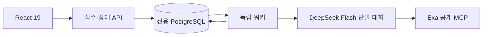

# 독립 포트폴리오 분석 워커

추적: [ALPHA-1266](https://alphaeveryday.atlassian.net/browse/ALPHA-1266)

## 목적과 경계

사용자의 보유 ETF·평가금액·투자 기간·질문에서 한국어 포트폴리오 보고서를 만든다.
React UI와 접수 API, 실행 워커, 전용 PostgreSQL은 별도 배포 단위다.
기존 analysis-engine-v2, ontology, etf-research-agent 모듈을 import하지 않는다.
AWS 전망은 목적을 명시한 ETF 단건 조회 도구로만 연결한다.

## 적용한 공식 사례와 선택 이유

- [Anthropic: Building effective agents](https://www.anthropic.com/engineering/building-effective-agents): 고정된 하위 작업은 prompt chaining과 단계별 코드 검증으로 처리한다. 네 역할은 독립 에이전트가 아니라 같은 대화의 순차 단계다. 서브에이전트·자유 라우팅·토론은 추가하지 않는다.
- [AWS: Asynchronous communication](https://docs.aws.amazon.com/prescriptive-guidance/latest/modernization-integrating-microservices/asynchronous.html): 접수 응답과 실제 실행을 분리하고 작업 ID로 상태를 조회한다. UI는 실패 시 조회 간격을 늘리고 새로고침 뒤 작업 ID를 복원한다.
- [PostgreSQL SELECT / SKIP LOCKED](https://www.postgresql.org/docs/current/sql-select.html): 큐의 원자적 claim을 위해 트랜잭션과 `FOR UPDATE SKIP LOCKED`를 사용한다. 기존 DB 의존 없이 전용 저장소 하나로 작업·결과를 관리한다. 초기 규모에 SQS와 별도 상태 저장소를 동시에 추가하지 않는다.
- [DeepSeek thinking mode](https://api-docs.deepseek.com/guides/thinking_mode/): `deepseek-flash`, thinking enabled, effort low. 도구 대화에 필요한 `reasoning_content`는 메모리에서 전달하되 보고서·UI·관측 파일에 저장하지 않는다.
- [Exa 공식 MCP](https://github.com/exa-labs/exa-mcp-server#authentication): endpoint `https://mcp.exa.ai/mcp`의 `web_search_exa`, `web_fetch_exa`만 사용한다. `EXA_API_KEY`를 해당 HTTPS 원본의 `x-api-key` 헤더로 전달한다. 운영 키는 Secrets Manager `edge/portfolio/runtime`에서 워커에만 주입하며 URL·모델 입력에 넣지 않는다. 인증 후에도 공급자 요금제의 호출 제한은 적용된다.

## 단일 에이전트의 실행 계약

| 역할 | 판단 | 본문 글자 수 |
|---|---|---|
| question | 사용자가 내릴 결정과 조건 해석 | 90~650 |
| portfolio | 구성·집중·중복·투자 기간 진단 | 90~650 |
| outlook | 공식 자료·반대 근거·조건부 전망 | 90~650 |
| opinion | 투자 의견·추천 구성·평가·자유 분석 최종 확정 | 각 Section 90~650 |

공백·문장부호를 포함한 paragraphs의 Unicode 코드포인트 합계로 계산한다.
각 칸은 기본 3개·최대 5개 불릿이며 한 불릿은 한 문장·최대 180자다. 근거와 한계는 본문 분량에 포함하지 않는다. 한계는 항목당 100자 이하, 최대 3개다.
최종 역할은 네 칸과 현재 평가·추천 구성·추천 평가·자유 분석 1~3개 구역을 반환한다. 뒤에서 확인한 사실을 앞 칸에 미확인으로 남기는 모순을 줄인다.
글자 제한과 스키마 위반은 한 차례 수정 기회를 주며 해결되지 않으면 실패 처리한다. 잘라서 게시하지 않는다.

자료를 검색한 뒤 본문을 읽어 출처 ID와 문장 ID를 등록한다. 모델은 ID를 선택하고 서버가 원문을 복사한다.
실제 연동 중 모델이 표의 구분자를 바꾸는 문제가 확인되어, 모델에 원문 복사를 맡기는 초기안을 폐기했다.
문장 ID 존재 검증은 의미의 정확성 보증이 아니다. 주장과 근거의 연결은 마지막 역할과 샘플 검수로 평가한다.

## 운영 한계와 실패 처리

- 리밸런싱은 `calculate_rebalance`와 최종 발행에서 같은 코드로 계산한다. 원문에서 단일하고 명확한 일시/월 납입금만 읽으며 복수·근삿값·기간이 섞이면 확인을 요청한다. 목표 총액은 기존 평가금액과 추가 납입금의 합이고 원 단위 배분 합계를 보존한다. 매도 금지는 실제 금액으로 검사해 납입에 따른 비중 희석을 허용한다. 0% 목표로 기존 종목을 없애는 것은 매도 없이 불가능하다.
- 실행 표는 종목·계좌별 현재/목표/매수/매도/현금 투입 금액과 계좌 입출금을 표시한다. 계좌 개설·납입 여력·인출 조건이 미확인이면 주문 가능한 표를 숨긴다. 알려진 납입 한도 초과는 실행 불가다. 월 납입 계산은 가격·환율·분배금 고정 조건이며 미래 시점의 한도는 확인이 필요하다. 수수료·세금·주 단위 주문 반올림은 포함하지 않는다.
- 후보 탐색은 고객 제약을 비중 벡터마다 검사한 후 조합별 최선을 고른다. 목적 우선순위는 사전식으로 적용하며 성장(기간 초과 수익), 안정(최대 낙폭), 소득(확인된 12개월 분배율), 유지(현재 구성 보존), 단순성(종목 수)을 사용한다. 목적이 없거나 동률이면 기존 40/40/20 점수를 쓴다. 미확인 분배율은 0으로 보지 않는다. 계좌 배치 전에는 계좌별 상세 실행을 보장하지 않으며 최종 발행에서 다시 검사한다.
- 서로 다른 조합으로 재탐색할 수 있으며 모든 누적 후보는 같은 공통 기간으로 재계산된다. 최신 revision과 정확히 일치하는 비중만 발행한다. 같은 정상 배치는 캐시하고 자료 실패 배치는 최대 1회 재시도한다. 메모리 보호를 위해 4개 배치·40개 ETF를 넘지 않으며 제한과 실제 검색 범위를 명시한다. 검색 결과 없음은 전체 해 공간의 불가능 증명이 아니다.
- 실행 성공과 고객 과제 완료는 다르다. `completion`은 질문별 답변·미확인 입력·추천 상품의 자료 항목과 기준일·실행표를 검사해 complete/partial/needs_input/no_match를 구분한다. 형식 수정과 별도로 최대 2회 질문 답변·자료 보완·대안 탐색으로 돌아가며 해당 실행의 시간 제한(최초 분석 600초·후속 질문 300초)과 24회 모델 호출 한도를 공유한다. 실패·제한 종료 시 부분 체크포인트는 유지한다. 과거 로그의 누락된 도구 원문까지 복원하는 기능은 아니다.
- 보완 실행 여부는 전체 입력 대기 상태가 아니라 조사 가능한 미완료 질문·근거·대안 탐색 사유로 판단한다. 고객 답변이 필요한 질문과 보유 비중 입력만 기다리는 비교는 재조사 과제에서 제외하고, 그 밖의 조사는 계속한다. 보완 메시지는 남은 조사 과제만 전달하며 기존에 확인한 답과 추천을 유지하도록 지시한다.
- 질문·목표 배당금·매도 허용 여부는 일반 점검의 필수 입력이 아니다. 질문이 없으면 현재 구성 점검을 수행하며 해석 단계의 `decision.missing_inputs`만으로 분석을 입력 대기 상태로 만들거나 자료 조사·인용을 생략하지 않는다. 고객 질문별 실제 필요 입력과 계산기가 확인한 보유 비중·원금·추가 자금·계좌 조건을 완료 결과에 남긴다. 현재 정보로 계산하거나 합리적으로 가정할 수 있는 범위에서 추천과 명료한 결론을 먼저 제시하며, 상세한 계좌·절세 조건별 차이는 해당 전략에서 설명한다. 개인 사실이나 고객 필수 제약의 충족을 추정으로 확정하지 않는다.
- 현재 자료 상태를 매 모델 호출 전에 갱신한다. 아직 조회하지 않음과 실제 조회 실패를 구분하고 과거 가격 가용성을 미래 전망 부재와 혼동하지 않는다. 자료가 없으면 한계를 명시한 부분 분석을 허용하되 출처 없는 추천 평가를 만들지 않는다.
- 자료 실패만으로 출처 없는 부분 분석을 허용하려면 서로 다른 URL 두 개 이상이 실패하고 발견된 미조회 URL도 없어야 한다. 같은 추천 구성을 보완하는 동안 생략된 질문 답변과 자료 항목은 이미 검증한 내용으로 유지하며 새로 명시한 내용은 다시 검증한다. 추천 구성이 바뀌면 이전 답을 자동으로 이월하지 않는다.
- 웹 본문의 메뉴/오류 응답은 근거로 등록하지 않는다. 기본 24,000자, 확장 48,000자를 수집하고 저장된 문단을 24개씩 안정된 ID로 페이지 조회한다. 로컬 페이지 조회·캐시 재사용은 Exa 호출을 추가로 쓰지 않는다. `published_at`은 공급자의 발행 메타데이터이고 `claim_as_of`는 인용 문장에 드러난 사실 기준일이며 수집일로 대체하지 않는다. 추천 ETF의 구조·보유내역·보수 및 소득 목적의 분배 자료를 항목별로 기록한다. 서비스 검토 기준은 보유내역 90일, 보수/구조 365일, 분배 450일이며 날짜 미확인은 완료가 아니다. 이는 사실의 의미적 정확성 검증을 대신하지 않는다.
- JSON 출력 모드와 서버 스키마 검증을 함께 사용한다. 잘린 응답은 도구 결과를 유지한 채 짧게 재작성하고 JSON 문법·스키마·업무 계약 오류를 구분한다. API 계약은 [DeepSeek JSON Output](https://api-docs.deepseek.com/guides/json_mode/)과 [Exa 본문 도구](https://github.com/exa-labs/exa-mcp-server/blob/main/src/tools/webFetch.ts)를 확인했다.
- 질문 단계에서도 로컬 `search_etfs`로 고객이 지정한 ETF의 등록 ID를 확인한다. 이 단계의 외부 자료 도구는 허용하지 않는다.
- 질문 해석 단계는 의사결정 종류, 고객 목적 우선순위, 필수 제약, 추가 자금 원문, 확인할 입력을 별도 `decision`으로 반환한다. 원본 `input`과 함께 결과에 보존한다. 제약은 입력 원문을 인용하고 등록 종목 ID를 사용해야 한다. 종목 비중·제외/필수 종목·종목 수·계좌·상장시장·매도 금지는 코드로 검사하며 ETF 내부 노출 등 검증하지 못한 조건은 `unknown`이다. 최종 추천은 모든 필수 제약이 `pass`일 때만 발행한다. 모델의 자연어 요구 추출 자체가 완전하다는 보장은 아니며 추출 내용과 판정 근거를 함께 남긴다.
- 보유 없는 신규 설계만 현금 기준으로 비교하며 차트에 “투자 전 현금”으로 표시한다. 비중을 모르는 기존 보유를 현금으로 대체하지 않는다. 추가 자금 인용만으로 매도 금지 검사를 완화하지 않으며 실제 실행 가능성 계산이 필요하다.
- 여러 종목의 최소·최대 비중은 `scope=each`(각 종목)와 `combined`(종목 묶음 합계)를 구분한다. 같은 종목의 여러 계좌 비중은 합산하며 다중 종목에서 scope가 누락되면 해석을 수정해야 한다. 종목이 지정된 매도 금지는 해당 종목에만 적용하고 중복 보유 금액을 먼저 합산해 검사한다.

- 예상 분석 시간은 약 5분이며 최대 실행 시간과 구분한다. 최초 분석 실행 전체 deadline 600초(10분), 모델 최대 24회, Exa 검색·본문 읽기 합계 최대 70회(원격 도구 호출 기준, 저장된 문단 페이지 조회는 제외하고 아래 HTTP 429 재시도는 별도), 최종 응답 수정 최대 2회·다른 역할 최대 1회.
- 검색 미리보기는 2,500자로 제한하되 발견 URL 목록은 원 응답에서 수집한다. 읽은 원문의 excerpt와 인용 문장을 모델에 중복 전달하지 않으며, 인용 문장·ID와 저장하는 원문은 보존한다.
- Exa MCP의 일시적인 429는 HTTP 전송 단계에서 최대 2회 재시도한다. Retry-After를 따르며 안내가 없으면 2초·4초 간격, 안내가 10초를 넘으면 조기 재시도하지 않는다. 도구 35초·분석 600초 제한은 유지한다. 제한이 계속되면 SEARCH_RATE_LIMIT으로 저장해 방문자 체험 횟수 제한과 구분한다.
- 현금만 보유한 현재 평가가 점수 보류인 경우 입력 사실만 설명하는 reason에는 외부 인용을 요구하지 않는다. ETF 평가·추천 별점·전망의 외부 근거 검증은 유지한다.
- 최종 출력 검증 실패 로그는 계약에 정의된 필드명과 검증 오류 종류만 최대 6개 기록한다. 입력값·모델 답변·등록되지 않은 필드명은 기록하지 않으며, JSON 파싱 실패와 필수 근거 누락도 별도 코드로 구분한다.
- 각 실행의 `diagnostics`에 단계·모델·도구 시작/종료, 허용된 토큰 사용량, 도구 상태, 실제 호출 횟수와 상한, 종료 사유를 저장한다. 모델·프롬프트 해시·실행 Python 소스 해시로 적용 버전을 구분한다. 일반 로그에는 작업 ID와 정제된 오류 코드만 남기고 도구 인자·모델 내부 추론·인증 키를 진단 이벤트에 넣지 않는다.
- 도구 응답과 단계 완료 시점의 정상 섹션·근거·계산·최적화 결과를 모아 백그라운드에서 부분 체크포인트로 저장한다. 저장 지연이 분석 이벤트 루프를 막지 않으며 실패·프로세스 중단 뒤에는 마지막으로 저장된 기록을 유지한다. 진행 중 기록은 완료 보고서가 아니다. 중첩 예외의 시간 초과와 Exa 429를 구분하고 잘못된 도구 JSON 인자는 도구 거부 응답으로 돌려 수정할 수 있게 한다. 체크포인트 저장 장애는 코드와 함께 기록하며 분석의 최종 결과 저장을 계속 시도한다.
- `diagnose-portfolio`의 선택 입력 `replay_job_id`로 실패한 분석 한 건을 서버 안에서 재현할 수 있다. 저장된 요청 상태나 체험 횟수를 바꾸지 않고 모델·조회 도구를 다시 실행하며, 성공 여부·소요 시간·후보 수 또는 정제된 오류 코드만 출력한다. 실제 모델 호출 비용이 발생하며 수동 재현 실행은 기존 300초 제한을 유지한다. 전체 진단 워크플로 제한은 10분이다.
- 로컬 ETF 목록 검색은 별도로 최대 20회·회당 8종목이며 offset으로 다음 결과를 읽는다. 등록 ID/티커 정확 일치를 우선하고 상품명 공백·하이픈 차이를 정규화한다. 목록 검색은 상품 투자 근거를 대신하지 않는다.
- 기다리게 하기 위한 인위적인 sleep은 없다. 큐 대기 시간은 실행 시간과 별개다.
- 워커가 중단되면 시작 후 최초 분석은 11분, 후속 질문은 기존 6분이 지난 조회 또는 다음 claim에서 실패 처리한다. 해당 작업의 늦은 결과는 게시할 수 없다. 자동 재실행으로 중복 모델 비용을 만들지 않는다.
- Idempotency-Key와 방문자 식별자로 중복 제출을 하나의 작업으로 만든다. 키 재사용 시 입력이 다르면 409다.
- 익명 브라우저 쿠키 기준 하루 요청 3개, 전역 하루 50개(환경 설정), 동시 대기·실행 20개. 방문자 제한은 로그인 사용자 단위의 강한 사용량 제한이 아니다. 공개 출시 시 인증 또는 별도 남용 방어가 필요하다.
- 추가 질문 1회와 분석별 누락·오류 보완 2회는 서버에서 별도로 원자적으로 예약한다. 실패한 답변은 해당 횟수를 차감하지 않는다. 보완 요청은 본인 소유의 성공/실패 분석에서 가능하며 기존 전역 동시 실행·대기열 정책은 유지한다. 보완 요청은 방문자의 일반 일일 3회 한도에서 분리하지만 전역 일일 한도는 유지한다.
- 후속 질문은 원본 입력·결정·필수 제약·이전 보고서와 출처를 공통 분석 엔진에 전달한다. 계산·자료 재조회·대체 후보 검토를 수행하고 기존 필수 제약을 코드로 합쳐 유지한다. 원본 보고서는 덮어쓰지 않으며 별도 작업 ID의 `revision`과 새 기준시각을 저장한다. 후속 질문은 기존 300초 제한을 유지하며 최초 분석과 같은 24회 모델·70회 Exa 상한, 검증 및 진단을 사용한다. 저장된 추천의 리밸런싱 조건도 재검사한다.
- 기간별 금액 질문은 확정된 원금·납입금과 명시적 수익률 가정으로 코드가 복리 계산한다. 원금 미입력을 0원으로 바꾸지 않는다. 월말 납입, 세금·수수료·물가 제외를 표시하며 미래 예측과 구분한다. 단순 시나리오 질문에는 새로운 ETF 최적화를 강제하지 않는다.
- 포트폴리오 변경과 계산을 함께 요청하면 주된 의사결정 종류와 별도로 `scenario_requested`를 추출한다. 이 값이 참이면 계산표가 없는 보고서는 완료가 아니며 계산·보완으로 돌아간다. 계산 요청의 자연어 해석은 질문 역할이 담당하고 산술 및 완료 판정은 코드가 수행한다.
- 계산 전용 질문은 외부 조회 없이 계산 도구만 사용하며, Exa 연결은 실제 외부 조회가 필요할 때 연다. 보완 질문의 단일하고 명확한 전체 원금 진술을 코드로 검증하고 원래 질문의 원금도 유지한다. 같은 요청에서 추가 비교 가정을 계산해도 앞선 계산 행을 버리지 않는다.
- 자유문장의 원금은 제한된 명시적 형식만 계산 입력으로 인정한다. 현재 질문과 부가 입력의 문장이 기간별 계산 질문·명확한 납입 약속·무납입·매도 금지로 해석되지 않으면 원금을 확정하지 않고 확인을 요청한다. 이 보수적 검증은 후속 메시지와 메모에 나눠 쓴 조건에도 적용한다. 금액 정정·취소·철회 뒤에는 이전 원금으로 되돌아가지 않는다. 계산한 시나리오는 부분 체크포인트에도 저장한다.
- 저장된 목표의 실행만 설명하는 경로는 원본 분석이 완료된 경우에만 새 최적화를 생략한다. 실패한 작업의 초안이나 부분 완료 추천은 다시 조사·검증해야 하며 바로 실행표로 게시하지 않는다. 기존 필수 제약과 새 제약을 합칠 때 추출 회당 20개 상한으로 기존 조건을 누락시키지 않는다.
- 이메일 신청은 별도 테이블에 저장한다. 사용자 지시에 따라 UI는 “1일 이내에 리포트를 보내드려요”라고 안내한다. 자동 발송·정기 마케팅·예약 작업은 구현하지 않는다. 접수 후 발송은 운영자가 처리해야 한다.
- API 키는 워커 환경에만 주입한다. API·React 번들에는 넣지 않는다. 로컬 Compose 포트는 loopback에만 공개한다.

## AWS 전망의 단건 조회 계약

`read_etf_outlook`은 `etf_code` 하나, 20~240자의 `purpose`, 15~240자의 `decision_question`을 필수로 받는다. 사용자 입력 또는 읽은 근거에 등장한 코드만 허용한다. 코드 배열·전체 목록·범위 검색·일괄 조회 기능은 없다.
한 분석에서 최대 3종목만 순서대로 조회하며 같은 코드를 다시 읽지 않는다. 각 조회의 목적·판단 질문·코드·성공 여부는 결과의 `aws_outlook.queries`에 남는다. 문자열 길이 검증만으로 목적의 타당성을 보증할 수는 없으므로 목적과 종목의 관련성은 에이전트 지시문 및 실행 기록 검수로 보완한다.
내부 전망 조회 서비스가 기존 결과 API의 읽기 전용 계정으로 `outlook_analyses`에서 지정한 ETF의 완료된 최신 1건만 읽는다. 분석 워커에는 전망 DB 비밀번호나 AWS 관리 키를 주지 않는다. 실행 기준시각 이후 발행본은 제외하고, 14일보다 오래된 자료는 본문 없이 stale로 반환한다. SQL 제한시간은 5초다.
반환한 전망은 원천 사실이 아닌 기존 분석자의 의견으로 구분하며 외부 공식 자료와 대조한다. 데이터가 없으면 missing, 연결 장애는 unavailable, 미설정 환경은 not_connected다. 기존 엔진 실행 및 온톨로지 접근은 제공하지 않는다.

## 현재 결과의 범위

평가금액·ETF별 비중·추천 금액·변경 비중·세 축의 평균은 코드로 계산한다. 과거 성과는 yfinance의 최대 가용 일별 수정 종가를 공통 기간으로 맞춰 계산하며, 예상 수익률·배당률은 아래 근거 계약을 따른다. v2 별점은 별도의 근거 기반 AI 정성 평가이며 검증된 성과 점수와 구분한다.
검색 자료를 해석하는 실제 보고서는 제공하지만, 이를 검증된 백테스트나 수익 예측 모델로 표시하지 않는다.
프롬프트 해시·모델·기준시각·호출별 사용량·출처를 결과에 함께 저장한다.

## 검증 기준

자동 검증: 글자 제한, 허위 문장 ID, 네 단계 및 문맥 유지, 수정 횟수, 중복 제출, 작업 중복 claim, 소유권, 중단된 작업, 채팅 한도, 이메일 소유권, React 빌드와 브라우저 흐름.
실제 호출 검증: 명시적으로 실행하는 smoke 명령으로 DeepSeek와 Exa를 사용한다. 테스트 더블과 실제 호출 결과를 구분한다.
샘플 검수: 질문 직접 답변, 근거 관련성, 날짜 일관성, 앞뒤 모순, 쉬운 한국어, 근거 없는 숫자 및 단정 여부.

### 검증 기록

- 전용 PostgreSQL을 연결한 Python 테스트 12개 통과, 건너뛴 테스트 없음. Starlette TestClient의 httpx 사용 중단 예정 경고 1건은 남아 있다.
- React TypeScript·Vite 프로덕션 빌드 성공. 모바일·데스크톱 브라우저 테스트 2개 통과.
- 실제 DeepSeek Flash와 Exa를 연결한 브라우저 검증 성공: 합성 VOO 70%·QQQM 30% 분석 78.08초, 결과 복원, 첫 추가 질문 응답, 두 번째 질문 차단, 이메일 접수. 브라우저 오류 없음.
- 이 기록은 최초 로컬 검증 시점의 결과다. 이후 배포 상태와 추가 검증은 아래 배포 문서를 따른다. 실제 호출 샘플 검증은 일반적인 분석 품질·수익 예측 정확도를 보증하지 않는다.

## 배포 및 원본 화면 복원

[배포 운영 기록](portfolio-deployment.md)을 참조한다. React는 원본 compose HTML의 CSS·460px 레이아웃·단계형 입력·카드 구조를 재사용한다. 임의 점수나 시안의 가상 수익률은 게시하지 않는다. 일반 계좌와 현금 100만 원으로 시작하며 금액·비율·종목명 입력을 지원한다. 종목 추천 버튼은 바로 다음 단계로 이동한다. 배당 질문 단계는 제거했고 계좌 세부 정보는 별도 팝업, 관심 키워드는 선택과 직접 입력을 지원한다.

대기 화면은 원본의 Three.js 구체와 분석 관점 카드 3개·매니저 카드 2개를 사용한다. 카드의 진행 상태는 서버의 네 역할에 대응하며, 별도 에이전트 5개가 실행되는 것은 아니다. 원본의 자동 완료 타이머와 예시 결론은 사용하지 않는다. 절세 전략 팝업의 필수 선택은 빈 상태에서 시작하고, 사용자가 직접 ‘확인 필요’를 선택할 수 있다. 팝업을 열었다면 필수 답변과 전략에 포함할 계좌를 적용해야 다음 단계로 이동한다. 개설일·납입 금액은 선택 입력이다. 목돈 투자는 추가 금액을 묻지 않으며, 금액 입력은 월 적립에만 사용한다.

## 최종 결과 v2

`result.schema_version=3`는 기존 JSONB 결과 열에 저장하므로 DDL 마이그레이션이 없다. 기존 `sections`, `metrics`, `current_evaluation`, `insights`를 유지하며 `recommendation`은 조건을 통과한 후보가 없으면 null이다. `optimization`에 후보 순위·계산값·선택 ID·비교 기간·자료 출처를 보관한다. 과거 v1/v2 결과도 계속 읽는다. 화면 순서는 현재 평가 → 추천 구성·추천 별점·개선사항·계좌별 최종 금액·과거 성과 → 최종 투자 의견과 실행할 행동 → 전망 → 자유 분석이다.

에이전트는 최적화 함수를 통과한 추천 후보와 계좌를 선택한다. 서버는 선택 후보와 ETF별 비중 일치, 추천 현금 0%, 카탈로그 존재, 사용자가 지정한 계좌, 미국 상장 ETF의 절세 계좌 직접 배치 금지, 비중 합계 100과 중복을 검증한다. 계좌별 ETF 가능 여부와 세금 규정의 전체 적합성을 기계적으로 보증하는 것은 아니며 공식 근거를 조사하도록 지시한다. 금액은 입력 총액에서 비중으로 계산하고 원 미만 잔여를 배분해 합계를 보존한다. 총액 미입력은 임의 금액으로 바꾸지 않는다. 계좌 간 자금 이동 가능성·납입 한도는 별도 확인 조건이다.

`planning=true`인 종목부터 추천받기는 최적화 입력과 최종 추천 모두 서로 다른 ETF 최소 2종목을 요구한다. 대표 ETF와 검토한 대안 ETF를 함께 조사하며 운용 규모·유동성·보수·상장 이력을 확인하도록 지시한다. 같은 지수의 운용사만 다른 상품이나 환헤지·보수 차이만 있는 상품을 보완재로 묶지 않도록 지시한다. 대표/대안 구분은 에이전트의 근거 있는 판단이며 별도의 자동 인기도 지표가 아니다.

추천안은 시장 주도성(상위 기업·산업 비중), 수익성(장기 수익률·레버리지·보수), 안정성(나라·통화·자산 종류·하락 폭)을 0.5점 단위로 평가하며 세 항목을 반드시 반환한다. 종합 점수는 코드가 평균으로 계산하고 평균 4점 이상만 추천한다. 현재 평가에는 하한이 없고 현금만 있는 경우 보류할 수 있다. 점수를 하한으로 보정하지 않으며, 백테스트 통과 후보도 평가 근거가 부족하거나 모두 4점 미만이면 추천을 보류한다. 이때 후보 목록은 보존하고 `optimization.reason=RATING_BELOW_MINIMUM`, 추천·선택 ID·예상 수익률은 null로 반환한다. UI 판단 기준은 원본 HTML의 세 축과 등급 구간을 사용한다.

### 열 조합 병렬 최적화

- 에이전트가 등록 ETF로 서로 다른 조합 열 개를 한 번에 제출한다. 조합당 1~5종, 배치당 후보 ETF 최대 20종이다. 함수는 가격을 공유하며 누적 조합을 병렬 계산한다. 각 조합의 모든 ETF에 최소 10%를 배정하고 합계 100%인 10% 격자를 전수 탐색한다. 현금은 비교 대상에만 허용한다.
- 동일한 최대 가용 공통 기간의 원화 총수익률 구간에서 기존 구성과 비교한다. 가장 늦은 유효 시작일과 가장 이른 종료일로 맞춘다. 첫 기준일을 제외한 거래일 중 누적 수익률 우세 비율이 50% 이상이고 최근 10거래일 전부 엄격히 우세해야 발행한다. 따라서 최적화에는 기준일 포함 최소 11개 거래일 관측이 필요하다. 동률은 우세가 아니다. FX만 거래된 날은 집계에서 뺀다.
- 점수는 `0.4 × 우세 거래일 비율(%) + 0.4 × (초과 수익률 / 전체 통과 격자의 최대 초과 수익률 × 100) + 0.2 × 구성 보존율(%)`이다. 구성 보존율은 `100 − 0.5 × 종목별 비중 차이 절댓값의 합`이며 기존 현금도 포함한다. 고객 제약을 통과한 벡터 중 목적 우선순위로 조합별 한 건을 반환하고 이 점수는 보조 기준으로 사용한다. 동점이면 초과 수익률·구성 보존율·비중 배열 순으로 결정한다.
- 함수는 탈락 구성·비중을 반환하지 않는다. 에이전트는 통과 후보의 순위와 전망을 종합해 하나를 선택하고 이유를 쓴다. 1위 이외를 고르면 전망 근거로 차이를 설명한다. 선택 후보의 ETF·비중 수정은 서버가 거부한다. 전부 탈락하면 추천을 발행하지 않으며, 자료 부족과 실제 기준 미달을 구분한다. 기존 비중 미입력 시에도 임의 비교 대상을 만들지 않는다.
- 후보 준비·최적화는 포트폴리오 역할 완료 전에 강제한다. 마지막 투자 의견 역할의 최대 응답 토큰은 16,000이며 다른 역할은 6,000이다. 모든 역할의 추론을 유지하고 전체 분석은 600초·모델 호출 24회·실제 UTF-8 컨텍스트 350KB로 제한한다. 최종 응답의 형식 수정은 최대 두 번, 다른 역할은 한 번이다. 호출 횟수와 컨텍스트 초과를 서로 다른 오류 코드로 기록하며 결과 검증 실패도 원문 입력 없이 정해진 사유 코드로 구분한다.

별점 세 축은 근거에 대한 AI 정성 평가이며 종합 점수는 서버가 평균을 계산한다. 현재와 추천에 같은 기준을 적용하며 비교 근거가 부족하면 점수를 비운다. 예상 수익률은 과거 성과와 시장 근거를 고려한 AI 추정이며 검증된 예측 모형이 아니다. 양수나 7%로 보정하지 않는다.

도넛은 최초 등장 시, 성과 차트는 화면 진입 시 한 번만 그려진다. `prefers-reduced-motion`에서는 애니메이션을 생략한다. 자유 분석은 사용자의 실제 결정과 고민을 다루는 제목·불릿으로 구성하며 동의나 낙관을 유도하지 않는다. 후속 질문에도 추천 구성과 자유 분석을 전달한다.

월 적립금 입력은 '매달 꾸준히' 선택지 바로 아래에 열리고 화면 안으로 이동한다. 자동 초점으로 모바일 키보드를 열지는 않는다.

### 일별 성과·수익 추정·웹 배당 자료

- `read_portfolio_history`는 등록 ETF/현금과 비중을 받아 최대 가용 공통 기간의 일별 성과를 계산한다. 한 분석에 최대 3개 구성, 종목 데이터는 해당 분석 안에서 재사용한다. Yahoo 조회는 취소 시 종료하는 별도 프로세스로 시도당 25초, 동시에 최대 2개, 한 구성의 조회 제한은 65초다. 복구 라이브러리가 추가로 사용하는 메모리를 고려해 병렬 조회 수를 제한한다. 전체 분석 제한 600초는 유지한다.
- 국내 ETF는 `.KS`, 미국 ETF는 등록 티커를 사용한다. 가격 통화를 확인하며 미국 ETF의 수정 종가에는 `KRW=X` 환율을 반영한다. 당일 미완료 가격은 제외하고 두 구성의 공통 종료일까지 비교한다. 시작 100만 원, 시작 비중 매수 후 유지, 분배금 재투자, 세금·거래비용 제외 기준이다. 현금 수익률은 0이다.
- 신규 상장 ETF도 유효한 공통 관측이 2개 이상이면 실제 시작·종료일을 표시해 비교한다. ETF·환율 중 가장 짧은 가용 이력에 맞추며 1년으로 제한하지 않는다. 공통 기간 내부의 실제 거래일 결측과 7일 이상 오래된 시세는 임의 보간하지 않는다. 주말·휴장일에는 직전 관측값만 유지하고 미래 가격으로 역방향 보간하지 않는다. `return_period_pct`는 표시 기간 수익률이고 `return_1y_pct`는 최근 1년 자료가 있을 때만 별도로 계산한다. 짧은 기간을 연율화하지 않으며 12개월 배당 계산 조건은 유지한다. 모델이 좌표를 만들지 않는다.
- 최근 2년 이내 거래일의 누락·무효 가격은 yfinance의 시간별 자료 복구를 한 번 시도한다. 통화와 이미 관측한 정상 종가·수정주가 기준이 일치할 때만 빠진 값을 채우며 기존 분배금 이벤트는 유지한다. 복구 날짜·방법·실패 사유를 ETF와 환율 가격 출처에 남긴다. 복구 전 원본을 임시 체크포인트로 보존해 선택적 복구의 시간 초과·프로세스 장애에도 이미 받은 자료를 사용한다. 전체 분석 취소는 그대로 전파한다. 복구 실패 시 원본에 공통 기간 검증을 적용한다. 휴장일의 가격 없는 분배금 이벤트는 가격 결측과 구분하되 이벤트 자체를 삭제하지 않는다.
- 가격 공급자의 일시적 통신·응답 오류는 종목 조회당 최대 한 번 재시도하며 전체 가격 수집 제한 안에서 실행한다. 시세가 오래됐거나 가격 검증에 실패한 오류는 맹목적으로 재시도하지 않는다. 실패한 성과 조회를 완료 캐시에 저장하지 않으며 도구 응답에 종목별 실패 코드와 제외한 조합의 사유를 남긴다. 공급자의 원문 예외 메시지·비밀값은 결과에 포함하지 않는다.
- `return_forecast`는 최종 추천 비중의 과거 성과를 실제 조회한 뒤 시장 근거와 함께 내는 AI 추정이다. 최적화 캐시 존재와 에이전트의 명시적 성과 조회 기록을 구분하며, 캐시만으로 추정 발행을 허용하지 않는다. `percent`, `reason`, 등록 근거를 저장한다. `target_return_1y=7`은 별도 목표이며 예상 수익률의 하한이 아니다. 손실 추정도 그대로 표시한다.
- `dividend_observations`는 Yahoo Finance의 종목별 최근 12개월 실제 분배금 합계 / 최근 종가로 계산한다. 분배락일·금액 내역, 시세 기준일, 통화, 원문 URL을 보관한다. 에이전트는 웹 검색으로 배당 정책와 기준일을 대조하지만 검색에서 추출한 비율을 숫자의 정본으로 쓰지 않는다. 현금을 제외한 추천 ETF의 자료가 모두 확인됐을 때만 비중 가중 평균을 표시한다. 누락을 0%로 바꾸지 않는다.
- 새 필드는 기존 결과 JSONB 안에 저장하며 DDL 변경은 없다. 기존 v1/v2 결과의 누락 필드는 계속 처리한다.
- UI 스타일 기준은 `portfolio-ui/tests/reference/report.html`과 함께 보관한 승인 CSS다. 모바일/데스크톱에서 주요 카드·별점·도넛·금액 표의 계산된 스타일과 너비를 원본과 비교한다. 실데이터 차트는 일별 직선 연결, 실제 날짜 간격, 원화 금액 축과 날짜 선택으로 확인한다.

외부 동작 근거: [yfinance download](https://ranaroussi.github.io/yfinance/reference/api/yfinance.download.html)와 [프로젝트 안내](https://github.com/ranaroussi/yfinance). Yahoo 데이터 이용 조건과 라이브러리 라이선스는 별개이며, 운영 데이터 사용 권한을 라이브러리 설치만으로 취득하는 것은 아니다.

새 평가는 `rubric_version=1`을 포함한다. 이 표시가 없는 저장된 결과는 이전 기준으로 안내하며 기존 점수를 새 기준으로 다시 계산했다고 표시하지 않는다.
