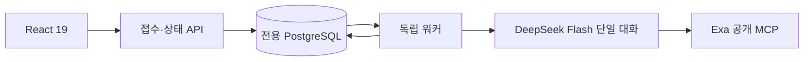

# 독립 포트폴리오 분석 워커

추적: [ALPHA-1266](https://alphaeveryday.atlassian.net/browse/ALPHA-1266)

## 목적과 경계

사용자의 보유 ETF·평가금액·투자 기간·질문에서 한국어 포트폴리오 보고서를 만든다.
React UI와 접수 API, 실행 워커, 전용 PostgreSQL은 별도 배포 단위다.
기존 analysis-engine-v2, ontology, etf-research-agent 모듈을 import하지 않는다.
현재 AWS 전망은 연결하지 않으며 아래 읽기 계약만 남긴다.

## 적용한 공식 사례와 선택 이유

- [Anthropic: Building effective agents](https://www.anthropic.com/engineering/building-effective-agents): 고정된 하위 작업은 prompt chaining과 단계별 코드 검증으로 처리한다. 네 역할은 독립 에이전트가 아니라 같은 대화의 순차 단계다. 서브에이전트·자유 라우팅·토론은 추가하지 않는다.
- [AWS: Asynchronous communication](https://docs.aws.amazon.com/prescriptive-guidance/latest/modernization-integrating-microservices/asynchronous.html): 접수 응답과 실제 실행을 분리하고 작업 ID로 상태를 조회한다. UI는 실패 시 조회 간격을 늘리고 새로고침 뒤 작업 ID를 복원한다.
- [PostgreSQL SELECT / SKIP LOCKED](https://www.postgresql.org/docs/current/sql-select.html): 큐의 원자적 claim을 위해 트랜잭션과 `FOR UPDATE SKIP LOCKED`를 사용한다. 기존 DB 의존 없이 전용 저장소 하나로 작업·결과를 관리한다. 초기 규모에 SQS와 별도 상태 저장소를 동시에 추가하지 않는다.
- [DeepSeek thinking mode](https://api-docs.deepseek.com/guides/thinking_mode/): `deepseek-flash`, thinking enabled, effort low. 도구 대화에 필요한 `reasoning_content`는 메모리에서 전달하되 보고서·UI·관측 파일에 저장하지 않는다.
- [Exa 공식 MCP](https://exa.ai/mcp): 공개 endpoint `https://mcp.exa.ai/mcp`의 `web_search_exa`, `web_fetch_exa`만 사용한다. 별도 Exa 비밀키 없이 연결하며 서비스 가용성·호출 제한에 대한 보장은 하지 않는다.

## 단일 에이전트의 실행 계약

| 역할 | 판단 | 본문 글자 수 |
|---|---|---|
| question | 사용자가 내릴 결정과 조건 해석 | 300~500 |
| portfolio | 구성·집중·중복·투자 기간 진단 | 500~800 |
| outlook | 공식 자료·반대 근거·조건부 전망 | 500~800 |
| opinion | 투자 의견 및 앞선 세 칸 최종 수정 | 400~700 |

공백·문장부호를 포함한 paragraphs의 Unicode 코드포인트 합계로 계산한다.
각 칸은 2~5문단이며 근거와 한계는 본문 분량에 포함하지 않는다. 한계는 항목당 100자 이하, 최대 3개다.
최종 역할은 네 칸 전체를 다시 반환한다. 뒤에서 확인한 사실을 앞 칸에 미확인으로 남기는 모순을 줄인다.
글자 제한과 스키마 위반은 한 차례 수정 기회를 주며 해결되지 않으면 실패 처리한다. 잘라서 게시하지 않는다.

자료를 검색한 뒤 본문을 읽어 출처 ID와 문장 ID를 등록한다. 모델은 ID를 선택하고 서버가 원문을 복사한다.
실제 연동 중 모델이 표의 구분자를 바꾸는 문제가 확인되어, 모델에 원문 복사를 맡기는 초기안을 폐기했다.
문장 ID 존재 검증은 의미의 정확성 보증이 아니다. 주장과 근거의 연결은 마지막 역할과 샘플 검수로 평가한다.

## 운영 한계와 실패 처리

- 예상 분석 시간 5분. 실행 전체 deadline 300초, 모델 최대 18회, Exa 최대 12회, 역할별 수정 최대 1회.
- 기다리게 하기 위한 인위적인 sleep은 없다. 큐 대기 시간은 실행 시간과 별개다.
- 워커가 중단되면 6분 뒤 조회 또는 다음 claim에서 실패 처리한다. 해당 작업의 늦은 결과는 게시할 수 없다. 자동 재실행으로 중복 모델 비용을 만들지 않는다.
- Idempotency-Key와 방문자 식별자로 중복 제출을 하나의 작업으로 만든다. 키 재사용 시 입력이 다르면 409다.
- 익명 브라우저 쿠키 기준 하루 요청 3개, 전역 하루 50개(환경 설정), 동시 대기·실행 20개. 방문자 제한은 로그인 사용자 단위의 강한 사용량 제한이 아니다. 공개 출시 시 인증 또는 별도 남용 방어가 필요하다.
- 일회 채팅은 서버에서 원자적으로 예약한다. 실패한 답변은 사용 횟수를 차감하지 않는다. 기존 보고서와 근거로 답하며 새 자료를 조회했다고 주장하지 않는다.
- 이메일 신청은 별도 테이블에 저장한다. 자동 발송·정기 마케팅은 구현하지 않는다. UI도 발송 일정 미정임을 표시한다.
- API 키는 워커 환경에만 주입한다. API·React 번들에는 넣지 않는다. 로컬 Compose 포트는 loopback에만 공개한다.

## AWS 전망의 후속 연결 계약

현재 결과에 `aws_outlook.status = not_connected`를 명시한다. 사용자 본문에는 구현 용어를 노출하지 않는다.
후속 어댑터는 서버가 확정한 ETF 코드로 기존 게시된 전망만 조회한다. 입력은 `etf_code`, `as_of`.
반환은 `analysis_id`, `published_at`, `as_of`, `body`, `sources`, `status`이며 `as_of`보다 미래인 자료는 제외한다.
해당 ETF에 없거나 오래된 전망은 각각 missing/stale로 표현한다. 기존 전망은 원시 사실이 아닌 선행 의견으로 전달하고 새 근거와 대조한다.
이 작업에는 AWS 데이터 접근 권한·온톨로지·기존 분석 엔진의 실행 호출을 추가하지 않는다.

## 현재 결과의 범위

평가금액과 ETF별 비중만 코드로 계산한다. 검증된 가격·배당 시계열 및 전망 모형이 연결되기 전에는 점수·과거 성과·예상 1년 수익률·배당률을 null로 반환한다.
검색 자료를 해석하는 실제 보고서는 제공하지만, 이를 검증된 백테스트나 수익 예측 모델로 표시하지 않는다.
프롬프트 해시·모델·기준시각·호출별 사용량·출처를 결과에 함께 저장한다.

## 검증 기준

자동 검증: 글자 제한, 허위 문장 ID, 네 단계 및 문맥 유지, 수정 횟수, 중복 제출, 작업 중복 claim, 소유권, 중단된 작업, 채팅 한도, 이메일 소유권, React 빌드와 브라우저 흐름.
실제 호출 검증: 명시적으로 실행하는 smoke 명령으로 DeepSeek와 Exa를 사용한다. 테스트 더블과 실제 호출 결과를 구분한다.
샘플 검수: 질문 직접 답변, 근거 관련성, 날짜 일관성, 앞뒤 모순, 쉬운 한국어, 근거 없는 숫자 및 단정 여부.

### 2026-10-12 로컬 검증 결과

- 전용 PostgreSQL을 연결한 Python 테스트 12개 통과, 건너뛴 테스트 없음. Starlette TestClient의 httpx 사용 중단 예정 경고 1건은 남아 있다.
- React TypeScript·Vite 프로덕션 빌드 성공. 모바일·데스크톱 브라우저 테스트 2개 통과.
- 실제 DeepSeek Flash와 Exa를 연결한 브라우저 검증 성공: 합성 VOO 70%·QQQM 30% 분석 78.08초, 결과 복원, 첫 추가 질문 응답, 두 번째 질문 차단, 이메일 접수. 브라우저 오류 없음.
- 실제 호출 샘플 검증이며 일반적인 분석 품질·수익 예측 정확도를 보증하는 평가가 아니다. AWS 배포·전망 조회·메일 발송은 미수행 상태다.
