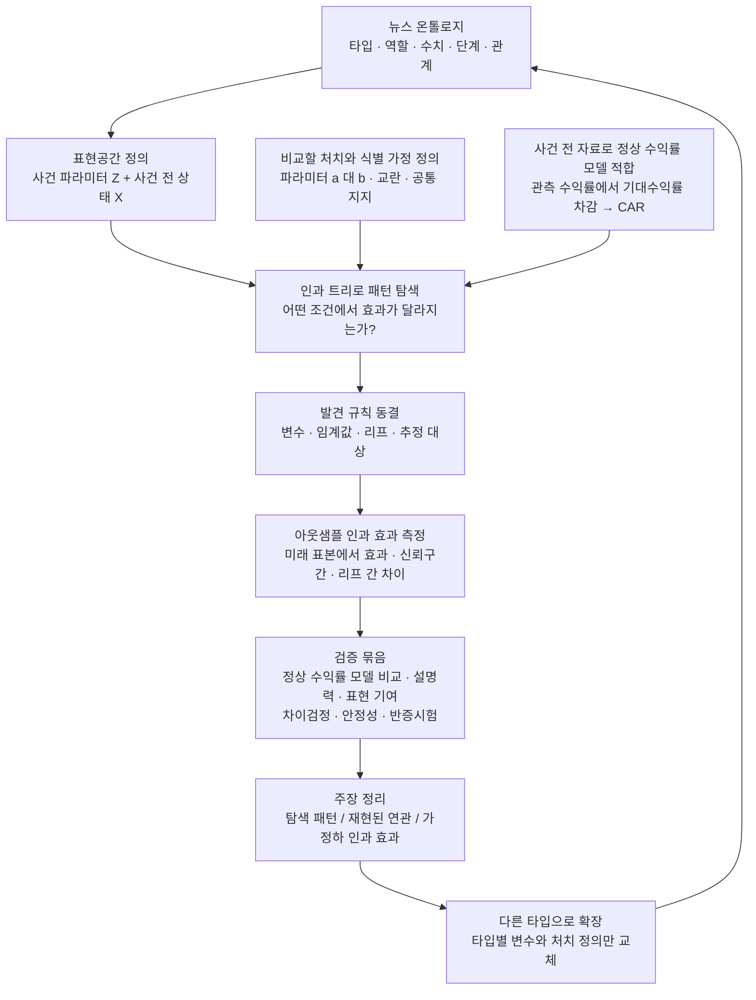

# 뉴스 온톨로지와 사건 효과 연구

**연구 질문: 같은 뉴스 타입 안에서도 어떤 내부 파라미터 조합이 서로 다른 시장 효과를 만드는가?**

온톨로지로 설명 가능한 표현공간을 정의하고, 트리로 발견한 조건부 효과가 미래 표본에서도 재현되는지 검증한다. 계약에서 시작해 다른 사건 타입으로 같은 실험을 반복한다. 현재는 실험 설계 단계이며, 추정 결과나 인과관계가 입증된 상태는 아니다. 데이터 품질 개선과 실행 코드는 후속 작업이다.

## 빅픽처

핵심 산출물은 트리 그림 하나가 아니라 **해석 가능한 분기 규칙 + 동결된 규칙의 미래 효과 + 그 주장을 깨려는 검증 결과**다. 정상 수익률을 제거한 CAR만으로 인과성이 성립하지는 않는다. 식별 가능한 비교가 없으면 같은 흐름에서 반응 트리를 사용하고, 결과를 조건부 연관으로 기록한다.

## 연구 공간

| 문서 | 역할 |
|---|---|
| [공통 프로토콜](protocol.md) | 모든 타입에 적용할 표본·탐색·추정·검정 규약 |
| [계약 연구](studies/contract-signing.md) | 첫 연구 질문과 온톨로지 변수 매핑 |
| [연구 등록 템플릿](study-template.md) | 다음 타입 또는 새 확인 실험을 시작할 때 복제 |

타입 확장은 계약 → 지분 취득 → 제휴 순서를 후보로 둔다. 우선순위는 독립 사건 수와 비교 가능한 파라미터 분포를 확인한 뒤 결정한다. 각 타입의 금액을 공통으로 규모화할 수 있어도, 역할과 경제적 의미가 다른 효과를 바로 합치지는 않는다.
